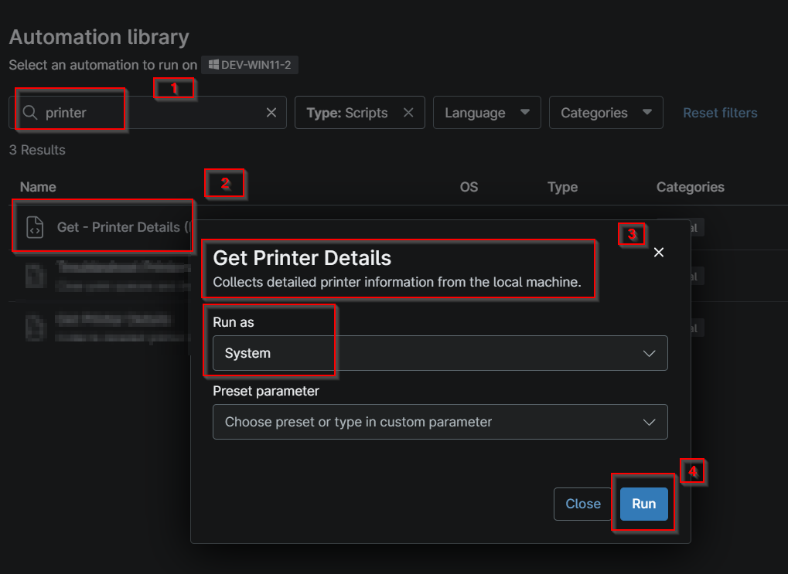
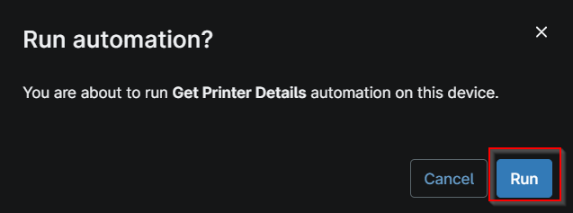

## Overview

Collects detailed printer information from the local machine.

## Sample Run

- Navigate to Automation > Script
- Search for `Get Printer Details`
- Click on the script `Get Printer Details`
- Click on Run

- Click Run again

## Dependencies

- [Solution - Get Printer Details](/docs/b5c871cf-f8fc-4fde-b20c-5aabd7341ade)

## Custom Fields

| Field Name | Type | Mandatory | Scope | Description |
| ---------- | ---- | --------- | ----- | ----------- |
| cpvalPrinterDetails | WYSIWYG | true | `Device` | This custom field stores the information of the printers fetched using the script "Get Printer Details". |
| cpvalGetPrinterDetails | Drop-down | false | `Organization`, `Location`, `Device` | Select the options to enable or disable auditing of printer details on endpoints. |

## Automation Setup/Import

[Automation Configuration](https://github.com/ProVal-Tech/ninjarmm/blob/main/scripts/get-printer-details.ps1)

## Output

- Activity Details  
- Custom Field

## Changelog

### 2026-10-13

- Initial version of the document