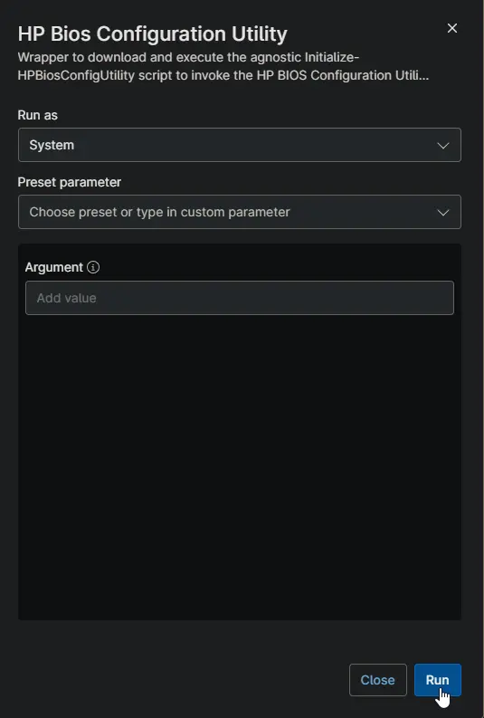
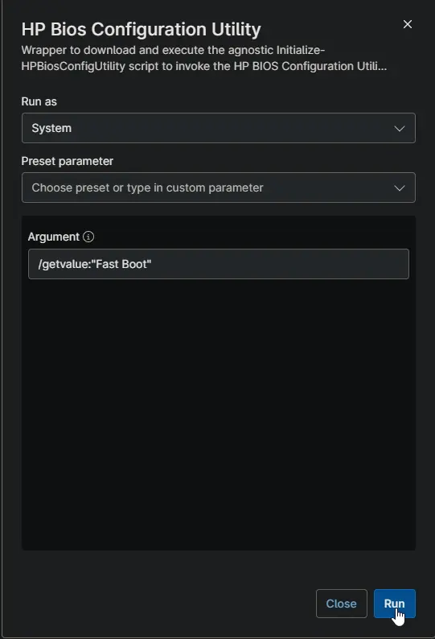
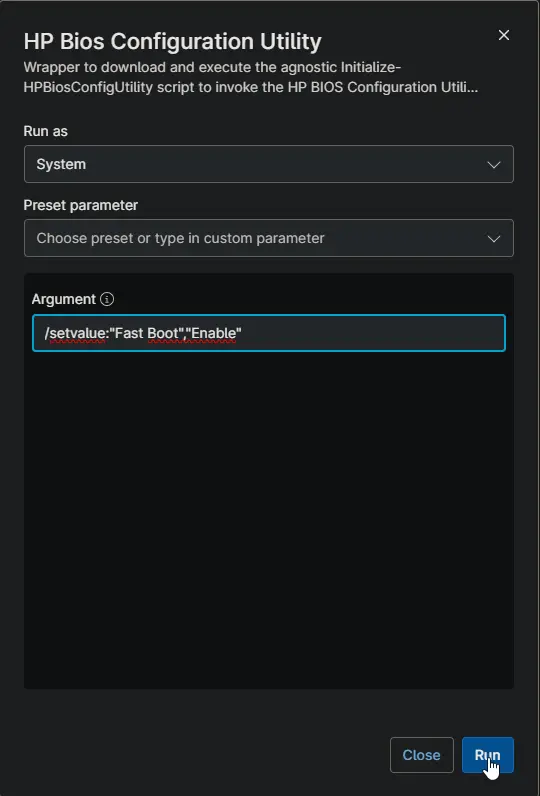
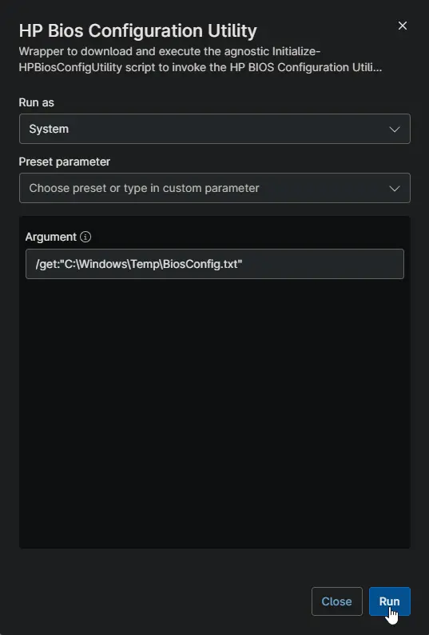
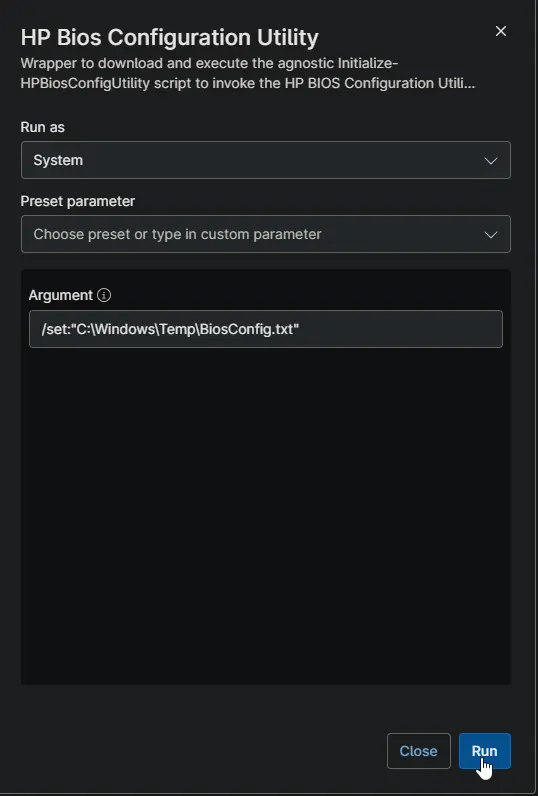

## Overview

This script reads and changes BIOS settings on HP workstations using the HP BIOS Configuration Utility (BCU), without visiting the device.

**When to use:**

- Review the full BIOS configuration of a device.
- Check or change a single BIOS setting, such as Fast Boot.
- Export a BIOS configuration and apply it to other devices of the same model.

**How it works:**

- BCU is downloaded from HP the first time the script runs on a device.
- The value of Argument is passed to BCU. With no value, BCU returns the full BIOS configuration.
- The result code is translated into a plain-language message in the activity output.
- BIOS changes take effect at the next restart. The script does not restart the device.

**Requirements:**

- HP workstation running Windows 10 or Windows 11.
- Runs elevated (System context).
- Internet access to download BCU.
- No BIOS setup password on the device when changing settings. With a password set, changes fail with a password error.

:::note  
Incorrect BIOS settings can stop a device from starting. Test a change on one device before running it on many.  
:::

## Sample Run

### Example 1: Running the script to read the full BIOS configuration

Leave **Argument** blank. BCU returns every BIOS setting with its available values; the current value is marked with *. Nothing is changed.

### Example 2: Running the script to check the current value of a setting

Set **Argument** to `/getvalue:"Fast Boot"`. The current Fast Boot value is shown in the activity output. Setting names must match the names returned in Example 1.

### Example 3: Running the script to change a BIOS setting

Set **Argument** to `/setvalue:"Fast Boot","Enable"`. Fast Boot is enabled and takes effect at the next restart.

### Example 4: Running the script to export the BIOS configuration to a file

Set **Argument** to `/get:"C:\Windows\Temp\BiosConfig.txt"`. The full BIOS configuration is saved to this file on the device. Use it to review settings, or to apply them to other devices (Example 5).

### Example 5: Running the script to apply a saved BIOS configuration

Set **Argument** to `/set:"C:\Windows\Temp\BiosConfig.txt"`. Every setting in the file is applied to the device. The file must already be on the device. Export it from a device of the same model (Example 4), and remove any settings you do not want to change.

## Dependencies

- [Script: Initialize-HPBiosConfigUtility](/docs/b5d53223-2755-48da-b4f5-a1cd5fa9f58f) (the underlying agnostic script)

## Parameters

| Name | Example | Accepted Values | Required | Default | Type | Description |
| ---- | ------- | --------------- | -------- | ------- | ---- | ----------- |
| Argument | `/getvalue:"Fast Boot"` | Any command from the [HP BCU user guide](https://ftp.hp.com/pub/caps-softpaq/cmit/whitepapers/BIOS_Configuration_Utility_User_Guide.pdf). Run `/help` to list them. | False | Empty (runs `/get`) | String/Text | The BCU command to run. Leave blank to read the full BIOS configuration. |

## Automation Setup/Import

[Automation Configuration](https://github.com/ProVal-Tech/ninjarmm/blob/main/scripts/hp-bios-configuration-utility.ps1)

## Output

- **Activity Details:** The run log, including the command that ran, the BCU output, and a plain-language result. Errors are reported in the activity output.
- **Exported File:** When /get is given a file path, the BIOS configuration is saved to that path.
- **Log Files:** A copy of the run log is kept on the device in C:\ProgramData\_Automation\Script\Initialize-HPBiosConfigUtility.

## Changelog

### 2026-10-16

- Updated the document to the current template.
- Replaced the Sample Run section with usage scenarios, including exporting and applying a BIOS configuration file.
- Fixed the link to the Initialize-HPBiosConfigUtility script.

### 2025-10-14

- Initial version of the document
