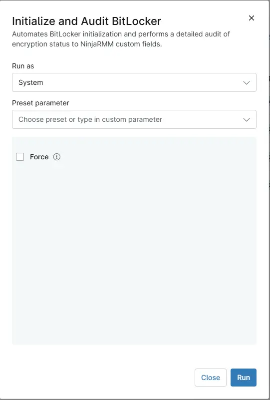

## Description

Applies the BitLocker configuration set in the cPVAL custom fields to the drive in [cPVAL MountPoint](/docs/4f9532e4-3d96-4e95-a6f5-b9a77d45c926), then records the BitLocker, Secure Boot and TPM status of the device in NinjaOne custom fields. It runs as the automation of the [Enable BitLocker - Laptop](/docs/32f08cdb-3ce6-4628-989b-704cd2e6394e), [Enable BitLocker - Desktop](/docs/47f52182-7c4c-4b4d-a0d7-7cb25c5256fa) and [Enable BitLocker - Server](/docs/a4d9dc9c-3e10-4cf4-a296-709ad9f507dd) compound conditions when [BitLocker Initialization - Detection](/docs/87d7a413-4bd4-4629-9475-35db91cb1320) reports a needed fix, and can also be run on demand.

The automation checks the drive in the same order as the detection script and takes the first action that applies:

| Drive state | Action |
| ----------- | ------ |
| Decrypting, or waiting for the BitLocker hardware test at the next restart | None |
| Not encrypted | Encrypts the drive with the configured settings |
| Force is checked and the drive is not encrypting | Turns BitLocker off and encrypts the drive again |
| System drive protected only by a recovery password, recovery key or Active Directory account | Adds a TPM protector without decrypting, then turns protection on |
| A different TPM based protector or encryption method than configured | Turns BitLocker off and encrypts the drive again |
| Encrypted without key protectors (Windows device encryption waiting for activation) | Adds the key protectors and turns protection on |
| Configured protector missing, encryption paused, or protection suspended until resumed manually | Fixes it without decrypting |
| Matches the configuration, or protection suspended for a set number of restarts | None |

After turning BitLocker off, the automation waits up to 15 minutes for decryption. When decryption finishes in time, the drive is encrypted again in the same run. Otherwise, the next detection run encrypts it once decryption completes. The drive is unprotected until then, and BitLocker is only turned off when the TPM needed to encrypt again is present and ready.

The encryption itself is done by the [Initialize-BitLockerVolume](/docs/2ce835a2-3ac1-4291-baaf-8d3cac76869f) script, which the automation downloads from the ProVal content repository and runs only when it carries a valid ProVal signature. The automation verifies its own signature first. When either check fails, it stops before changing the drive or the custom fields.

At the end of every run, successful or not, apart from one stopped by a failed signature check, the automation writes the same custom fields as [BitLocker and TPM Audit](/docs/2d104874-ec69-4d95-b912-7fcd240bf592). The drive's recovery passwords are therefore in [cPVAL BitLocker Info](/docs/fd545101-1cd5-4d9f-8df7-57c4df1616b9) even when the device restarts before they reach Active Directory or Microsoft Entra ID.

:::note

- `RecoveryPassword`, `RecoveryKey` and `AdAccount` cannot unlock the system drive at startup by themselves, so the automation always adds a TPM protector alongside them on that drive. When the TPM is missing, or not ready and [cPVAL Allow TPM Or Reboot](/docs/418f1b8b-14f8-492d-80fc-ea038cff6057) does not allow initializing it, the drive is left unchanged.
- Windows Home editions are not supported. Servers need the BitLocker Drive Encryption feature.
- When [cPVAL MountPoint](/docs/4f9532e4-3d96-4e95-a6f5-b9a77d45c926) is blank, the system drive is used.

:::

## Requirements

- Windows PowerShell 5.1, run as System.
- Access to `contentrepo.net`.
- The custom fields listed below, including [cPVAL TPM Info](/docs/68c098e2-54f1-40f8-9574-f70f1948e4ba).

## Sample Run

## Dependencies

- [Custom Field - cPVAL MountPoint](/docs/4f9532e4-3d96-4e95-a6f5-b9a77d45c926)
- [Custom Field - cPVAL EncryptionMethod](/docs/56fde7c8-f054-4b53-a3a9-d24134fb9cc0)
- [Custom Field - cPVAL KeyProtectorType](/docs/3378eace-ffba-4f7d-8e93-3cc37510a4ea)
- [Custom Field - cPVAL PIN Or Password](/docs/897971d9-4b4a-4554-8dd4-fc0bb324ed9b)
- [Custom Field - cPVAL Path Or ADAccount](/docs/fb290c5b-cf73-4b7e-be34-ada7d3391e47)
- [Custom Field - cPVAL Allow TPM Or Reboot](/docs/418f1b8b-14f8-492d-80fc-ea038cff6057)
- [Custom Field - cPVAL SkipHardwareTest](/docs/e22d7853-1e3c-403c-8ba9-b9b99ba31bac)
- [Custom Field - cPVAL BitLocker Info](/docs/fd545101-1cd5-4d9f-8df7-57c4df1616b9)
- [Custom Field - cPVAL BitLocker Enabled for System Drive](/docs/5f6128a5-4fc8-44b2-adb2-40c2ac92edc5)
- [Custom Field - cPVAL TPM Info](/docs/68c098e2-54f1-40f8-9574-f70f1948e4ba)
- [Automation - BitLocker Initialization - Detection](/docs/87d7a413-4bd4-4629-9475-35db91cb1320)
- [Agnostic - Initialize-BitLockerVolume](/docs/2ce835a2-3ac1-4291-baaf-8d3cac76869f)
- [Solution - BitLocker Initialize - NinjaOne](/docs/2ebfabd5-05cf-4175-a513-2aa290eb26e8)
- [Solution - BitLocker and TPM Audit](/docs/57c787ad-8d22-4ae4-b5e5-dac34fc600fc)

## Custom Fields

| Field Label | Scope | Accepted Values | Default Value | Description |
| ----------- | ----- | --------------- | ------------- | ----------- |
| [cPVAL MountPoint](/docs/4f9532e4-3d96-4e95-a6f5-b9a77d45c926) | Organization, Location, Device | A drive letter: `D`, `D:` or `D:\` | System drive | The drive to enforce BitLocker on. |
| [cPVAL EncryptionMethod](/docs/56fde7c8-f054-4b53-a3a9-d24134fb9cc0) | Organization, Location, Device | `Aes128`, `Aes256`, `XtsAes128`, `XtsAes256` | `XtsAes128` | The encryption method. A drive encrypted with another method is decrypted and encrypted again. |
| [cPVAL KeyProtectorType](/docs/3378eace-ffba-4f7d-8e93-3cc37510a4ea) | Organization, Location, Device | `Tpm`, `TpmPin`, `TpmStartup`, `TpmPinStartup`, `Password`, `Startup`, `RecoveryKey`, `RecoveryPassword`, `AdAccount` | `RecoveryPassword` | The key protector. `RecoveryPassword`, `RecoveryKey` and `AdAccount` also get a TPM protector on the system drive. |
| [cPVAL PIN Or Password](/docs/897971d9-4b4a-4554-8dd4-fc0bb324ed9b) | Organization, Location, Device | A PIN, a password, or a 48-digit recovery password | - | Required for `TpmPin`, `TpmPinStartup` and `Password`. Optional recovery password for `RecoveryPassword`. |
| [cPVAL Path Or ADAccount](/docs/fb290c5b-cf73-4b7e-be34-ada7d3391e47) | Organization, Location, Device | A folder path, or a domain account or group | - | Required for `TpmStartup`, `TpmPinStartup`, `Startup`, `RecoveryKey` and `AdAccount`. |
| [cPVAL Allow TPM Or Reboot](/docs/418f1b8b-14f8-492d-80fc-ea038cff6057) | Organization, Location, Device | `0` = None, `1` = Initialize the TPM, `2` = Restart, `3` = Both | `0` | Whether the automation may initialize the TPM and restart the device. |
| [cPVAL SkipHardwareTest](/docs/e22d7853-1e3c-403c-8ba9-b9b99ba31bac) | Organization, Location, Device | Checked or unchecked | Unchecked | Starts encryption without the hardware test at the next restart. |
| [cPVAL BitLocker Info](/docs/fd545101-1cd5-4d9f-8df7-57c4df1616b9) | Device | Written by the automation | - | Every BitLocker volume and key protector, including recovery passwords. |
| [cPVAL BitLocker Enabled for System Drive](/docs/5f6128a5-4fc8-44b2-adb2-40c2ac92edc5) | Device | Written by the automation | - | Checked when the system drive has a key protector. |
| [cPVAL TPM Info](/docs/68c098e2-54f1-40f8-9574-f70f1948e4ba) | Device | Written by the automation | - | TPM details. |
| cPVAL Audit fields of [BitLocker and TPM Audit](/docs/57c787ad-8d22-4ae4-b5e5-dac34fc600fc) | Device | Written by the automation | - | Optional. Written when they exist; the run does not fail without them. |

## Parameters

| Name | Type | Description |
| ---- | ---- | ----------- |
| Force | Checkbox | Turns BitLocker off on an encrypted drive and encrypts it again with the settings from the custom fields. The drive is unprotected while it decrypts. |

## Automation Setup/Import

[Automation Configuration](https://github.com/ProVal-Tech/ninjarmm/blob/main/scripts/initialize-and-audit-bitlocker.ps1)

## Output

- Activity log, including the Initialize-BitLockerVolume log of the run
- `C:\ProgramData\_Automation\Script\Initialize-BitLockerVolume\Initialize-BitLockerVolume-log.txt`
- Custom fields:
  - [cPVAL BitLocker Info](/docs/fd545101-1cd5-4d9f-8df7-57c4df1616b9)
  - [cPVAL BitLocker Enabled for System Drive](/docs/5f6128a5-4fc8-44b2-adb2-40c2ac92edc5)
  - [cPVAL TPM Info](/docs/68c098e2-54f1-40f8-9574-f70f1948e4ba)
  - The cPVAL Audit fields of [BitLocker and TPM Audit](/docs/57c787ad-8d22-4ae4-b5e5-dac34fc600fc), when they exist

## Changelog

### 2026-10-26

- Renamed the automation from Initialize BitLocker to Initialize and Audit BitLocker.
- A system drive protected only by a recovery password, recovery key or Active Directory account now gets a TPM protector before protection is turned on, and is left unchanged when the TPM cannot be used.
- The drive is checked in the same order as the detection script. Missing protectors, Windows device encryption waiting for activation, paused encryption and suspended protection are fixed without decrypting.
- BitLocker is turned off only when the TPM needed to encrypt again is ready, and encryption no longer starts while the drive is still decrypting.
- The signatures of the automation and the Initialize-BitLockerVolume script are verified before anything runs.
- The automation writes the same custom fields as BitLocker and TPM Audit, including cPVAL TPM Info.
- Moved the Force parameter to this document, and removed the output screenshots, which the custom field documents show.

### 2025-12-16

- Initial version of the document
