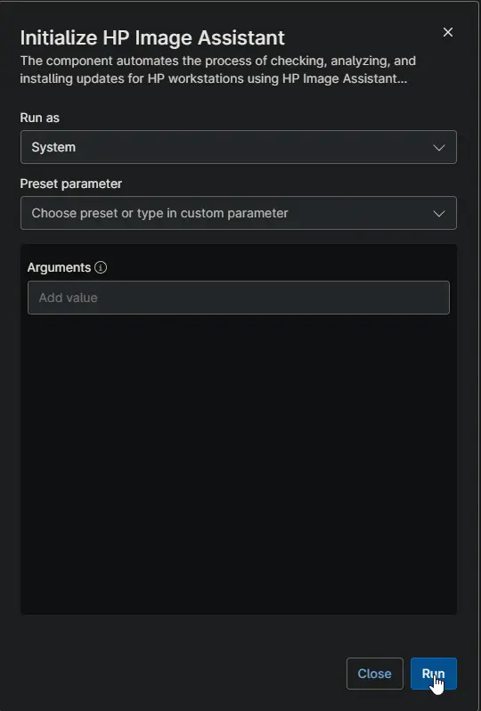
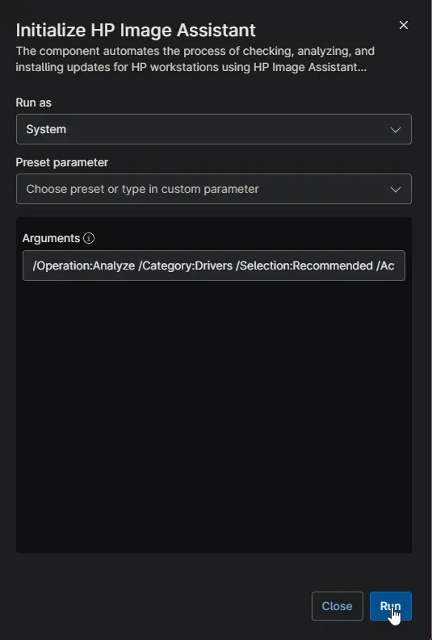
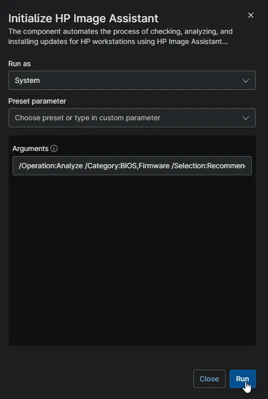
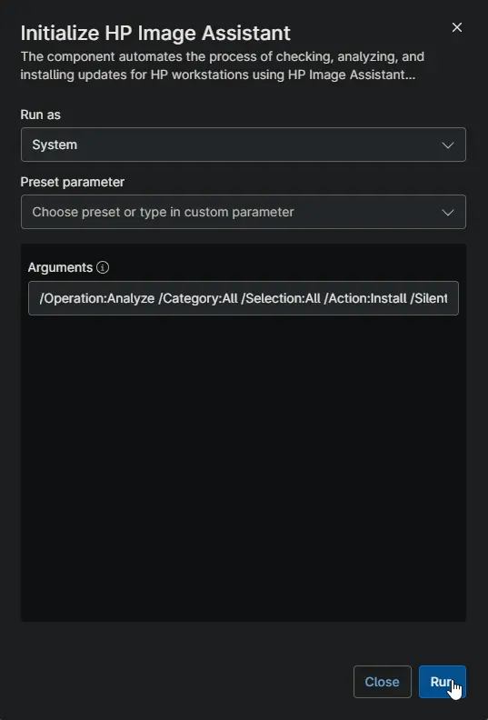
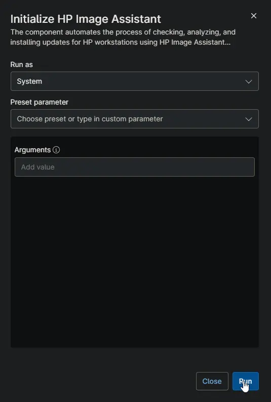

## Overview

This script keeps HP workstations up to date with drivers, BIOS, firmware, and HP software using HP Image Assistant (HPIA). It is part of the [HP Image Assistant](/docs/4c4053fb-301c-4c77-8e7f-97ed2f00b391) solution, which runs it weekly on HP devices where [cPVAL HPIA Update Audit](/docs/d13a9112-7ddc-4808-926d-4f24c44b7f42) is set to Enable.

**When to use:**

- Check which HP updates a device needs, without installing anything.
- Install recommended driver updates.
- Install BIOS and firmware updates during a maintenance window.
- Set one standard update command per organization, location, or device.

**How it works:**

- The script confirms that HPIA supports the device model. Unsupported models stop with an error.
- HPIA is downloaded if it is not already on the device.
- The command comes from the Arguments variable. When it is blank, the [cPVAL HPIA Arguments](/docs/cc92019d-e16e-4ca4-b8d8-1e91bb167669) custom field is used. When both are blank, the script only scans.
- The script does not restart the device.

**Requirements:**

- HP workstation running Windows 10 or Windows 11, on HP's [supported platform list](https://ftp.ext.hp.com/pub/caps-softpaq/cmit/imagepal/ref/platformList.html).
- Runs elevated (System context).
- Internet access to download HPIA and the updates.
- Optional: the [cPVAL HPIA Arguments](/docs/cc92019d-e16e-4ca4-b8d8-1e91bb167669) custom field, to set a default command (Example 5).

## Sample Run

### Example 1: Running the script to scan for available updates

Leave **Arguments** blank and the [cPVAL HPIA Arguments](/docs/cc92019d-e16e-4ca4-b8d8-1e91bb167669) custom field empty. HPIA reports the device health and lists each recommended update with its type, name, installed version, and available version. Nothing is installed.

### Example 2: Running the script to install recommended driver updates

Set **Arguments** to `/Operation:Analyze /Category:Drivers /Selection:Recommended /Action:Install /Silent /AutoCleanup /ReportFilePath:C:\ProgramData\_Automation\App\HPImageAssistant\InstallReport`. Recommended driver updates are installed silently, and downloaded files are removed afterwards. Keep /ReportFilePath in every install command; the script reads the install result from this report.

### Example 3: Running the script to install recommended BIOS and firmware updates

Set **Arguments** to `/Operation:Analyze /Category:BIOS,Firmware /Selection:Recommended /Action:Install /Silent /AutoCleanup /ReportFilePath:C:\ProgramData\_Automation\App\HPImageAssistant\InstallReport`. Recommended BIOS and firmware updates are installed. They finish at the next restart, so run this during a maintenance window.

### Example 4: Running the script to install all available updates

Set **Arguments** to `/Operation:Analyze /Category:All /Selection:All /Action:Install /Silent /AutoCleanup /ReportFilePath:C:\ProgramData\_Automation\App\HPImageAssistant\InstallReport`. Every available update is installed, including routine ones. Use this to bring a new or rebuilt device fully up to date.

### Example 5: Running the script with a default command from the custom field

Set the [cPVAL HPIA Arguments](/docs/cc92019d-e16e-4ca4-b8d8-1e91bb167669) custom field at the organization, location, or device level, for example to the command from Example 2. Leave **Arguments** blank, and the custom field value is used. A value entered in **Arguments** always takes priority. Use this to control what the weekly [Execute HP Image Assistant](/docs/5732428a-7410-49b6-a4e7-06fb906f424c) task runs for each organization, location, or device.

## Dependencies

- [Solution: HP Image Assistant](/docs/4c4053fb-301c-4c77-8e7f-97ed2f00b391)
- [Script: Initialize-HPImageAssistant](/docs/92b749f0-2e30-4d4d-8916-fb5f30d85bff) (the underlying agnostic script)
- [Custom Field: cPVAL HPIA Arguments](/docs/cc92019d-e16e-4ca4-b8d8-1e91bb167669) (optional; create before using Example 5)

## Parameters

| Name | Example | Accepted Values | Required | Default | Type | Description |
| ---- | ------- | --------------- | -------- | ------- | ---- | ----------- |
| Arguments | `/Operation:Analyze /Category:Drivers /Selection:Recommended /Action:Install /Silent /AutoCleanup /ReportFilePath:C:\ProgramData\_Automation\App\HPImageAssistant\InstallReport` | Any command from the [HPIA user guide](https://ftp.hp.com/pub/caps-softpaq/cmit/imagepal/userguide/936944-005.pdf). | False | Empty | String/Text | The HPIA command to run. When blank, the [cPVAL HPIA Arguments](/docs/cc92019d-e16e-4ca4-b8d8-1e91bb167669) custom field is used. When both are blank, the script only scans. |

## Custom Fields

| Field Name | Type | Mandatory | Scope | Description |
| ---------- | ---- | --------- | ----- | ----------- |
| [cPVAL HPIA Arguments](/docs/cc92019d-e16e-4ca4-b8d8-1e91bb167669) | Text | No | Organization, Location, Device | Default HPIA command, used when Arguments is blank. A device value overrides a location value, and a location value overrides an organization value. |

## Automation Setup/Import

[Automation Configuration](https://github.com/ProVal-Tech/ninjarmm/blob/main/scripts/initialize-hp-image-assistant.ps1)

## Output

- **Activity Details:** The run log. A scan shows the device health and the recommended updates; an install shows the result of each update. Errors are reported in the activity output.
- **Install Report:** Install commands save a .json report at the /ReportFilePath location, for example C:\ProgramData\_Automation\App\HPImageAssistant\InstallReport.json.
- **Scan Report:** A scan saves its results to C:\ProgramData\_Automation\App\HPImageAssistant\UpdateReportPath\HPIAApplicableUpdates.xml.
- **Restart:** When an update needs a restart, the activity shows a restart-required warning. Restart the device to finish the update.
- **Log Files:** A copy of the run log is kept on the device in C:\ProgramData\_Automation\Script\Initialize-HPImageAssistant.

## Changelog

### 2026-10-16

- Updated the document to the current template.
- Corrected the script variable name to Arguments and documented the optional [cPVAL HPIA Arguments](/docs/cc92019d-e16e-4ca4-b8d8-1e91bb167669) custom field.
- Added links to the HP Image Assistant solution and its components.
- Replaced the Sample Run section with usage scenarios.

### 2026-03-06

- Initial version of the document
