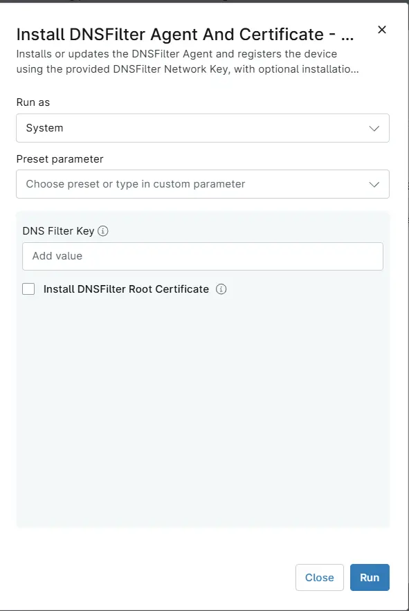

## Overview

Automates the deployment of the DNSFilter Agent via NinjaRMM. This script performs a secure, automated installation of the DNSFilter Agent using NinjaRMM custom fields for configuration. It ensures a clean environment, retrieves the required DNSFilter Key, downloads the latest agent installer, and executes the installation with appropriate parameters, with optional installation of the DNSFilter root certificate.

## Requirements

- Windows
- Run As: `System`

## Sample Run

## Parameters

| Name | Required | Accepted Values | Default | Type | Description |
| ---- | -------- | --------------- | ------- | ---- | ----------- |
| DNS Filter Key | True | | | Text | DNSFilter Network Key used to register the device with the DNSFilter organization. |
| Install DNSFilter Root Certificate | True | | | Checkbox | Select to download the DNSFilter root certificate (NetAlerts.cer) and import it into the Enterprise Trusted Root Certification Authorities. |

## Custom Fields

| Custom Field | Scope | Type | Description |
| ------------ | ----- | ---- | ----------- |
| [cPVAL DNSFilter Key](</docs/ea940639-c217-4f4d-ac31-b5767417691a>)  | Device | Custom Fields to enter the DNSFilter Network Key required to register the device with the appropriate DNSFilter organization. |

## Dependencies

* [Custom Field - cPVAL DNSFilter Key](</docs/ea940639-c217-4f4d-ac31-b5767417691a>)
* [Solution - DNSFilter Deployment](</docs/1c257867-5a6f-4887-a383-7c5af4cf1c98)

## Automation Setup/Import

[Automation Configuration](https://github.com/ProVal-Tech/ninjarmm/blob/main/scripts/install-dnsfilter-agent-and-certificate-windows.ps1)

## Output

- Activity Details

## Changelog

### 2026-10-22

- Updated the powershell for Error Handling
- Introduced parameter `Install DNSFilter Root Certificate` for optional certificate installation
- Updated the documents as per Proval's new Standard

### 2025-07-17

- Initial version of the document
