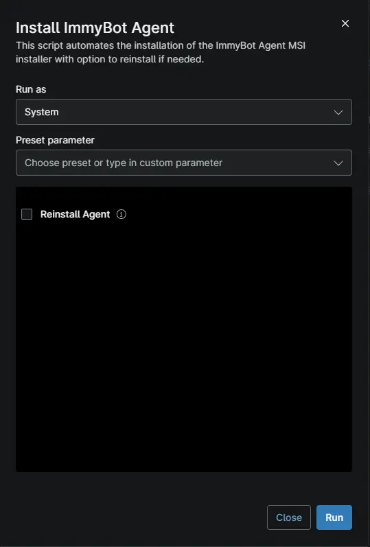

## Overview

This script automates the installation of the ImmyBot Agent MSI installer with option to reinstall if needed.

## Sample Run

## Dependencies

- [Solution - ImmyBot Agent Deployment - NinjaOne](/docs/72284ce2-4cf0-402b-99c3-7c0cafa3d213)

## Parameters

| Name | Example | Accepted Values | Required | Default | Type | Description |
| ---- | ------- | --------------- | -------- | ------- | ---- | ----------- |
| `Reinstall Agent` | -- | -- | False | -- | `Checkbox` | This will reinstall the ImmyBot Agent |

## Automation Setup/Import

[Automation Configuration](https://github.com/ProVal-Tech/ninjarmm/blob/main/scripts/install-immybot-agent.ps1)

## Output

- Activity Details  

## Changelog

### 2026-10-16

- This is initial version of the document.