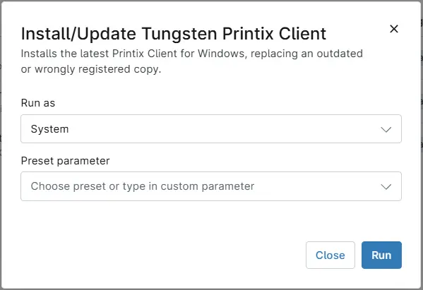

## Overview

Installs the latest Tungsten Printix Client on Windows machines and registers it to the client's Printix tenant. The script reads the tenant ID and domain from the [cPVAL Tungsten PrintixClientID](/docs/ac1c2105-bc81-4dca-9786-1991d00e5155) and [cPVAL Tungsten PrintixClientDomain](/docs/4e5a88c2-1f5a-41fd-bd22-fd3d7ea2fb9b) custom fields, downloads the tenant's installer from Printix, and checks that the installer is signed by Tungsten Automation. It then compares the download with the copy already on the device:

- **Not installed:** installs the client.
- **Installed, at or above the downloaded version, and registered to the tenant:** makes no changes.
- **Older, registered to another tenant or to no tenant, or its version can't be compared:** uninstalls the client silently and installs the downloaded version.

After the install, the script checks that the client is registered to the tenant and is at the downloaded version.

## Requirements

- Windows workstations and servers, 64-bit
- Run As: `System`
- PowerShell 5.1, 64-bit. In 32-bit PowerShell the script may not find an installed client and would reinstall it on every run.
- Internet access to `api.printix.net`
- Both custom fields in [Custom Fields](#custom-fields) set for the device

## Sample Run

1. On the device, select `Play Button` > `Run Automation` > `Script`.
2. Search for `Install/Update Tungsten Printix Client` and select it.
3. Leave Run As set to `System` and select `Run`.

## Custom Fields

| Custom Field | Scope | Type | Description |
| ------------ | ----- | ---- | ----------- |
| [cPVAL Tungsten PrintixClientID](/docs/ac1c2105-bc81-4dca-9786-1991d00e5155) | Organization, Location, Device | Text | The Printix tenant ID, a GUID. The script uses it to download the tenant's installer and to check that the client is registered to the tenant. |
| [cPVAL Tungsten PrintixClientDomain](/docs/4e5a88c2-1f5a-41fd-bd22-fd3d7ea2fb9b) | Organization, Location, Device | Text | The Printix tenant name, the part of the sign-in address before `.printix.net`. For `https://acme.printix.net`, enter `acme`. `acme.printix.net` and the full address also work. |

## Dependencies

* [Custom Field: cPVAL Tungsten PrintixClientID](/docs/ac1c2105-bc81-4dca-9786-1991d00e5155)
* [Custom Field: cPVAL Tungsten PrintixClientDomain](/docs/4e5a88c2-1f5a-41fd-bd22-fd3d7ea2fb9b)
* [Custom Field: cPVAL Tungsten Printix Client Deployment](/docs/d53a9981-9c39-4392-bf02-9d069b529f2f)
* [Compound Condition: Deploy Tungsten Printix Client - Workstations](/docs/96795ceb-d3c7-4d36-b424-d2979140e036)
* [Compound Condition: Deploy Tungsten Printix Client - Servers](/docs/aad200d0-6423-4b95-80c8-0e8cbae219fa)
* [Solution: Deploy Tungsten Printix Client - NinjaOne](/docs/9424b17b-b55f-417d-9d2d-a953bed8575e)

## Automation Setup/Import

[Automation Configuration](https://github.com/ProVal-Tech/ninjarmm/blob/main/scripts/install-update-tungsten-printix-client.ps1)

## Output

- Activity Details
- Log files in `C:\ProgramData\_automation\script\Printix`:
  - `Install-PrintixClient.log`: each step the script took, the account it ran as, and the Printix uninstall entry it found.
  - `Printix_Install.log`: the installer's own log. When the install fails, its last 25 lines are also shown in Activity Details.

## Changelog

### 2026-11-16

- Initial version of the document
