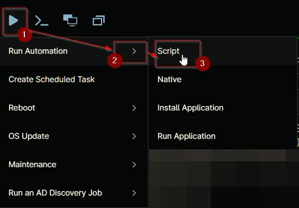
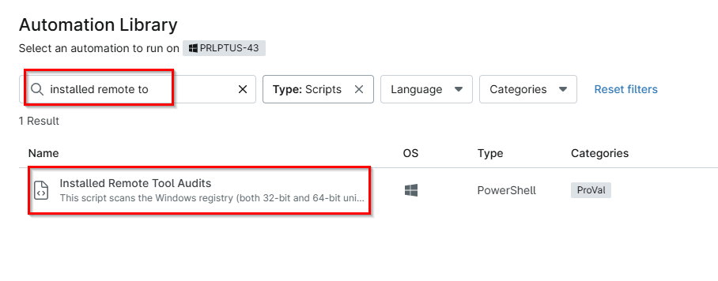
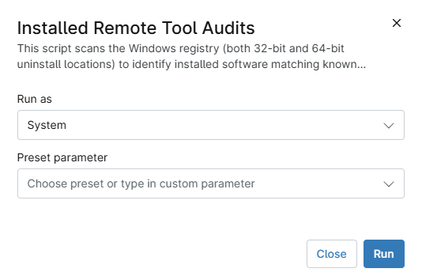

## Overview

Checks the device for remote access, RMM and other management tools, using installed programs, running processes, services and known program paths. Detected tools are stored in [cPVAL Installed Remote Access Tools](/docs/62487ab1-8f55-426d-8127-f0ba0fcf4f66), and their names in [cPVAL Detected Remote Tool Names](/docs/6238b6b2-1e19-4840-8f54-0d952a694c8a). Use it to find unapproved tools that give outside access to your devices.

Supported tools:

1. AeroAdmin
2. Ammyy Admin
3. AnyDesk
4. Atera
5. Automate (ConnectWise Automate)
6. Auvik
7. BeyondTrust
8. Chrome Remote Desktop
9. Continuum
10. CW RMM (ConnectWise RMM)
11. DameWare
12. Datto (other Datto products)
13. Datto RMM
14. DWService
15. GoToAssist
16. GoToMyPC
17. ITSPlatform
18. Kaseya
19. Kaseya VSA (VSA)
20. LiteManager
21. LogMeIn
22. Malwarebytes
23. ManageEngine
24. N-Able N-Central
25. N-Able N-Sight
26. Naverisk
27. NoMachine
28. Parsec
29. PRTG
30. Rapid7 Insight Agent
31. Remote Utilities
32. RemotePC
33. ScreenConnect / ConnectWise Control (one row per instance)
34. SolarWinds
35. Splashtop
36. Supremo
37. Syncro
38. TeamViewer
39. TightVNC
40. UltraVNC
41. VNC (generic detection)
42. VNC Connect (RealVNC)
43. Zoho Assist

:::note  
The automation shows as failed when it detects at least one tool. This is by design, so you can alert on it. To ignore approved tools, list them in the `Whitelisted Remote Access Tools` parameter or the `cPVAL Whitelisted Remote Access Tools` custom field.  
:::

## Requirements

- Windows
- Run As: `System`
- PowerShell 5.1

## Sample Run

`Play Button` > `Run Automation` > `Script`

Search for `Installed Remote Tool Audits` and click it.

Click `Run`.

## Parameters

| Name | Example | Accepted Values | Required | Default | Type | Description |
| ---- | ------- | --------------- | -------- | ------- | ---- | ----------- |
| Whitelisted Remote Access Tools | `TeamViewer; Datto RMM; ScreenConnect Client (342xxxxxxxxxxxf)` | Comma or semicolon separated list | False | - | String | Tools to ignore on every device. Combined with the `cPVAL Whitelisted Remote Access Tools` custom field, which can be set per organization, location or device. Use `ScreenConnect` to ignore every instance, or `ScreenConnect Client (<instance ID>)` to ignore one. |

## Custom Fields

| Custom Field | Scope | Type | Description |
| ------------ | ----- | ---- | ----------- |
| [cPVAL Installed Remote Access Tools](/docs/62487ab1-8f55-426d-8127-f0ba0fcf4f66) | Device | WYSIWYG | Stores the detected tools with their details. |
| [cPVAL Detected Remote Tool Names](/docs/6238b6b2-1e19-4840-8f54-0d952a694c8a) | Device | Multi-line | Stores the detected tool names, one per line, for groups and conditions. |
| cPVAL Whitelisted Remote Access Tools | Organization, Location, Device | Text | Optional list of tools to ignore. |

## Dependencies

* [Custom Field: cPVAL Installed Remote Access Tools](/docs/62487ab1-8f55-426d-8127-f0ba0fcf4f66)
* [Custom Field: cPVAL Detected Remote Tool Names](/docs/6238b6b2-1e19-4840-8f54-0d952a694c8a)
* [Audit Report: Admin - RMM or Other Management Software](/docs/68d77a2d-3fa9-4244-931b-e7eeb46962d7)
* [Solution: Installed Remote Access Tool Audit](/docs/eae2fab9-4697-4e1e-ad8f-93f8a09d7056)

## Automation Setup/Import

[Automation Configuration](https://github.com/ProVal-Tech/ninjarmm/blob/main/scripts/installed-remote-tools-audit.ps1)

## Output

- Activity Details
- Custom Fields: [cPVAL Installed Remote Access Tools](/docs/62487ab1-8f55-426d-8127-f0ba0fcf4f66) and [cPVAL Detected Remote Tool Names](/docs/6238b6b2-1e19-4840-8f54-0d952a694c8a)

## Changelog

### 2026-10-14

- Added detection for SolarWinds, Rapid7 Insight Agent, Continuum, PRTG, Auvik, Naverisk and other Datto products. Kaseya detection now covers every Kaseya product.
- Added the `Product Name` column and renamed `Script Ran Date` to `DataCollectionDate` in [cPVAL Installed Remote Access Tools](/docs/62487ab1-8f55-426d-8127-f0ba0fcf4f66).
- Datto Windows Agent is no longer reported as N-Able N-Central.
- Fixed detection in the ProgramData folder and for newer Chrome Remote Desktop versions.
- Added the [Admin - RMM or Other Management Software](/docs/68d77a2d-3fa9-4244-931b-e7eeb46962d7) report to the dependencies.

### 2026-09-28

- Fixed a bug where detecting a single tool resulted in a **No remote access tools detected** false negative.

### 2026-08-27

- Updated the script to bypass NinjaRMM detection and replaced exit code 2 with exit code 1.

### 2026-07-27

- Added a new Multi-Line Text Custom Field `cPVAL Detected Remote Tool Names` to store only the names of detected remote access tools as a simple list.
- Updated the PowerShell script to extract tool names and populate the new text field, enabling the data to be used for dynamic grouping and exports (which is not possible with the existing WYSIWYG field).

### 2026-06-24

- Added more remote tools for detection and updated the powershell script to check processes, services and executable paths along with registries for remote tools.
- Added script variable to mention whitelisted remote tools.
- Updated script to whitelist the remote tools mentioned in the new custom field `cPVAL Whitelisted Remote Access Tools`
- Updated HTML output to show more columns like installed location, executable path, if tool is currently active and script last ran date.

### 2026-05-21

- Initial version of the document
