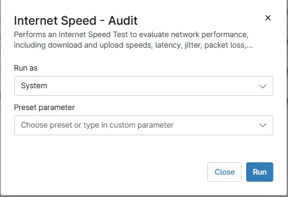

## Overview

Performs an Internet Speed Test to evaluate network performance, including download and upload speeds, latency, jitter, packet loss, and connection details. This script executes the [Agnostic - Test-InternetSpeed](/docs/12946fed-d74f-4977-b59d-85d5c639b56b) which runs an internet speed test via the Ookla SpeedTest CLI application.

## Requirements

- Windows Systems
- Run As: `System`
- PowerShell 5.1

## Sample Run

## Custom Fields

| Custom Field | Scope | Type | Description |
| ------------ | ----- | ---- | ----------- |
| [Custom Field - cPVAL Internet Speed Test Results](/docs/96f40eb8-1282-42d2-aefa-38042d85b796) | Device | WYSIWYG | Contains the internet speed test results generated by the script.|
| [Custom Field - cPVAL Latency](/docs/e524bae2-78b5-4e41-84dd-d55d0509dc23) | Device | Text | Represents the Ping latency detected on the device during an internet speed test.| 
| [Custom Field - cPVAL Jitter](/docs/9a71b337-8153-4004-9fd7-61658ba0494b)| Device | Text | Represents the ping jitter detected on the device during an internet speed test. | 
| [Custom Field - cPVAL PacketLoss](/docs/bd3ca16b-532a-4c55-bced-50732eea3a74) | Device | Text | Represents the packet loss detected on the device during an internet speed test. | 
| [Custom Field - cPVAL DownloadMbps](/docs/58e36e0e-6896-4f80-8140-61fc7ad8680d) | Device | Text | Represents the download speed detected in Mbps on the device during an internet speed test.  |
| [Custom Field - cPVAL UploadMbps](/docs/7d74bd7b-4a7b-42c9-9e37-f00cd5ea7c49) | Device | Text | Represents the upload speed detected in Mbps on the device during an internet speed test. | 

## Dependencies

* [Custom Field - cPVAL Internet Speed Test Results](/docs/96f40eb8-1282-42d2-aefa-38042d85b796)
* [Custom Field - cPVAL Latency](/docs/e524bae2-78b5-4e41-84dd-d55d0509dc23)
* [Custom Field - cPVAL Jitter](/docs/9a71b337-8153-4004-9fd7-61658ba0494b)
* [Custom Field - cPVAL PacketLoss](/docs/bd3ca16b-532a-4c55-bced-50732eea3a74)
* [Custom Field - cPVAL DownloadMbps](/docs/58e36e0e-6896-4f80-8140-61fc7ad8680d)
* [Custom Field - cPVAL UploadMbps](/docs/7d74bd7b-4a7b-42c9-9e37-f00cd5ea7c49)
* [Agnostic - Test-InternetSpeed](/docs/12946fed-d74f-4977-b59d-85d5c639b56b)
* [Solution - Internet Speed Audit](/docs/7dc8d18c-aab4-4ad1-80bc-4e7beef98530)  

## Automation Setup/Import

[Automation Configuration](https://github.com/ProVal-Tech/ninjarmm/blob/main/scripts/internet-speed-audit.ps1)

## Output

- Activity Details
- [Custom Field - cPVAL Internet Speed Test Results](/docs/96f40eb8-1282-42d2-aefa-38042d85b796)
- [Custom Field - cPVAL Latency](/docs/e524bae2-78b5-4e41-84dd-d55d0509dc23)
- [Custom Field - cPVAL Jitter](/docs/9a71b337-8153-4004-9fd7-61658ba0494b)
- [Custom Field - cPVAL PacketLoss](/docs/bd3ca16b-532a-4c55-bced-50732eea3a74)
- [Custom Field - cPVAL DownloadMbps](/docs/58e36e0e-6896-4f80-8140-61fc7ad8680d)
- [Custom Field - cPVAL UploadMbps](/docs/7d74bd7b-4a7b-42c9-9e37-f00cd5ea7c49)

## Changelog

### 2026-10-28

- Initial version of the document
