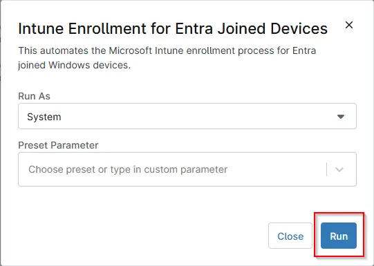

## Overview

This automation enrolls a Windows device that's already joined to Microsoft Entra ID in Microsoft Intune. It turns on the MDM auto-enrollment policy with the signed-in user's Entra ID credentials, writes the Intune enrollment URLs to the device's Entra tenant key, and starts the enrollment with `deviceenroller.exe`. Use it after [Join Computer to Entra](/docs/c6612702-1dff-47e5-91b7-9ad4fa237f22), or on any Entra joined device that didn't enroll in Intune by itself. The device can take up to 15 minutes to appear in the Intune admin center.

## Requirements

- Windows 10 or Windows 11 device joined to Microsoft Entra ID
- Run As: `System`
- PowerShell 5.1
- A user signed in with an Entra ID account
- Intune automatic enrollment (MDM user scope) set up in Microsoft Entra ID, and an Intune license for the signed-in user

## Sample Run

## Scenarios

- **Device not Entra joined:** the automation returns `Failure: Device is not Azure AD joined.` and changes nothing.
- **`AutoEnrollMDM` already turned on:** the automation returns `Success: Device is already enrolled in Intune.` and changes nothing.
- **Enrollment started:** the automation sets the `AutoEnrollMDM` and `UseAADCredentialType` policy values, runs `gpupdate /force`, writes the Intune enrollment, terms of use and compliance URLs to the tenant key, and runs `deviceenroller.exe /c /AutoEnrollMDM`. It returns `Success: Enrollment process completed. Please allow up to 15 minutes for the device to appear in Intune.`
- **A registry change or the enrollment fails:** the automation returns a line that starts with `Failure:` and gives the reason.

## Dependencies

* [Solution: Domain to Entra ID and Intune Migration](/docs/7264fd6b-4957-473f-9d3e-75471c0fce73)
* [Automation: Join Computer to Entra](/docs/c6612702-1dff-47e5-91b7-9ad4fa237f22)

## Automation Setup/Import

[Automation Configuration](https://github.com/ProVal-Tech/ninjarmm/blob/main/scripts/intune-enrollment-for-entra-joined-devices.ps1)

## Output

- Activity Details, with one line that starts with `Success:` or `Failure:`
- The device enrolled in Microsoft Intune

## Changelog

### 2026-11-17

- Moved the script to the ProVal-Tech/ninjarmm repository and updated the document to the new template.
- The script now creates the MDM policy key only when it's missing, so existing values in the key are kept.

### 2025-04-22

- Initial version of the document
