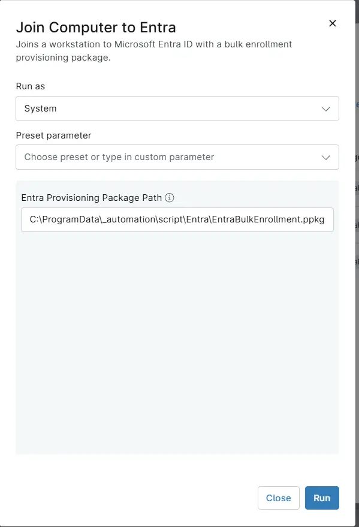

## Overview

This automation joins a Windows workstation to Microsoft Entra ID by applying an Entra ID bulk enrollment provisioning package (`.ppkg`) created with Windows Configuration Designer. Use it on workstations that have been removed from their Active Directory domain The automation deletes its copy of the package after every run, because the package contains the bulk enrollment token. On a computer that's already Entra joined, it skips the join and reports the tenant the computer is joined to.

:::note  
The automation doesn't restart the computer. After a new join, restart it before users sign in with their Entra ID accounts. Nothing is changed until every pre-flight check passes, and the automation shows as failed when a check or the join fails.  
:::

## Requirements

- Windows 10 or Windows 11 Pro, Enterprise, or Education workstation. Servers and Home editions aren't supported.
- Run As: `System`
- PowerShell 5.1
- Not joined to an Active Directory domain, and restarted since it was removed from the domain
- No computer rename waiting on a restart, because Entra ID registers the device under its current name
- Access on TCP port 443 to `login.microsoftonline.com` and `enterpriseregistration.windows.net`
- An Entra ID bulk enrollment provisioning package with a bulk token that hasn't expired, reachable from the computer. It isn't needed when the computer is already Entra joined.

## Sample Run

Applies the provisioning package that the [Entra Provisioning Package](/docs/0ad6a640-bcd2-4d87-8c7d-ace30dbf7044) file transfer placed on the computer.

| Script Variable | Value |
| --------------- | ----- |
| Entra Provisioning Package Path | `C:\ProgramData\_automation\script\Entra\EntraBulkEnrollment.ppkg` |

## Parameters

| Name | Calculated Name | Example | Accepted Values | Required | Default | Type | Description |
| ---- | --------------- | ------- | --------------- | -------- | ------- | ---- | ----------- |
| Entra Provisioning Package Path | entraProvisioningPackagePath | `C:\ProgramData\_automation\script\Entra\EntraBulkEnrollment.ppkg` | Local path, UNC path, or HTTP(S) URL of a `.ppkg` file | False | | String/text | Provisioning package to apply. Required unless the computer is already Entra joined. |

:::note  
When the automation runs as `System` on a computer that has left the domain, it opens a UNC share without domain credentials, so a UNC path often fails. Use a local path, such as the one the [Entra Provisioning Package](/docs/0ad6a640-bcd2-4d87-8c7d-ace30dbf7044) file transfer uses, or an HTTPS URL.  
:::

## Scenarios

- **Not Entra joined yet:** the automation copies or downloads the package to the `TEMP` folder, checks that it can be read, applies it, and waits up to 5 minutes for the join. It then reports the tenant and asks for a restart.
- **Already Entra joined:** the join is skipped and the tenant is reported. No package is needed.
- **A pre-flight check fails:** for example, the computer is still joined to the domain, a rename is waiting on a restart, no package path is set, or the Entra ID endpoints can't be reached. Nothing is changed and the automation shows as failed with the reason.
- **The join doesn't finish within 5 minutes:** the automation shows as failed. Check that the bulk token hasn't expired and that the package account is allowed to join devices. The failure message gives the path of the provisioning logs.
- **The staged package can't be deleted:** the automation shows as failed and gives the path of the file. Delete it by hand, because it contains the bulk enrollment token.

## Dependencies

* [Solution: Domain to Entra ID and Intune Migration](/docs/7264fd6b-4957-473f-9d3e-75471c0fce73)
* [File Transfer: Entra Provisioning Package](/docs/0ad6a640-bcd2-4d87-8c7d-ace30dbf7044)
* [Automation: Local Machine - Domain - Remove](/docs/1e5fb8ca-bf85-447d-8add-f583af6b64d6)

## Automation Setup/Import

[Automation Configuration](https://github.com/ProVal-Tech/ninjarmm/blob/main/scripts/join-computer-to-entra.ps1)

## Output

- Activity Details, ending with a line that starts with `Success:` or `Failure:`
- The computer joined to Microsoft Entra ID

## Changelog

### 2026-11-17

- Initial version of the document