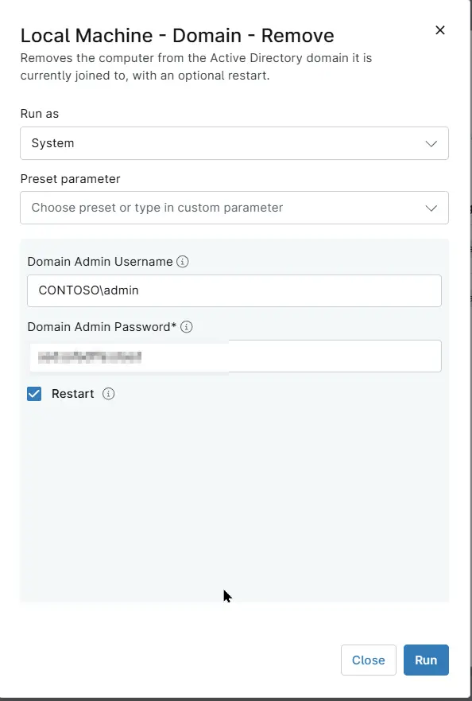

## Overview

This automation removes a Windows computer from the Active Directory domain it is joined to and moves it to the default `WORKGROUP`. The change takes effect at the next restart, which the automation can do straight away. Use it as the first step when moving a computer from Active Directory to Microsoft Entra ID, before [Join Computer to Entra](/docs/c6612702-1dff-47e5-91b7-9ad4fa237f22).

:::note  
Make sure you know the password of a local administrator account on the computer before you run it. After the restart, domain accounts, including cached domain logons, can no longer sign in to the computer.  
:::

## Requirements

- Windows computer joined to an Active Directory domain
- Run As: `System`
- Windows PowerShell 5.1. The automation stops if it runs in PowerShell 7.
- Network access to a domain controller of the computer's domain
- A domain account that's allowed to remove the computer from the domain

## Sample Run

Removes the computer from its domain as `CONTOSO\admin` and restarts it straight away.

| Script Variable | Value |
| --------------- | ----- |
| Domain Admin Username | `CONTOSO\admin` |
| Domain Admin Password | The password of `CONTOSO\admin` |
| Restart Computer | Selected |

## Parameters

| Name | Calculated Name | Example | Accepted Values | Required | Default | Type | Description |
| ---- | --------------- | ------- | --------------- | -------- | ------- | ---- | ----------- |
| Domain Admin Username | domainAdminUsername | `CONTOSO\admin` | `DOMAIN\user`, `user@domain.com`, or a user name only | False | | String/text | Domain account allowed to remove the computer. If you leave out the domain, the computer's current domain is added in front. |
| Domain Admin Password | domainAdminPassword | -- | The account's password | True | | String/password | Password of the domain account. |
| Restart Computer | restartComputer | `True` | `True/False` | False | False | Boolean | Restarts the computer straight after it is removed from the domain. If it is not selected, the change takes effect at the next restart. |

## Scenarios

- **Computer joined to a domain:** the automation removes it from the domain, moves it to `WORKGROUP` and disables its computer account in Active Directory. It restarts the computer if **Restart Computer** is selected.
- **Computer not joined to a domain:** nothing is changed and the automation finishes successfully.
- **Removal fails:** for example because of a wrong password or no access to a domain controller. Nothing is changed and the automation shows as failed with the reason.

## Dependencies

* [Solution: Domain to Entra ID and Intune Migration](/docs/7264fd6b-4957-473f-9d3e-75471c0fce73)

## Automation Setup/Import

[Automation Configuration](https://github.com/ProVal-Tech/ninjarmm/blob/main/scripts/local-machine-domain-remove.ps1)

## Output

- Activity Details
- The computer removed from its Active Directory domain, and restarted if **Restart Computer** is selected

## Changelog

### 2026-11-17

- Initial version of the document
