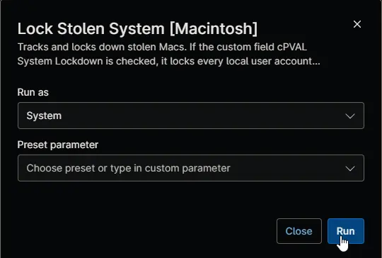

## Overview

This automation tracks a Mac marked as stolen and saves its public IP address, internet provider, approximate location, Wi-Fi network name, FileVault status, network settings and nearby network devices to custom fields. When [cPVAL System Lockdown](/docs/4b18c9bf-8aea-41a5-8242-77dfcfd0042a) is checked, it first locks the Mac: it sets the password in [cPVAL Stolen System BitLocker Password](/docs/92779b41-3331-480c-a72d-402c0f328af3) on every local user account except the IT admin account, disables those accounts, signs out the current user and shows your message on the login window and the FileVault screen. The Mac then shuts down one minute after the automation finishes. Without lockdown, the Mac stays online so it can be tracked again.

:::note  
The [Lock Stolen Systems [Macintosh]](/docs/e2669c99-0a79-4456-9923-b63345bf9a3c) compound condition runs this automation every 30 minutes on Macs marked as stolen, so you rarely need to run it yourself. It shows as failed when the Mac isn't marked as stolen, or when the lockdown can't finish, for example because the admin account fields are missing.  
:::

## Requirements

- macOS, with FileVault turned on to protect the data on the disk
- Run As: `System`
- Shell script (bash)
- For lockdown, a local admin account with a Secure Token, set in the cPVAL Stolen System Mac Admin User and cPVAL Stolen System Mac Admin Password custom fields
- Internet access to `ipinfo.io` for the public IP address and location

## Sample Run

## Scenarios

- **Track only:** with [cPVAL Mark System as Stolen](/docs/20a99ff3-a63d-4f73-bd48-3bb8d66626e6) checked and [cPVAL System Lockdown](/docs/4b18c9bf-8aea-41a5-8242-77dfcfd0042a) unchecked, the automation updates the location and network details, and the Mac stays online.
- **Track and lock down:** with both checked and the lockdown password and admin account set, the automation locks every user account except the admin account, updates the details, sets [cPVAL Lock Status](/docs/e734bed4-a878-4574-b456-1e1ed59ee6bc) to `Locked` and shuts the Mac down after one minute.
- **Some accounts couldn't be locked:** cPVAL Lock Status shows `Partially Locked`, the Mac still shuts down, and the activity details name the accounts that failed.
- **Lockdown settings missing or wrong:** if the lockdown password, the admin account or its password is missing or wrong, or the admin account has no Secure Token, nothing is locked. The details are still updated, the Mac stays online, and the automation shows as failed.
- **FileVault off:** the automation still runs, and both the activity details and cPVAL Current Location and IP Details show that FileVault is off.
- **Not marked as stolen:** the automation makes no changes and shows as failed.

## Custom Fields

| Custom Field | Scope | Type | Description |
| ------------ | ----- | ---- | ----------- |
| [cPVAL Mark System as Stolen](/docs/20a99ff3-a63d-4f73-bd48-3bb8d66626e6) | Device | Checkbox | Must be checked for the automation to run. |
| [cPVAL System Lockdown](/docs/4b18c9bf-8aea-41a5-8242-77dfcfd0042a) | Device | Checkbox | Locks and shuts down the Mac when checked. |
| [cPVAL Stolen System BitLocker Password](/docs/92779b41-3331-480c-a72d-402c0f328af3) | Device | Secure | New password of every locked user account. Required for lockdown. |
| [cPVAL Stolen System BitLocker Message](/docs/04443686-5a42-41d4-b936-b62145597107) | Device | Text | Message shown on the login window and the FileVault screen. Optional. |
| [cPVAL Stolen System Mac Admin User](/docs/35966a9e-1a07-45c8-99e0-e51961543784) | Device | Text | IT admin account that performs the lockdown and is never locked. Required for lockdown. |
| [cPVAL Stolen System Mac Admin Password](/docs/d527c77e-88b5-48f0-8ae8-364e909da96f) | Device | Secure | Password of the IT admin account. Required for lockdown. |
| [cPVAL Current Location and IP Details](/docs/85cb62ba-6e5f-4235-9964-975af04658d0) | Device | Multi-line | Receives the FileVault status, Wi-Fi network name, public IP address, internet provider, location and network settings. |
| [cPVAL Network Neighbours](/docs/150e0b6d-db7e-4b7b-8879-bd36b1e11771) | Device | WYSIWYG | Receives up to 30 nearby network devices. |
| [cPVAL Lock Status](/docs/e734bed4-a878-4574-b456-1e1ed59ee6bc) | Device | Text | Set to `Locked`, or `Partially Locked` when some accounts couldn't be locked. |

## Dependencies

* [Custom Field: cPVAL Mark System as Stolen](/docs/20a99ff3-a63d-4f73-bd48-3bb8d66626e6)
* [Custom Field: cPVAL System Lockdown](/docs/4b18c9bf-8aea-41a5-8242-77dfcfd0042a)
* [Custom Field: cPVAL Stolen System BitLocker Password](/docs/92779b41-3331-480c-a72d-402c0f328af3)
* [Custom Field: cPVAL Stolen System BitLocker Message](/docs/04443686-5a42-41d4-b936-b62145597107)
* [Custom Field: cPVAL Stolen System Mac Admin User](/docs/35966a9e-1a07-45c8-99e0-e51961543784)
* [Custom Field: cPVAL Stolen System Mac Admin Password](/docs/d527c77e-88b5-48f0-8ae8-364e909da96f)
* [Custom Field: cPVAL Current Location and IP Details](/docs/85cb62ba-6e5f-4235-9964-975af04658d0)
* [Custom Field: cPVAL Network Neighbours](/docs/150e0b6d-db7e-4b7b-8879-bd36b1e11771)
* [Custom Field: cPVAL Lock Status](/docs/e734bed4-a878-4574-b456-1e1ed59ee6bc)
* [Compound Condition: Lock Stolen Systems [Macintosh]](/docs/e2669c99-0a79-4456-9923-b63345bf9a3c)
* [Automation: Unlock Stolen System [Macintosh]](/docs/ef4a9833-6094-4e6e-ad99-12ae267db316)
* [Solution: Lock Stolen System](/docs/13b4df99-df9b-4a57-bc0f-8675c68be028)

## Automation Setup/Import

[Automation Configuration](https://github.com/ProVal-Tech/ninjarmm/blob/main/scripts/lock-stolen-system-macintosh.sh)

## Output

- Activity Details
- Custom Field: [cPVAL Current Location and IP Details](/docs/85cb62ba-6e5f-4235-9964-975af04658d0)
- Custom Field: [cPVAL Network Neighbours](/docs/150e0b6d-db7e-4b7b-8879-bd36b1e11771)
- Custom Field: [cPVAL Lock Status](/docs/e734bed4-a878-4574-b456-1e1ed59ee6bc)

## Changelog

### 2026-11-12

- Initial version of the document
