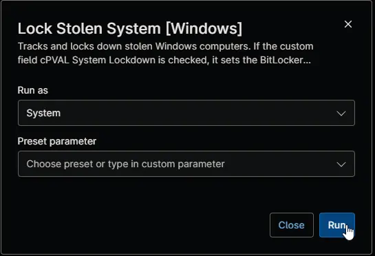

## Overview

This automation tracks a Windows computer marked as stolen and saves its public IP address, internet provider, approximate location, network settings and nearby network devices to custom fields. When [cPVAL System Lockdown](/docs/4b18c9bf-8aea-41a5-8242-77dfcfd0042a) is checked, it first locks the system drive with the BitLocker password in [cPVAL Stolen System BitLocker Password](/docs/92779b41-3331-480c-a72d-402c0f328af3), then shuts the computer down one minute after it finishes. Without lockdown, the computer stays online so it can be tracked again.

:::note  
The [Lock Stolen Systems [Windows]](/docs/705b400b-28fc-4c01-95a6-edbf43960122) compound condition runs this automation every 30 minutes on computers marked as stolen, so you rarely need to run it yourself. It shows as failed when the computer isn't marked as stolen, or when the lockdown can't finish, for example because the lockdown password isn't set.  
:::

## Requirements

- Windows 10 or Windows 11 Pro, Enterprise or Education, which include BitLocker
- Run As: `System`
- PowerShell 5.1
- Internet access to `ipinfo.io` for the public IP address and location

## Sample Run

## Scenarios

- **Track only:** with [cPVAL Mark System as Stolen](/docs/20a99ff3-a63d-4f73-bd48-3bb8d66626e6) checked and [cPVAL System Lockdown](/docs/4b18c9bf-8aea-41a5-8242-77dfcfd0042a) unchecked, the automation updates the location and network details, and the computer stays online.
- **Track and lock down:** with both checked and the lockdown password set, the automation locks the system drive, updates the details, sets [cPVAL Lock Status](/docs/e734bed4-a878-4574-b456-1e1ed59ee6bc) to `Locked` and shuts the computer down after one minute. If BitLocker was off, the automation turns it on with the lockdown password, and encryption continues in the background.
- **Lockdown without a password:** if [cPVAL Stolen System BitLocker Password](/docs/92779b41-3331-480c-a72d-402c0f328af3) is empty, nothing is locked. The details are still updated, the computer stays online, and the automation shows as failed.
- **Not marked as stolen:** the automation makes no changes and shows as failed.

## Custom Fields

| Custom Field | Scope | Type | Description |
| ------------ | ----- | ---- | ----------- |
| [cPVAL Mark System as Stolen](/docs/20a99ff3-a63d-4f73-bd48-3bb8d66626e6) | Device | Checkbox | Must be checked for the automation to run. |
| [cPVAL System Lockdown](/docs/4b18c9bf-8aea-41a5-8242-77dfcfd0042a) | Device | Checkbox | Locks and shuts down the computer when checked. |
| [cPVAL Stolen System BitLocker Password](/docs/92779b41-3331-480c-a72d-402c0f328af3) | Device | Secure | BitLocker password set on the system drive. Required for lockdown. |
| [cPVAL Stolen System BitLocker Message](/docs/04443686-5a42-41d4-b936-b62145597107) | Device | Text | Message shown on the BitLocker recovery screen. Optional. |
| [cPVAL Current Location and IP Details](/docs/85cb62ba-6e5f-4235-9964-975af04658d0) | Device | Multi-line | Receives the BitLocker status, public IP address, internet provider, location and `ipconfig /all` output. |
| [cPVAL Network Neighbours](/docs/150e0b6d-db7e-4b7b-8879-bd36b1e11771) | Device | WYSIWYG | Receives up to 30 nearby network devices. |
| [cPVAL Lock Status](/docs/e734bed4-a878-4574-b456-1e1ed59ee6bc) | Device | Text | Set to `Locked` after a successful lockdown. |

## Dependencies

* [Custom Field: cPVAL Mark System as Stolen](/docs/20a99ff3-a63d-4f73-bd48-3bb8d66626e6)
* [Custom Field: cPVAL System Lockdown](/docs/4b18c9bf-8aea-41a5-8242-77dfcfd0042a)
* [Custom Field: cPVAL Stolen System BitLocker Password](/docs/92779b41-3331-480c-a72d-402c0f328af3)
* [Custom Field: cPVAL Stolen System BitLocker Message](/docs/04443686-5a42-41d4-b936-b62145597107)
* [Custom Field: cPVAL Current Location and IP Details](/docs/85cb62ba-6e5f-4235-9964-975af04658d0)
* [Custom Field: cPVAL Network Neighbours](/docs/150e0b6d-db7e-4b7b-8879-bd36b1e11771)
* [Custom Field: cPVAL Lock Status](/docs/e734bed4-a878-4574-b456-1e1ed59ee6bc)
* [Compound Condition: Lock Stolen Systems [Windows]](/docs/705b400b-28fc-4c01-95a6-edbf43960122)
* [Automation: Unlock Stolen System [Windows]](/docs/0ced6b64-58a6-4a7f-bfea-a40724f6b554)
* [Solution: Lock Stolen System](/docs/13b4df99-df9b-4a57-bc0f-8675c68be028)

## Automation Setup/Import

[Automation Configuration](https://github.com/ProVal-Tech/ninjarmm/blob/main/scripts/lock-stolen-system-windows.ps1)

## Output

- Activity Details
- Custom Field: [cPVAL Current Location and IP Details](/docs/85cb62ba-6e5f-4235-9964-975af04658d0)
- Custom Field: [cPVAL Network Neighbours](/docs/150e0b6d-db7e-4b7b-8879-bd36b1e11771)
- Custom Field: [cPVAL Lock Status](/docs/e734bed4-a878-4574-b456-1e1ed59ee6bc)

## Changelog

### 2026-11-12

- Renamed the automation to Lock Stolen System [Windows].
- Computers without System Lockdown now stay online. Only locked computers shut down, one minute after the automation finishes.
- The lockdown now runs before the details are collected and also works when BitLocker protection is suspended.
- cPVAL Network Neighbours now lists up to 30 devices, including devices without a DNS name, and cPVAL Current Location and IP Details now includes the internet provider, country and BitLocker status.
- Fixed cPVAL Network Neighbours and cPVAL Lock Status not being updated.
- Rewrote the document in the current automation format.

### 2026-02-10

- Initial version of the document
