## Overview

This NinjaOne automation helps keep .NET components on Windows devices clean, current, and secure. It supports listing installed .NET components, installing the latest supported versions, updating patch releases, uninstalling unsupported or specifically targeted versions, and performing a complete cleanup and refresh.

The automation uses Microsoft's release data to determine the appropriate versions to install, update, or remove. It reads configuration from NinjaOne custom fields and downloads and executes the agnostic Optimize-DotNetRunTime.ps1 script from ProVal's content repository.

Depending on the selected action, the automation may download installers, silently install updates, and remove existing .NET components. Execution details are written to log files under `%ProgramData%\_Automation\Script\Optimize-DotNetRunTime`.

**NOTE:**

- Installing or uninstalling `sdk` can also install or remove related `aspNetCoreRuntime`, `desktopRuntime`, and `runtime` components.
- Installing or uninstalling `desktopRuntime` can also install or remove the related `runtime`.
- For actions other than `list`, if `Type` is not provided, the script uses `desktopRuntime` by default.
- Install and update use the machine's native architecture installer (for example, x64 installer on x64 machines).
- If x86 components already exist on a machine, the script can detect and remove outdated x86 components during `uninstall`, `update`, and `renew`.
- Use `Version` carefully:
  - For `list`, `install`, `uninstall`, and `update`, you can target specific major versions (including unsupported versions).
  - For `renew` with `Version`, all specified versions must still be supported. If any are unsupported, the action will stop.
- Set `Force` to `1` to apply force removal behavior. Any other value (or blank) means force is not applied.
- For `uninstall`, `update`, and `renew`, older-version cleanup primarily targets components detected by `dotnet.exe`. With `Force = 1`, cleanup can also remove .NET entries found through uninstall registry data and package metadata, including components that `dotnet.exe` does not list.
- `renew` is the most aggressive option. It can remove versions you are not targeting. Review your required application dependencies before using it.

## Dependencies

- [Agnostic script: Optimize-DotNetRunTime](/docs/6ec8fb3c-29ef-4b05-b8fd-546eb07176c7)  

## Sample Run

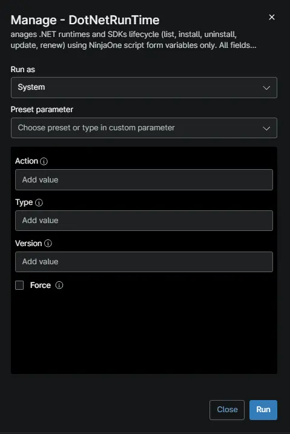

### Example 1: List all installed .NET components

### Example 2: List only .NET SDKs

- **Action:** `list`
- **Type:** `sdk`

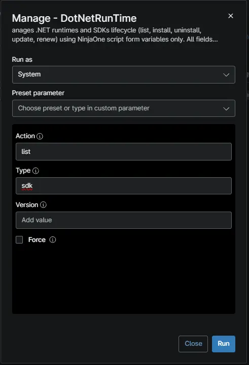

### Example 3: Install the latest versions of all .NET components

- **Action:** `install`
- **Type:** `all`

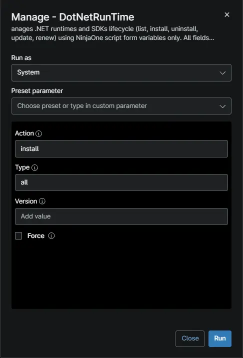

### Example 4: Update SDKs to the latest patch version

- **Action:** `update`
- **Type:** `sdk`

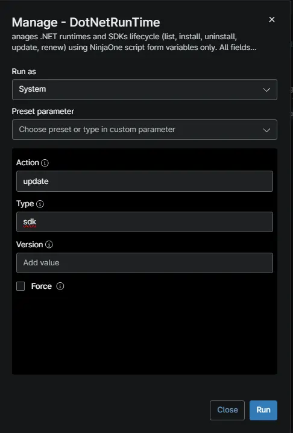

### Example 5: Remove unsupported ASP.NET Core versions

- **Action:** `uninstall`
- **Type:** `aspNetCoreRuntime`

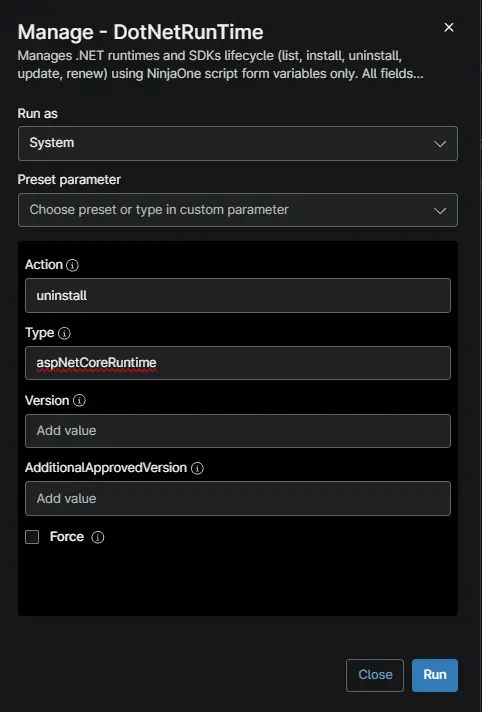

### Example 6: Removes all unsupported versions of .NET runtimes and SDKs and installs the latest available version

- **Action:** `renew`
- **Type:** `all`

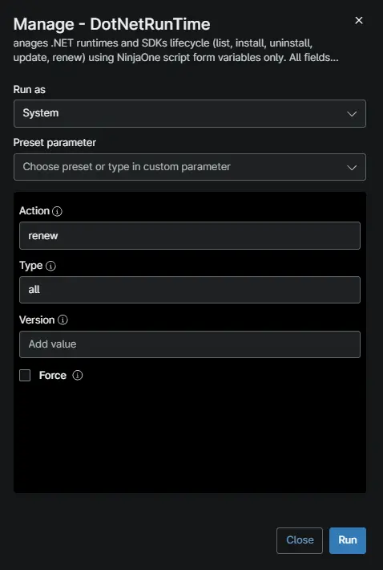

### Example 7: Install the latest .NET Desktop Runtime (default type)

- **Action:** `install`

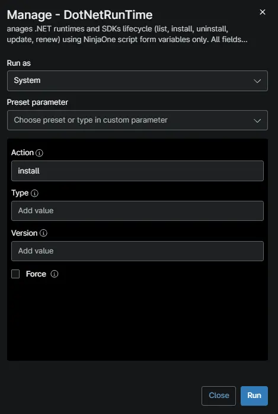

### Example 8: Install .NET 10 Desktop Runtime

- **Action:** `install`
- **Type:** `desktopRuntime`
- **Version:** `10`

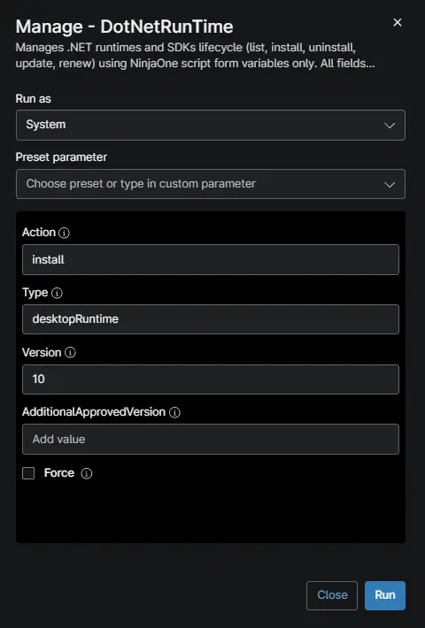

### Example 9: Install multiple specific versions

- **Action:** `install`
- **Type:** `desktopRuntime`
- **Version:** `8, 10`

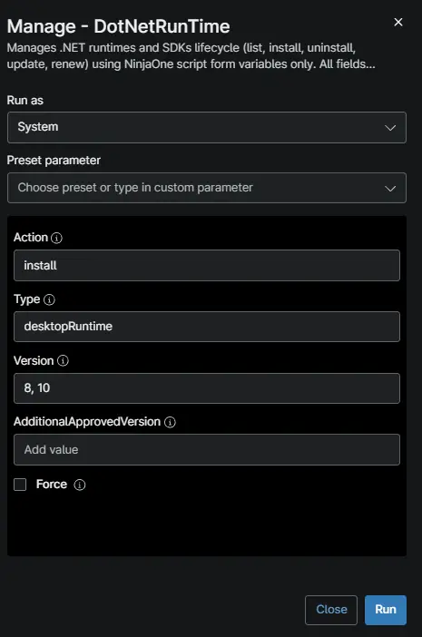

### Example 10: Update only .NET 8 to the latest patch

- **Action:** `update`
- **Type:** `desktopRuntime`
- **Version:** `9`

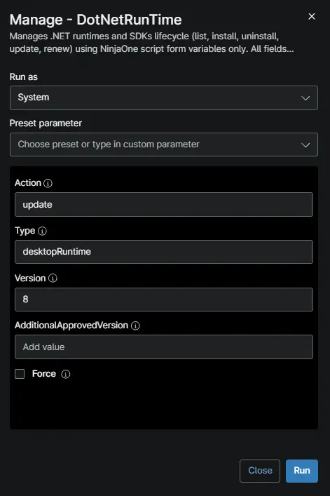

### Example 11: Update multiple versions to their latest patches

- **Action:** `update`
- **Type:** `all`
- **Version:** `6, 7, 8, 9`

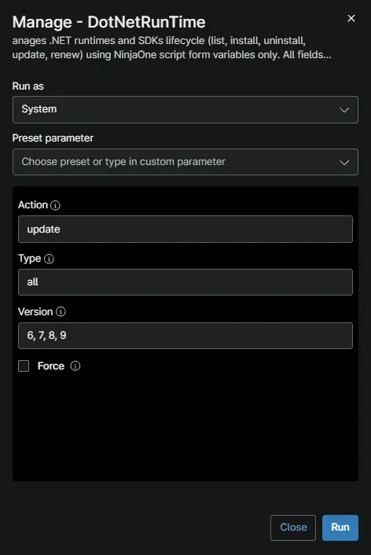

### Example 12: Remove specific .NET versions

- **Action:** `uninstall`
- **Type:** `all`
- **Version:** `6, 7`

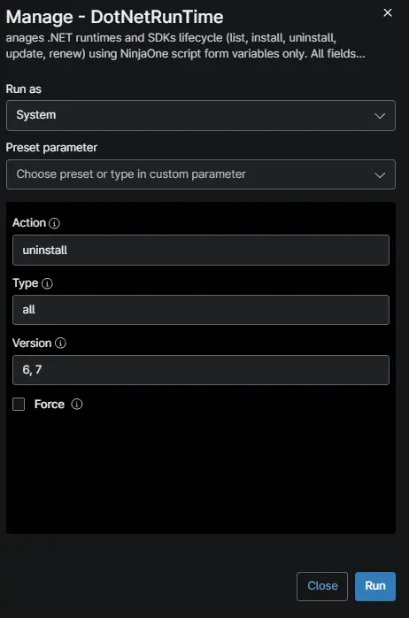

### Example 13: Keep only .NET 8 and .NET 9 and remove all others

- **Action:** `renew`
- **Type:** `all`
- **Version:** `6, 7, 8`

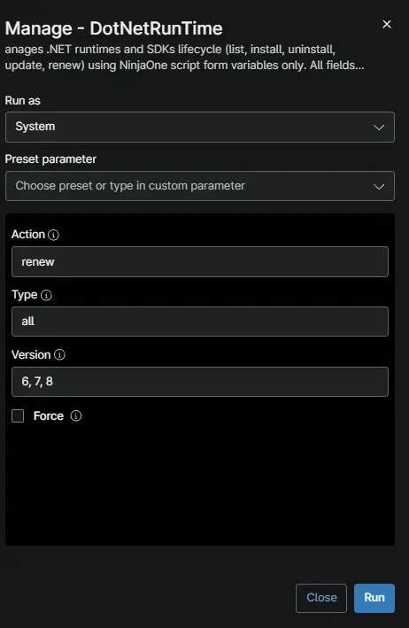

### Example 14: List only .NET 8 and .NET 9 components

- **Action:** `list`
- **Type:** `<Blank>`
- **Version:** `6, 7, 8`

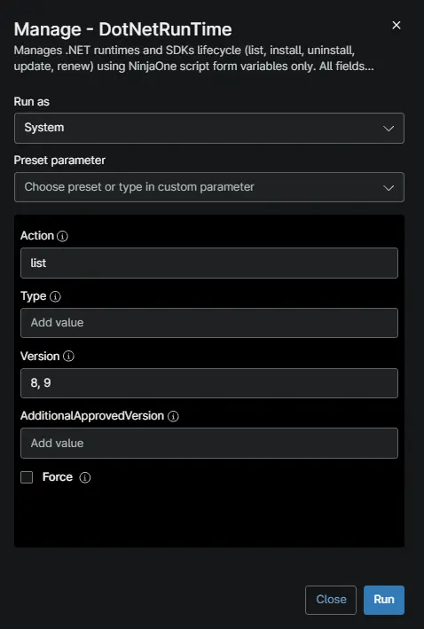

### Example 15: Keep only .NET 10 and remove all others

- **Action:** `renew`
- **Type:** `<Blank>`
- **Version:** `10`

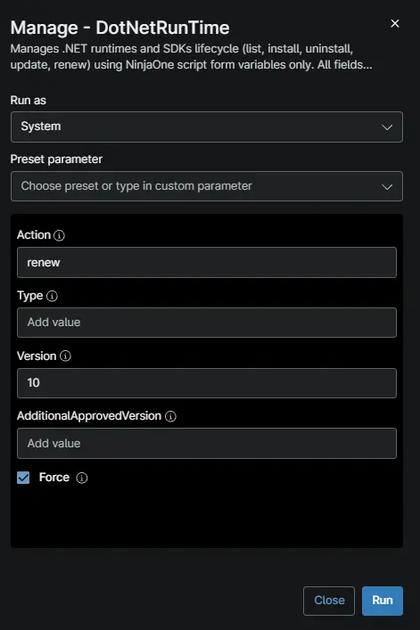

### Example 16: Force renew to .NET 10 only

- **Action:** `renew`
- **Type:** `all`
- **Version:** `10`
- **Force:** `1`

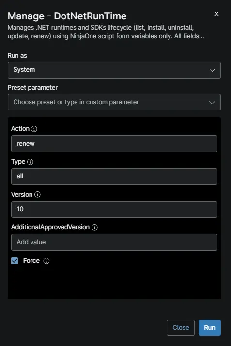

### Example 17: Force uninstall .NET 8

- **Action:** `uninstall`
- **Type:** `all`
- **Version:** `8`
- **Force:** `1`

## Requirements

- Supported operating system and device role
- Run As: `System`
- PowerShell 5.1

## User Parameters

| Name       | Example | Accepted Values | Required | Default | Type     | Description                                                   |
|------------|---------|-----------------|----------|---------|----------|---------------------------------------------------------------|
| `Action`  | `Install` | <ul><li>`list`</li><li>`install`</li><li>`uninstall`</li><li>`update`</li><li>`renew`</li></ul>             | False    | False   | `String/Text` | Optional. Specify the action to perform. Valid values: list, install, uninstall, update, renew. Defaults to 'list' when empty. |
| `Type`  | `all, sdk, runtime` | <ul><li>`sdk`</li><li>`runtime`</li><li>`desktopRuntime`</li><li>`aspNetCoreRuntime`</li><li>`all`</li></ul>  | False    | False   | `String/Text` | Optional. Comma-separated .NET component types to manage. Valid values: sdk, runtime, desktopRuntime, aspNetCoreRuntime, all. |
| `Version`  | `8, 9`      |<ul><li>`8`</li><li>`9`</li><li>`8, 9`</li></ul> | False    | False   | `String/Text`| Optional. Comma-separated .NET major version numbers (e.g., 8 or 8, 9, 10) to scope the action to. |
| `Force`  | `Checked, Unchecked` | <ul><li>`1`</li><li>`Yes`</li><li>`True`</li><li>`Blank`</li></ul>   | False    | False   | `CheckBox` | Optional. Check this box to force removal of components bypassing MSI dependency providers. CAUTION: May cause dependent applications to malfunction.. |

## Tips for `Version` Behavior

| Action | Without `Version` | With `Version` (e.g., `Version 8, 9`) |
| --- | --- | --- |
| `list` | Shows all installed .NET components | Shows only versions 8 and 9 |
| `install` | Installs the latest supported version | Installs the latest release for each specified version (EOL included with warning) |
| `update` | Updates only supported installed versions | Updates the specified version(s), including EOL |
| `uninstall` | Removes only unsupported/EOL versions | Removes the specified version(s), including supported |
| `renew` | Installs latest supported + removes all unsupported | Keeps only specified version(s), removes everything else. **Aborts if any version is EOL.** |

## `Force` Parameter - Caution

> **⚠️ WARNING:** The `Force` parameter overrides Windows Installer dependency protection. Use only when you fully understand the implications.

Without `Force` (or `Force =  false`), the script respects MSI dependency providers registered by other applications. If software such as Visual Studio, SQL Server, or third-party tools installed a .NET component and registered a dependency on it, the Windows Installer will silently refuse to remove it (returning exit code 0) to protect the dependent application. This is by design.

When `Force = True`, the script appends `IGNOREDEPENDENCIES=ALL` to all MSI uninstall commands, which:

- Bypasses the dependency provider safety check.
- Forces removal of the .NET component regardless of what other software depends on it.
- May cause dependent applications to malfunction, fail to start, or require repair/reinstallation.

**When to use `Force = 1`:**

- You are certain no critical software depends on the targeted .NET version.
- You are performing a controlled upgrade where a newer version will immediately replace the removed one (e.g., `Action: renew`, `Version: 10`, `Force: 1` installs .NET 10 before removing older versions).
- You need to clean up orphaned registry entries from partially removed installations.

**When NOT to use `Force = 1`:**

- On systems with Visual Studio, SQL Server, or other enterprise software that bundles .NET runtimes.
- On shared or production servers where breaking a dependency could disrupt services.
- When you are unsure which applications depend on the .NET components being removed.

## Automation Setup/Import

[Automation Configuration](https://github.com/ProVal-Tech/ninjarmm/blob/main/scripts/manage-dotnetruntime.ps1)

## Output

- Activity Details
- %ProgramData%\_Automation\Script\Optimize-DotNetRunTime\Optimize-DotNetRunTime-log.txt
- %ProgramData%\_Automation\Script\Optimize-DotNetRunTime\Optimize-DotNetRunTime-error.txt

## Changelog

### 2026-11-10

- Initial version of the document

