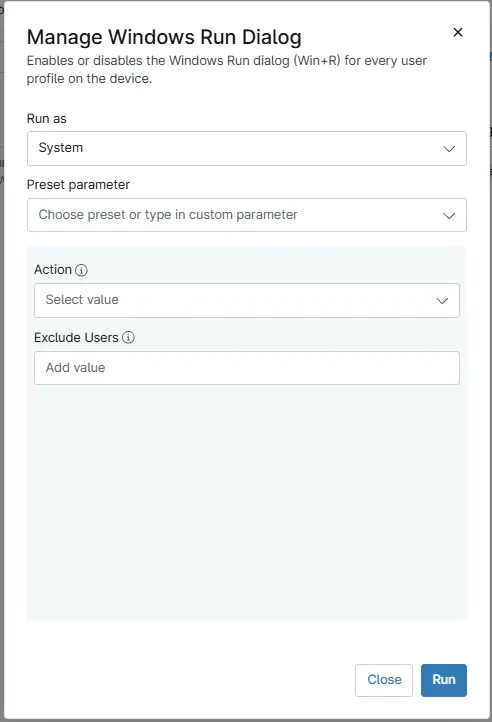

## Overview

Enables or disables the Windows Run dialog (Windows key + R) for every user profile on the device. It applies the same per-user setting as the Group Policy setting **Remove Run menu from Start Menu**, without needing Group Policy. When the Run dialog is disabled, it no longer opens with Windows key + R or from the Run entry on the Start button's right-click menu.

The automation updates every user who has a profile on the device, whether they're signed in or not. It also updates the Default User profile, so users who sign in for the first time later get the same setting. Built-in service accounts such as SYSTEM aren't changed, and excluded users keep their current setting.

Run it on demand, or let the compound conditions in the [Manage Windows Run Dialog - NinjaOne](/docs/8668290e-01bb-4501-be78-f2c2b626f3b7) solution run it based on the [cPVAL Windows_Run_Dialog Action](/docs/689ce4ff-e5ed-4f07-b9a8-3e1dd3738795) custom field.

:::note  
The change takes effect the next time each user signs in. Users who are signed in while the automation runs must sign out and back in, or the device must be restarted.  
:::

## Requirements

- Windows workstations and servers
- Run As: `System`
- PowerShell 3.0 or later

## Sample Run

1. On the device, select `Play Button` > `Run Automation` > `Script`.
2. Search for `Manage Windows Run Dialog` and select it.
3. Choose `Enable` or `Disable` in **Action**. Optionally, enter the users to leave unchanged in **Exclude Users**.
4. Leave Run As set to `System` and select `Run`.

## Parameters

Both parameters are optional. Leave them empty to use the custom fields, which is how the compound conditions run the automation.

| Name | Example | Accepted Values | Required | Default | Type | Description |
| ---- | ------- | --------------- | -------- | ------- | ---- | ----------- |
| Action | `Disable` | `Enable`, `Disable` | False | Empty, which uses [cPVAL Windows_Run_Dialog Action](/docs/689ce4ff-e5ed-4f07-b9a8-3e1dd3738795) | Drop-down | `Disable` blocks the Run dialog. `Enable` makes it available again. If neither this parameter nor the custom field is `Enable` or `Disable`, the automation fails without making changes. |
| Exclude Users | `Administrator,jdoe` | User names separated by commas | False | Empty | Text | Users whose profiles are left unchanged. Added to the names in [cPVAL Windows_Run_Dialog Exclude Users](/docs/6f5d07d7-7f29-45b8-ab1c-eab34a1dbe86). Matching isn't case-sensitive, and a domain prefix such as `CONTOSO\` is ignored. |

## Custom Fields

| Custom Field | Scope | Type | Description |
| ------------ | ----- | ---- | ----------- |
| [cPVAL Windows_Run_Dialog Action](/docs/689ce4ff-e5ed-4f07-b9a8-3e1dd3738795) | Organization, Location, Device | Drop-down | `Enable` or `Disable`. Used when the `Action` parameter is empty. The compound conditions run the automation only when the field is set to one of these. |
| [cPVAL Windows_Run_Dialog Exclude Users](/docs/6f5d07d7-7f29-45b8-ab1c-eab34a1dbe86) | Organization, Location, Device | Text | Users whose profiles are left unchanged, separated by commas. Always combined with the `Exclude Users` parameter. |

## Dependencies

* [Custom Field: cPVAL Windows_Run_Dialog Action](/docs/689ce4ff-e5ed-4f07-b9a8-3e1dd3738795)
* [Custom Field: cPVAL Windows_Run_Dialog Exclude Users](/docs/6f5d07d7-7f29-45b8-ab1c-eab34a1dbe86)
* [Compound Condition: Manage Windows Run Dialog - Workstations](/docs/0e2876ac-75e1-498b-a163-2a5d26fe2c1c)
* [Compound Condition: Manage Windows Run Dialog - Servers](/docs/b181197e-2971-4df6-b485-e5d8818978d8)
* [Solution: Manage Windows Run Dialog - NinjaOne](/docs/8668290e-01bb-4501-be78-f2c2b626f3b7)

## Automation Setup/Import

[Automation Configuration](https://github.com/ProVal-Tech/ninjarmm/blob/main/scripts/manage-windows-run-dialog.ps1)

## Output

- Activity Details

The activity details show the action and the excluded users, then one line for each profile:

| Line starts with | Meaning |
| ---------------- | ------- |
| `[OK]` | The profile was updated. |
| `[Skip]` | The profile belongs to an excluded user and wasn't changed. |
| `[Warn]` | Something needs attention. For example, the Run dialog is also blocked for the whole computer, so `Enable` has no visible effect. |
| `[Error]` | The profile couldn't be updated, or the automation couldn't run. |

The automation shows as failed when any line starts with `[Error]`. Profiles without an error are still updated.

## Changelog

### 2026-11-24

- Initial version of the document
