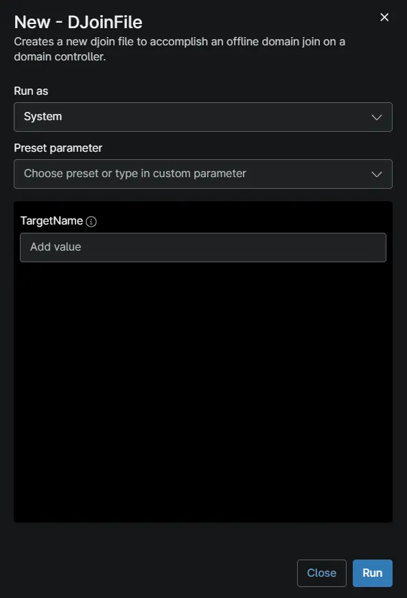

## Overview

This automation runs `djoin.exe /provision` on a domain controller to create an offline domain join (ODJ) provisioning file for the computer name supplied in the `TargetName` variable. The computer account is created (or reused if it already exists) in the domain of the domain controller, and the provisioning blob is saved to `C:\ProgramData\_Automation\Script\New-DJoinFile\<TargetName>-OfflineJoin.txt` on the domain controller. Use it when a machine needs to be joined to the domain without line-of-sight to a domain controller, for example during imaging or for remote devices.

:::note
Run this automation against a **domain controller**, not against the machine that is being joined. The provisioning file stays on the domain controller; it must be copied to the target machine and applied there with `djoin.exe /requestODJ /loadfile <TargetName>-OfflineJoin.txt /windowspath %SystemRoot% /localos`, followed by a restart.

The `/REUSE` switch is used, so if a computer account with the same name already exists in Active Directory, it will be reused and its password reset.
:::

## Requirements

- Windows Server with the `AD-Domain-Services` role installed (domain controller)
- Run As: `System`
- PowerShell 5.1
- Internet access to `contentrepo.net` to download the signed agnostic script
- `TargetName` must be a valid NetBIOS computer name: 15 characters or fewer, letters, numbers, and hyphens only, and not numbers only

## Sample Run

## Parameters

| Name | Example | Required | Type | Description |
| ---- | ------- | -------- | ---- | ----------- |
| `TargetName` | `Dev-Win10-2` | True | String | Computer name of the machine to provision for offline domain join. Used as the `djoin /machine` argument and to name the output file `<TargetName>-OfflineJoin.txt`. |

## Dependencies

[Generate DJoin File [Domain Controller]](/docs/d1313948-cbd2-420e-b5af-f633b894edeb)

## Automation Setup/Import

[Automation Configuration](https://github.com/ProVal-Tech/ninjarmm/blob/main/scripts/new-djoinfile.ps1)

## Output

- Activity Details
- Provisioning file on the domain controller: `C:\ProgramData\_Automation\Script\New-DJoinFile\<TargetName>-OfflineJoin.txt`
- Log files:
  - `C:\ProgramData\_Automation\Script\New-DJoinFile\New-DJoinFile-log.txt`
  - `C:\ProgramData\_Automation\Script\New-DJoinFile\New-DJoinFile-error.txt`

## Changelog

### 2026-11-13

- Initial version of the document