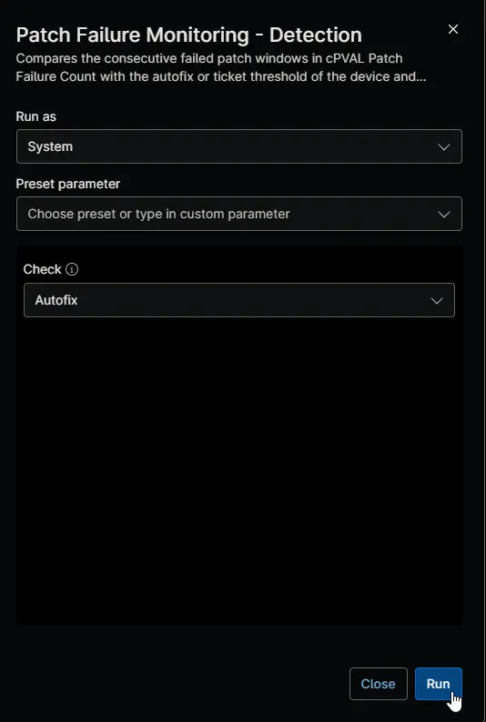
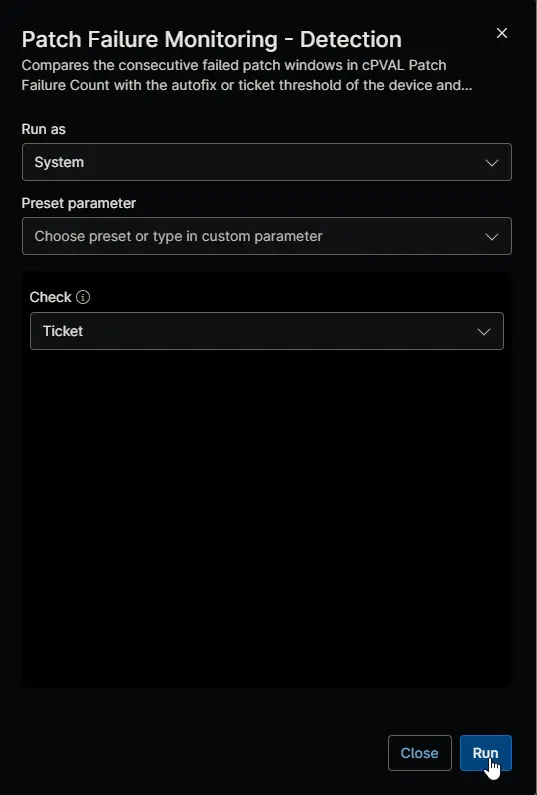

## Overview

This automation is the detection script of the [Patch Failure Monitoring - NinjaOne](/docs/020ff3c5-06a6-4f98-9eaa-7f7392b2257a) compound conditions. It compares [cPVAL Patch Failure Count](/docs/02b8e35f-c8dd-4685-a00b-412fd0112c7c) with the autofix and ticket thresholds that apply to the device, and the **Check** script variable tells it which compound condition runs it:

- **Autofix:** when the count has reached the autofix threshold but not the ticket threshold, and no repair was requested since the latest failed patch window started, it writes the current time to [cPVAL Patch Failure Autofix Date](/docs/6a454795-0de4-40c9-ab25-d016b42ccd7a), then exits with `1` and a line beginning with `Failure: Autofix required`. The compound condition then runs [Repair Windows Update](/docs/d7bb77e6-e7b8-45d2-9fa7-f109574aa887).
- **Ticket:** when the count has reached the ticket threshold, it exits with `1` and a line beginning with `Failure: Ticket required`, followed by the failed patch windows, the KB number and name of each failed update, when the repair ran and what to try next. The compound condition then creates a ticket with this text.

:::note  
The compound conditions run this automation every hour, so you don't need to run it yourself. It exits with `0` when no action is needed, and with `2` and a line beginning with `Error:` when a custom field can't be read or written, so neither compound condition acts on a script problem. A ticket threshold equal to or lower than the autofix threshold is treated as the autofix threshold + 1.  
:::

## Requirements

- Windows 10, Windows 11, or Windows Server 2012 R2 or later
- Run As: `System`
- PowerShell 5.1

## Sample Run

### Autofix check

Run by the autofix compound conditions.

| Script Variable | Value |
| --------------- | ----- |
| Check | `Autofix` |

### Ticket check

Run by the ticket compound conditions.

| Script Variable | Value |
| --------------- | ----- |
| Check | `Ticket` |

## Parameters

| Name | Calculated Name | Example | Accepted Values | Required | Default | Type | Description |
| ---- | --------------- | ------- | --------------- | -------- | ------- | ---- | ----------- |
| Check | check | `Autofix` | `Autofix`, `Ticket` | True | | Drop-down | `Autofix` in the autofix compound conditions, `Ticket` in the ticket compound conditions. |

## Scenarios

- **Autofix due:** a server has `1` consecutive failed patch window, an autofix threshold of `1` and a ticket threshold of `2`. With **Check** set to `Autofix`, the automation records the time in [cPVAL Patch Failure Autofix Date](/docs/6a454795-0de4-40c9-ab25-d016b42ccd7a), exits with `1` and lists the failed updates.
- **Autofix already requested:** the repair was requested after the latest failed window started. The automation exits with `0`, so the repair runs only once per failed window.
- **Ticket due:** the count has reached the ticket threshold. With **Check** set to `Ticket`, the automation exits with `1` and reports the failed windows, the failed KB updates, when [Repair Windows Update](/docs/d7bb77e6-e7b8-45d2-9fa7-f109574aa887) was requested and whether the window after it still failed. With **Check** set to `Autofix`, it exits with `0`, because the ticket takes over.
- **Below the threshold, or threshold disabled:** the automation exits with `0` and reports the count and thresholds. A threshold of `0` or blank at every level disables the autofix or the ticket.
- **Device not monitored:** [cPVAL Patch Failure Monitoring](/docs/b3797751-cb85-4d82-b943-3bde379d6481) doesn't cover the device. The automation exits with `0` without checking.

## Custom Fields

| Custom Field | Scope | Type | Description |
| ------------ | ----- | ---- | ----------- |
| [cPVAL Patch Failure Monitoring](/docs/b3797751-cb85-4d82-b943-3bde379d6481) | System, Organization, Location, Device | Drop-down | Read, with inheritance, to check that the device is monitored. |
| [cPVAL Patch Failure Autofix Server](/docs/62bf3875-c734-48e8-b518-b53373a9137e) | System, Organization, Location, Device | Integer | Read on servers for the autofix threshold. |
| [cPVAL Patch Failure Autofix Workstation](/docs/04f87a60-2857-4253-bca8-f4addd2f71fe) | System, Organization, Location, Device | Integer | Read on workstations for the autofix threshold. |
| [cPVAL Patch Failure Ticket Server](/docs/3c54b72d-8fb2-49bd-a2a2-5c6b08833b12) | System, Organization, Location, Device | Integer | Read on servers for the ticket threshold. |
| [cPVAL Patch Failure Ticket Workstation](/docs/4e93e558-3a43-4d58-b60b-e6391fb79e46) | System, Organization, Location, Device | Integer | Read on workstations for the ticket threshold. |
| [cPVAL Patch Failure Count](/docs/02b8e35f-c8dd-4685-a00b-412fd0112c7c) | Device | Integer | Read for the number of consecutive failed patch windows. |
| [cPVAL Patch Failure Last Window](/docs/5b700551-2f69-4ac2-9489-bfa279c8d7ac) | Device | Date/Time | Read to run the repair once per failed patch window. |
| [cPVAL Patch Failure Autofix Date](/docs/6a454795-0de4-40c9-ab25-d016b42ccd7a) | Device | Date/Time | Written when the repair is requested, and read for the ticket. |
| [cPVAL Patch Failure Detail](/docs/b23a6da2-148f-4649-9233-c02170b5e72f) | Device | Multi-line | Read for the failed patch windows and updates added to the output. |

:::note  
Every field needs its **Automation** permission set to **Read Only** or **Read/Write**, and [cPVAL Patch Failure Autofix Date](/docs/6a454795-0de4-40c9-ab25-d016b42ccd7a) needs **Read/Write**.  
:::

## Dependencies

* [Custom Field: cPVAL Patch Failure Monitoring](/docs/b3797751-cb85-4d82-b943-3bde379d6481)
* [Custom Field: cPVAL Patch Failure Count](/docs/02b8e35f-c8dd-4685-a00b-412fd0112c7c)
* [Custom Field: cPVAL Patch Failure Last Window](/docs/5b700551-2f69-4ac2-9489-bfa279c8d7ac)
* [Custom Field: cPVAL Patch Failure Autofix Date](/docs/6a454795-0de4-40c9-ab25-d016b42ccd7a)
* [Custom Field: cPVAL Patch Failure Detail](/docs/b23a6da2-148f-4649-9233-c02170b5e72f)
* [Compound Condition: Patch Failure Monitoring - Autofix [Windows Servers]](/docs/ae7d3fd7-d4b4-4e0e-88a4-ed917a5dd402)
* [Compound Condition: Patch Failure Monitoring - Autofix [Windows Workstations]](/docs/6da0c83e-d6bd-4b4a-985b-6b7b6b2d7774)
* [Compound Condition: Patch Failure Monitoring - Ticket [Windows Servers]](/docs/fafe75cc-3caa-4713-9f78-507ad9eec3b5)
* [Compound Condition: Patch Failure Monitoring - Ticket [Windows Workstations]](/docs/d4488df1-2292-4886-ab7a-46207ec6f856)
* [Automation: Repair Windows Update](/docs/d7bb77e6-e7b8-45d2-9fa7-f109574aa887)
* [Ticket Template: Consecutive Patch Failures](/docs/d5aaffa6-061b-4349-86f3-cf30b9a3cd14)
* [Solution: Patch Failure Monitoring - NinjaOne](/docs/020ff3c5-06a6-4f98-9eaa-7f7392b2257a)

## Automation Setup/Import

[Automation Configuration](https://github.com/ProVal-Tech/ninjarmm/blob/main/scripts/patch-failure-monitoring-detection.ps1)

## Output

- Activity Details
- Custom Field: [cPVAL Patch Failure Autofix Date](/docs/6a454795-0de4-40c9-ab25-d016b42ccd7a)

## Changelog

### 2026-11-23

- Initial version of the document
