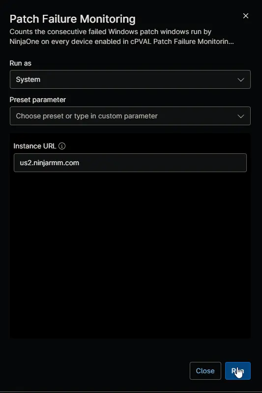
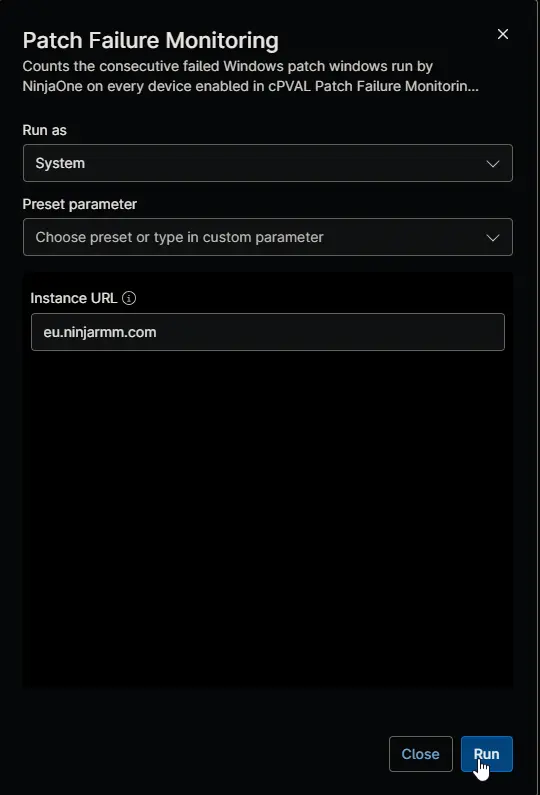

## Overview

This automation is the engine of the [Patch Failure Monitoring - NinjaOne](/docs/020ff3c5-06a6-4f98-9eaa-7f7392b2257a) solution. It reads the NinjaOne patch activity of every Windows device monitored through [cPVAL Patch Failure Monitoring](/docs/b3797751-cb85-4d82-b943-3bde379d6481), works out which patch windows failed, and keeps the number of consecutive failed windows in [cPVAL Patch Failure Count](/docs/02b8e35f-c8dd-4685-a00b-412fd0112c7c). It also writes the start of the latest failed window to [cPVAL Patch Failure Last Window](/docs/5b700551-2f69-4ac2-9489-bfa279c8d7ac), the failed KB updates to [cPVAL Patch Failure Detail](/docs/b23a6da2-148f-4649-9233-c02170b5e72f) and a status table to [cPVAL Patch Failure Status](/docs/6d0d7b7c-f71d-4db9-9767-e3b7cd4846cd). The autofix and ticket compound conditions act on these fields.

:::note  
The [Patch Failure Monitoring](/docs/ffc02ba6-8c07-4075-9844-2e7327723023) scheduled task runs this automation once a day on **one** device. Don't schedule it anywhere else: every run covers the whole tenant, so running it on more devices only repeats the work and uses up the API rate limit. The automation changes nothing on the device it runs on.  
:::

:::note  
Every time it writes is in the time zone of the device it runs on, which the TimeZone column of [cPVAL Patch Failure Status](/docs/6d0d7b7c-f71d-4db9-9767-e3b7cd4846cd) and each line of [cPVAL Patch Failure Detail](/docs/b23a6da2-148f-4649-9233-c02170b5e72f) show, for example `Eastern Standard Time (UTC-05:00)`.  
:::

## Requirements

- One Windows device that's always online, such as a server
- Run As: `System`
- PowerShell 5.1
- HTTPS access from that device to the NinjaOne instance
- An API application with the **Client Credentials** grant type and the **Monitoring** and **Management** scopes, stored in [cPVAL Ninja API Client ID](/docs/32142af2-d352-4d0d-9ec3-9dae0a5fef88) and [cPVAL Ninja API Client Secret](/docs/58b01634-4e1a-4793-aafd-18526ea8c80e). The application used by [WYSIWYG Custom Field Report - Organization and Global KB](/docs/67df14cd-3c20-4a40-bb7a-80caae242687) works.

## How It Works

1. **Authenticate:** reads the Client ID and Client Secret from the secure custom fields and signs in to the NinjaOne API.
2. **Read:** reads every Windows device, the Patch Failure Monitoring custom fields at every level, and the NinjaOne patch activity of the last 48 hours. Only OS patch runs started by NinjaOne leave this activity.
3. **Group:** groups the patch runs of each monitored device into patch windows. Runs that start within 23 hours of the first run of a window belong to that window. A device seen for the first time only counts the windows of the last 24 hours.
4. **Count:** decides whether each window failed from its last run. A window fails when that run reports failed updates and at least one of them has a KB number. A failed window adds 1 to the count, and a successful window resets it to 0. A window already counted by an earlier run is updated, not counted again.
5. **Record:** updates [cPVAL Patch Failure Count](/docs/02b8e35f-c8dd-4685-a00b-412fd0112c7c), [cPVAL Patch Failure Last Window](/docs/5b700551-2f69-4ac2-9489-bfa279c8d7ac), [cPVAL Patch Failure Detail](/docs/b23a6da2-148f-4649-9233-c02170b5e72f) and [cPVAL Patch Failure Status](/docs/6d0d7b7c-f71d-4db9-9767-e3b7cd4846cd) where a value changed. When the count resets, it also clears [cPVAL Patch Failure Autofix Date](/docs/6a454795-0de4-40c9-ab25-d016b42ccd7a), Last Window and Detail. It clears every patch failure field of the devices no longer monitored.

## Sample Run

### Default settings

Run once a day by the [Patch Failure Monitoring](/docs/ffc02ba6-8c07-4075-9844-2e7327723023) scheduled task on one device of a US2 instance.

| Script Variable | Value |
| --------------- | ----- |
| Instance URL | `us2.ninjarmm.com` |

### Another NinjaOne instance

Run once a day on one device of an EU instance.

| Script Variable | Value |
| --------------- | ----- |
| Instance URL | `eu.ninjarmm.com` |

## Parameters

| Name | Calculated Name | Example | Accepted Values | Required | Default | Type | Description |
| ---- | --------------- | ------- | --------------- | -------- | ------- | ---- | ----------- |
| Instance URL | instanceUrl | `us2.ninjarmm.com` | Any valid NinjaOne instance host | False | `us2.ninjarmm.com` | string/text | NinjaOne instance the API application belongs to. Must match the tenant's region. |

## Custom Fields

| Custom Field | Scope | Type | Description |
| ------------ | ----- | ---- | ----------- |
| [cPVAL Ninja API Client ID](/docs/32142af2-d352-4d0d-9ec3-9dae0a5fef88) | System | Secure | Client ID of the API application. Read at runtime. |
| [cPVAL Ninja API Client Secret](/docs/58b01634-4e1a-4793-aafd-18526ea8c80e) | System | Secure | Client Secret of the API application. Read at runtime. |
| [cPVAL Patch Failure Monitoring](/docs/b3797751-cb85-4d82-b943-3bde379d6481) | System, Organization, Location, Device | Drop-down | Which Windows devices are monitored. |
| [cPVAL Patch Failure Autofix Server](/docs/62bf3875-c734-48e8-b518-b53373a9137e) | System, Organization, Location, Device | Integer | Read to show the autofix threshold of servers in the status table. |
| [cPVAL Patch Failure Autofix Workstation](/docs/04f87a60-2857-4253-bca8-f4addd2f71fe) | System, Organization, Location, Device | Integer | Read to show the autofix threshold of workstations in the status table. |
| [cPVAL Patch Failure Ticket Server](/docs/3c54b72d-8fb2-49bd-a2a2-5c6b08833b12) | System, Organization, Location, Device | Integer | Read to show the ticket threshold of servers in the status table. |
| [cPVAL Patch Failure Ticket Workstation](/docs/4e93e558-3a43-4d58-b60b-e6391fb79e46) | System, Organization, Location, Device | Integer | Read to show the ticket threshold of workstations in the status table. |
| [cPVAL Patch Failure Count](/docs/02b8e35f-c8dd-4685-a00b-412fd0112c7c) | Device | Integer | Written with the number of consecutive failed patch windows. |
| [cPVAL Patch Failure Last Window](/docs/5b700551-2f69-4ac2-9489-bfa279c8d7ac) | Device | Date/Time | Written with the start of the latest failed patch window. Cleared when the count resets. |
| [cPVAL Patch Failure Autofix Date](/docs/6a454795-0de4-40c9-ab25-d016b42ccd7a) | Device | Date/Time | Read to show the last repair and its outcome. Cleared when the count resets. |
| [cPVAL Patch Failure Detail](/docs/b23a6da2-148f-4649-9233-c02170b5e72f) | Device | Multi-line | Written with one line per failed patch window and its failed KB updates. Cleared when the count resets. |
| [cPVAL Patch Failure Status](/docs/6d0d7b7c-f71d-4db9-9767-e3b7cd4846cd) | Device | WYSIWYG | Written with the count, thresholds, latest patch windows and repair outcome. |

:::note  
Every Patch Failure Monitoring custom field needs its **API** permission set to **Read Only** or **Read/Write**, and [cPVAL Patch Failure Count](/docs/02b8e35f-c8dd-4685-a00b-412fd0112c7c), [cPVAL Patch Failure Last Window](/docs/5b700551-2f69-4ac2-9489-bfa279c8d7ac), [cPVAL Patch Failure Autofix Date](/docs/6a454795-0de4-40c9-ab25-d016b42ccd7a), [cPVAL Patch Failure Detail](/docs/b23a6da2-148f-4649-9233-c02170b5e72f) and [cPVAL Patch Failure Status](/docs/6d0d7b7c-f71d-4db9-9767-e3b7cd4846cd) need **Read/Write**.  
:::

## Dependencies

* [Custom Field: cPVAL Ninja API Client ID](/docs/32142af2-d352-4d0d-9ec3-9dae0a5fef88)
* [Custom Field: cPVAL Ninja API Client Secret](/docs/58b01634-4e1a-4793-aafd-18526ea8c80e)
* [Custom Field: cPVAL Patch Failure Monitoring](/docs/b3797751-cb85-4d82-b943-3bde379d6481)
* [Custom Field: cPVAL Patch Failure Autofix Server](/docs/62bf3875-c734-48e8-b518-b53373a9137e)
* [Custom Field: cPVAL Patch Failure Autofix Workstation](/docs/04f87a60-2857-4253-bca8-f4addd2f71fe)
* [Custom Field: cPVAL Patch Failure Ticket Server](/docs/3c54b72d-8fb2-49bd-a2a2-5c6b08833b12)
* [Custom Field: cPVAL Patch Failure Ticket Workstation](/docs/4e93e558-3a43-4d58-b60b-e6391fb79e46)
* [Custom Field: cPVAL Patch Failure Count](/docs/02b8e35f-c8dd-4685-a00b-412fd0112c7c)
* [Custom Field: cPVAL Patch Failure Last Window](/docs/5b700551-2f69-4ac2-9489-bfa279c8d7ac)
* [Custom Field: cPVAL Patch Failure Autofix Date](/docs/6a454795-0de4-40c9-ab25-d016b42ccd7a)
* [Custom Field: cPVAL Patch Failure Detail](/docs/b23a6da2-148f-4649-9233-c02170b5e72f)
* [Custom Field: cPVAL Patch Failure Status](/docs/6d0d7b7c-f71d-4db9-9767-e3b7cd4846cd)
* [Automation: Patch Failure Monitoring - Detection](/docs/97aa8bfb-f376-4acf-8241-782c364d3d18)
* [Scheduled Task: Patch Failure Monitoring](/docs/ffc02ba6-8c07-4075-9844-2e7327723023)
* [Audit Report: Patch Failure Monitoring Status](/docs/e475c21b-05a9-40a5-bea2-efd7e0515930)
* [Solution: Patch Failure Monitoring - NinjaOne](/docs/020ff3c5-06a6-4f98-9eaa-7f7392b2257a)

## Automation Setup/Import

[Automation Configuration](https://github.com/ProVal-Tech/ninjarmm/blob/main/scripts/patch-failure-monitoring.ps1)

## Output

- Activity Details, ending with a run summary
- Custom Field: [cPVAL Patch Failure Count](/docs/02b8e35f-c8dd-4685-a00b-412fd0112c7c)
- Custom Field: [cPVAL Patch Failure Last Window](/docs/5b700551-2f69-4ac2-9489-bfa279c8d7ac)
- Custom Field: [cPVAL Patch Failure Detail](/docs/b23a6da2-148f-4649-9233-c02170b5e72f)
- Custom Field: [cPVAL Patch Failure Status](/docs/6d0d7b7c-f71d-4db9-9767-e3b7cd4846cd)

## Changelog

### 2026-11-23

- Initial version of the document
