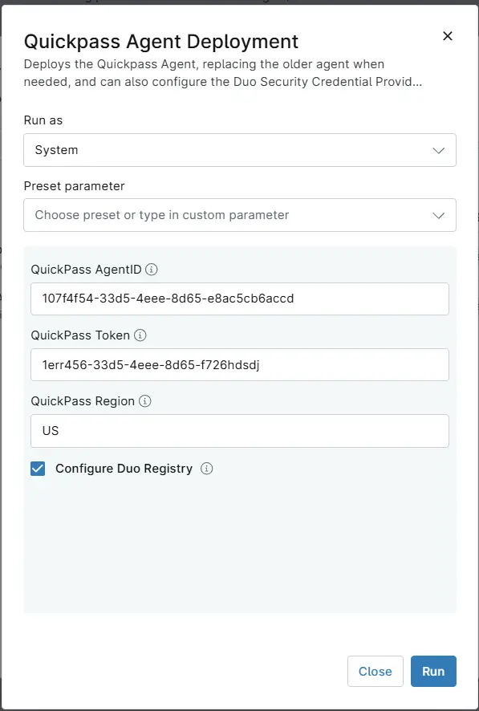

## Overview

Deploys the Quickpass Agent, replacing the older agent when needed, and can also configure the Duo Security Credential Provider to allow Quickpass.

## Requirements

- Windows
- Run As: `System`
- PowerShell 5.1

## Sample Run

## Parameters

| Name | Example | Accepted Values | Required | Default | Type | Description |
| ---- | ------- | --------------- | -------- | ------- | ---- | ----------- |
| QuickPass AgentID | `107f4f54-33d5-4eee-8d65-e8ac5cb6accd` |  | `False` | - | Text | Enter the Quickpass Agent ID to associate the endpoint with the correct client organization for centralized management and site-level administration. |
| QuickPass Token | `1err456-33d5-4eee-8d65-f726hdsdj` |  | `False` | - | Text | Enter the Quickpass Token to authenticate the installer and associate the endpoint with the correct MSP/tenant account. |
| QuickPass Region | `1err456-33d5-4eee-8d65-f726hdsdj` |  | `False` | - | Text | Enter the Quickpass Region to connect the agent to the appropriate regional Quickpass service endpoint for installation and communication. |
| Configure Duo Registry | |  | `False` | - | Checkbox | Select it to configure the Duo Security Credential Provider to allow Quickpass. |

## Custom Fields

| Custom Field | Scope | Type | Description |
| ------------ | ----- | ---- | ----------- |
| [Custom Field - cPVAL Quickpass AgentID](/docs/851f4987-7956-4118-9cb7-fa7bbb7eaf88) | `Organization`, `Location`, `Device` | Text | Custom field to enter the Quickpass Agent ID to associate the endpoint with the correct client organization for centralized management and site-level administration. |
| [Custom Field - cPVAL Quickpass Token](/docs/3a6239b1-a7d1-470a-80de-f633f69d9691) | `Organization`, `Location`, `Device` | Text | Custom Field to enter the Quickpass Token to authenticate the installer and associate the endpoint with the correct MSP/tenant account. |
| [Custom Field - cPVAL Quickpass Region](/docs/3a6239b1-a7d1-470a-80de-f633f69d9691) | `Organization`, `Location`, `Device` | Text | Custom field to enter the Quickpass Region to connect the agent to the appropriate regional Quickpass service endpoint for installation and communication. |

## Dependencies

* [Custom Field - cPVAL Quickpass AgentID](/docs/851f4987-7956-4118-9cb7-fa7bbb7eaf88)
* [Custom Field - cPVAL Quickpass Token](/docs/3a6239b1-a7d1-470a-80de-f633f69d9691)
* [Custom Field - cPVAL Quickpass Region](/docs/3a6239b1-a7d1-470a-80de-f633f69d9691)
* [Solution - Deploy Quickpass Agent](/docs/a68fa93c-45c7-4491-80d1-5e7543016b7f)

## Automation Setup/Import

[Automation Configuration](https://github.com/ProVal-Tech/ninjarmm/blob/main/scripts/quickpass-agent-deployment.ps1)

## Output

- Activity Details

## Changelog

### 2026-10-21

- Initial version of the document
