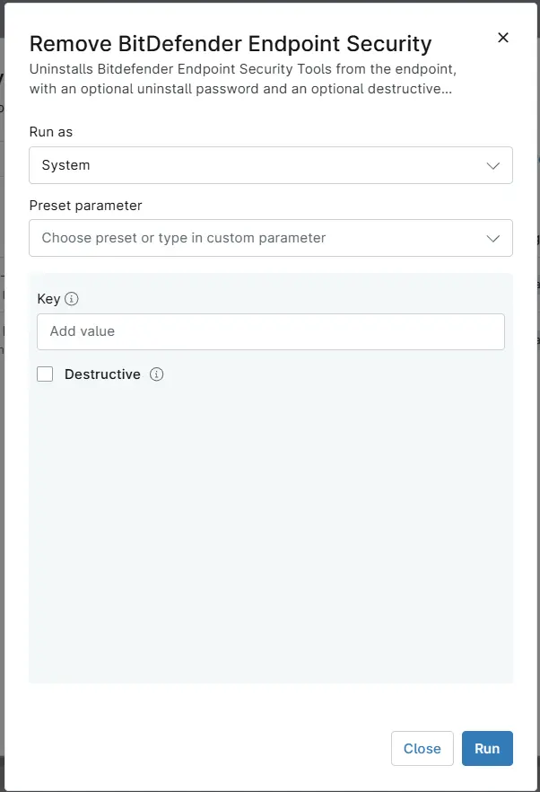

## Overview

Uninstalls Bitdefender Endpoint Security Tools from the endpoint, with an optional uninstall password and an optional destructive (forced) removal mode.

## Requirements

- Windows
- Run As: `System`

## Sample Run

## Parameters

| Name | Example | Accepted Values | Required | Default | Type | Description |
| ---- | ------- | --------------- | -------- | ------- | ---- | ----------- |
| Key | `gqwej-ashdsd-jkasdj-asjdkla` |  | `False` | - | Text | Uninstall password for Bitdefender Endpoint Security Tools. Required only when the Bitdefender policy protects the agent from removal with a password. |
| Destructive |  |  | `False` | - | Checkbox | Select to perform a forced removal that also cleans up leftover Bitdefender services, drivers, files, and registry entries. Use only when the standard uninstall fails. |

## Automation Setup/Import

[Automation Configuration](https://github.com/ProVal-Tech/ninjarmm/blob/main/scripts/remove-bitdefender-endpoint-security.ps1)

## Output

- Activity Details

## Changelog

### 2026-10-22

- Initial version of the document
