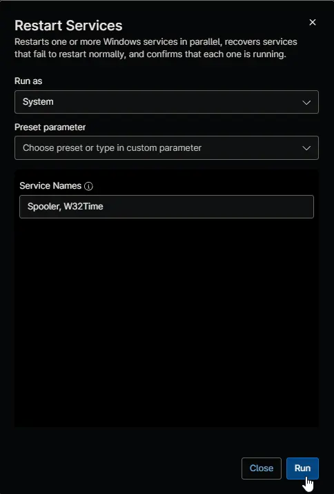
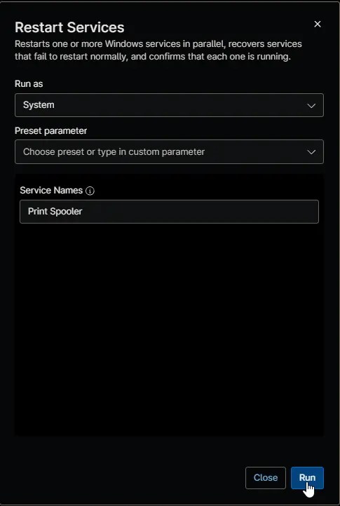

## Overview

This automation restarts one or more Windows services on a device at the same time and confirms that each one is running afterward. When a service doesn't restart normally, the automation recovers it by forcefully ending its process and starting it again, unless that process also runs other services. The result of each service shows in the activity details. Run it by hand for a one-off fix, or attach it to a condition so NinjaOne restarts a service on its own whenever it goes down, as described in [Ways to Use This Automation](#ways-to-use-this-automation). The automation runs the [Invoke-RestartService](/docs/df5d8267-5836-48d8-8971-a5cc8b33722d) script.

:::note  
The automation shows as failed when a service in **Service Names** isn't found or isn't running after the restart. Services set to Disabled are skipped and don't fail the run.  
:::

## Requirements

- Windows workstation or server
- Run As: `System`
- PowerShell 5.1
- Internet access to ProVal's content repository and the PowerShell Gallery, to download the script and the Strapper module
- A script timeout of at least 2 minutes, plus 1 minute for each service that may need recovery

## Sample Run

Restart several services at once, with **Service Names** set to `Spooler, W32Time`:

Restart a service by its display name, with **Service Names** set to `Print Spooler`:

## Parameters

| Name | Example | Required | Type | Description |
| ---- | ------- | -------- | ---- | ----------- |
| Service Names | `Spooler, W32Time` | True | String/Text | Comma-separated names of the services to restart. Display names and wildcards also work, and spaces and quotes around the names are ignored. |

## Ways to Use This Automation

### Run It Manually

Run **Restart Services** on a device as an ad hoc automation, with **Service Names** set to the services to restart. Use this for a one-off fix, or to restart several services together. To restart a service at a set time, for example every night, add the automation to the policy's **Scheduled Automations** with the same variable.

### Keep a Service Running With a Condition (Recommended)

Attach the automation to a **Windows Service** condition, and NinjaOne restarts the service on its own whenever it goes down. If the restart doesn't bring the service back, the condition stays triggered and the automation's activity shows as failed, with the reason in its output.

1. In the agent policy, or in a policy override on a single device, add a condition and select **Windows Service**.
2. Select the service to watch, and set the condition to trigger when the service is **Down**.
3. Set **Start alerting after** to a few minutes, so the restart doesn't run while the device is still starting up.
4. In **Advanced Settings**:
    - Select **Ignore if service is disabled**. Select **Ignore if service is manual** too, unless the service must always run even though its startup type is Manual.
    - Leave **Trigger again if condition still true after reset** cleared. Otherwise, the condition runs the automation again after every reset while the service stays down, restarting a failing service over and over.
5. In the **Automation** section, click **Add**, select **Restart Services**, and set **Service Names** to the service the condition watches.
6. Optionally, add a notification or a ticketing rule. NinjaOne sends it when the condition triggers, so it arrives even when the restart fixes the service.
7. Save the condition and the policy.

:::note  
Create one condition for each service, with only that service in **Service Names**. A condition that restarts several services would also restart the ones that are still running.  
:::

### Use a Compound Condition

Use a compound condition when the restart should depend on more than the service itself, for example only on devices with a specific role or software, or only when a custom field turns it on for the device. Add a **Windows Service** condition that triggers when the service is **Down**, add the other conditions, then add **Restart Services** on the compound condition's **Automations** tab, with **Service Names** set to that service.

## Dependencies

- [Invoke-RestartService](/docs/df5d8267-5836-48d8-8971-a5cc8b33722d)

## Automation Setup/Import

[Automation Configuration](https://github.com/ProVal-Tech/ninjarmm/blob/main/scripts/restart-services.ps1)

## Output

- Activity Details

## Changelog

### 2026-11-10

- Renamed the automation to Restart Services.
- Added ways to use the automation: manually, and as an autofix from a condition or a compound condition.
- The automation now checks the code signature of the [Invoke-RestartService](/docs/df5d8267-5836-48d8-8971-a5cc8b33722d) script before running it, and uses its new recovery, shared process protection and per-service results.
- The automation now shows as failed when a service isn't found or couldn't be restarted.
- Updated the document to the new format.

### 2025-12-17

- Initial version of the document
