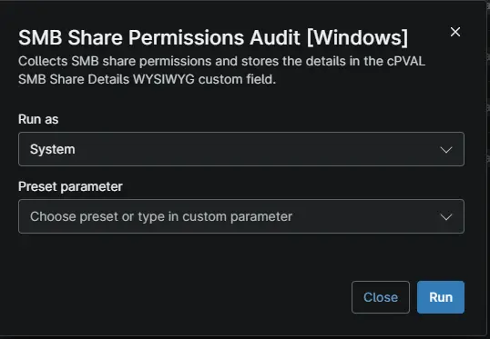

## Overview

The automation collects SMB share details and access permissions from Windows devices and stores the results as an HTML table in the [cPVAL SMB Share Details](/docs/751a00ed-8de0-4146-8722-75629788411b) WYSIWYG custom field. Use it to audit and review SMB share permissions for security and access monitoring.

:::note
Schedule the automation on Windows devices with Run As set to System. The automation reports a failure if no SMB shares are found, no share permissions can be read, or the custom field cannot be updated.
:::

## Requirements

- Supported operating system and device role
- Run As: `System`
- PowerShell 5.1
- Anything else the device needs, for example internet access or a signed-in user

## Sample Run

## Custom Fields

| Custom Field | Scope | Type | Description |
| ------------ | ----- | ---- | ----------- |
| [cPVAL SMB Share Details](/docs/751a00ed-8de0-4146-8722-75629788411b) | `Device` | `WYSIWYG` | Displays SMB share audit data in HTML format for easy viewing. |

## Dependencies

* [Custom Field: cPVAL SMB Share Details](/docs/751a00ed-8de0-4146-8722-75629788411b)
* [Solution: SMB Share Permission Audit](/docs/a1a0fea8-a255-45e3-98c6-1bbe094f5693)

## Automation Setup/Import

[Automation Configuration](https://github.com/ProVal-Tech/ninjarmm/blob/main/scripts/smb-share-permission-audit.ps1)

## Output

- Activity Details
- Custom Field: [cPVAL SMB Share Details](/docs/751a00ed-8de0-4146-8722-75629788411b)

## Changelog

### 2026-10-23

- Initial version of the document
