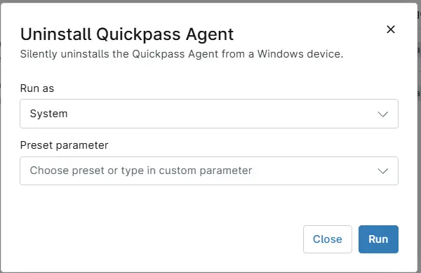

## Overview

Uninstalls the Quickpass Agent from a Windows device.

## Requirements

- Windows
- Run As: `System`
- PowerShell 5.1

## Sample Run

## Dependencies

* [Solution - Deploy Quickpass Agent](/docs/a68fa93c-45c7-4491-80d1-5e7543016b7f)

## Automation Setup/Import

[Automation Configuration](https://github.com/ProVal-Tech/ninjarmm/blob/main/scripts/uninstall-quickpass-agent.ps1)

## Output

- Activity Details

## Changelog

### 2026-10-21

- Initial version of the document
