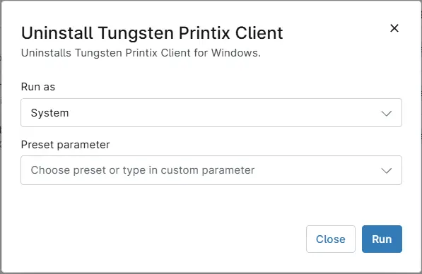

## Overview

Uninstalls the Tungsten Printix Client from Windows devices. The script finds every installed copy of the client and runs its uninstaller silently. It then waits until the removal is finished before it reports success. If the client is not installed, the script makes no changes and reports success.

## Requirements

- Windows workstations and servers, 64-bit
- Run As: `System`
- PowerShell 5.1, 64-bit. In 32-bit PowerShell the script may not find an installed client.

## Sample Run

1. On the device, select `Play Button` > `Run Automation` > `Script`.
2. Search for `Uninstall Tungsten Printix Client` and select it.
3. Leave Run As set to `System` and select `Run`.

## Dependencies

* [Automation: Install/Update Tungsten Printix Client](/docs/0c5963fc-ac9d-44ff-8fad-8ae2fd267547)
* [Custom Field: cPVAL Tungsten Printix Client Deployment](/docs/d53a9981-9c39-4392-bf02-9d069b529f2f)
* [Compound Condition: Deploy Tungsten Printix Client - Workstations](/docs/96795ceb-d3c7-4d36-b424-d2979140e036)
* [Compound Condition: Deploy Tungsten Printix Client - Servers](/docs/aad200d0-6423-4b95-80c8-0e8cbae219fa)
* [Solution: Deploy Tungsten Printix Client - NinjaOne](/docs/9424b17b-b55f-417d-9d2d-a953bed8575e)

## Automation Setup/Import

[Automation Configuration](https://github.com/ProVal-Tech/ninjarmm/blob/main/scripts/uninstall-tungsten-printix-client.ps1)

## Output

- Activity Details.
- Log file `C:\ProgramData\_automation\script\Printix\Uninstall-PrintixClient.log`: each step the script took, the account it ran as, and the Printix uninstall entries it found.

## Changelog

### 2026-11-16

- Initial version of the document
