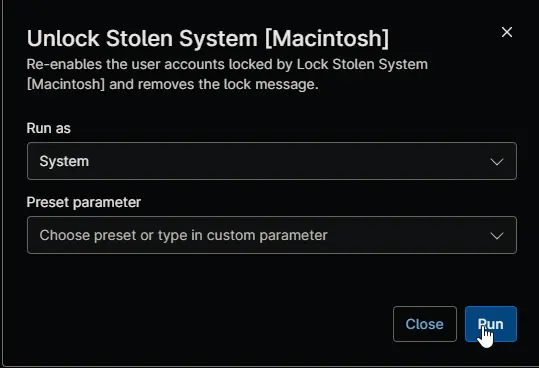

## Overview

This automation reverses [Lock Stolen System [Macintosh]](/docs/08b38e83-0836-49de-b185-dbfc97a0f249) on a Mac that has been recovered or was locked by mistake. It re-enables the user accounts the lockdown disabled, removes the lock message from the login window and the FileVault screen, and sets [cPVAL Lock Status](/docs/e734bed4-a878-4574-b456-1e1ed59ee6bc) to `Unlocked`. Automatic login and the Guest account stay off.

Users then sign in with the lockdown password and should change it right away. At the first sign-in, macOS asks to update the login keychain, which needs their previous password.

:::note  
This automation is optional and runs on demand only. Don't schedule it or add it to a condition. It runs only after [cPVAL Mark System as Stolen](/docs/20a99ff3-a63d-4f73-bd48-3bb8d66626e6) is unchecked, so it can't unlock a Mac that's still missing.  
:::

## Requirements

- A Mac locked by Lock Stolen System [Macintosh], started and unlocked at the FileVault screen with the IT admin account, and online in NinjaOne
- cPVAL Mark System as Stolen unchecked
- Run As: `System`
- Shell script (bash)

## Sample Run

## Scenarios

- **Recovered Mac:** the automation re-enables the locked accounts and sets cPVAL Lock Status to `Unlocked`. Users sign in with the lockdown password.
- **Still marked as stolen:** the automation makes no changes and shows as failed. Uncheck cPVAL Mark System as Stolen and run it again.
- **Mac not locked:** if the Mac wasn't locked by Lock Stolen System [Macintosh], the automation makes no changes and shows as failed.
- **An account couldn't be re-enabled:** the automation shows as failed and names the account. It keeps its record of the locked accounts, so you can run it again.

## Custom Fields

| Custom Field | Scope | Type | Description |
| ------------ | ----- | ---- | ----------- |
| [cPVAL Mark System as Stolen](/docs/20a99ff3-a63d-4f73-bd48-3bb8d66626e6) | Device | Checkbox | Must be unchecked for the automation to run. |
| [cPVAL Lock Status](/docs/e734bed4-a878-4574-b456-1e1ed59ee6bc) | Device | Text | Set to `Unlocked` after the lockdown is reversed. |

## Dependencies

* [Custom Field: cPVAL Mark System as Stolen](/docs/20a99ff3-a63d-4f73-bd48-3bb8d66626e6)
* [Custom Field: cPVAL Lock Status](/docs/e734bed4-a878-4574-b456-1e1ed59ee6bc)
* [Automation: Lock Stolen System [Macintosh]](/docs/08b38e83-0836-49de-b185-dbfc97a0f249)
* [Solution: Lock Stolen System](/docs/13b4df99-df9b-4a57-bc0f-8675c68be028)

## Automation Setup/Import

[Automation Configuration](https://github.com/ProVal-Tech/ninjarmm/blob/main/scripts/unlock-stolen-system-macintosh.sh)

## Output

- Activity Details
- Custom Field: [cPVAL Lock Status](/docs/e734bed4-a878-4574-b456-1e1ed59ee6bc)

## Changelog

### 2026-11-05

- Initial version of the document
