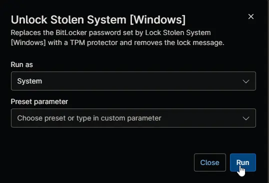

## Overview

This automation reverses [Lock Stolen System [Windows]](/docs/0f78be64-557a-4c0e-b7cf-e2ba41e71374) on a Windows computer that has been recovered or was locked by mistake. It removes the lockdown password from the system drive so the computer's TPM unlocks the drive at startup again, removes the lock message from the BitLocker recovery screen and sets [cPVAL Lock Status](/docs/e734bed4-a878-4574-b456-1e1ed59ee6bc) to `Unlocked`. BitLocker stays on.

The lockdown removed the BitLocker recovery password saved before the computer was stolen, so this automation creates a new one. Back it up the same way you back up other recovery passwords, for example to Microsoft Entra ID or Active Directory.

:::note  
This automation is optional and runs on demand only. Don't schedule it or add it to a condition. It runs only after [cPVAL Mark System as Stolen](/docs/20a99ff3-a63d-4f73-bd48-3bb8d66626e6) is unchecked, so it can't unlock a computer that's still missing.  
:::

## Requirements

- A Windows computer locked by [Lock Stolen System [Windows]](/docs/0f78be64-557a-4c0e-b7cf-e2ba41e71374), started with the lockdown password and online in NinjaOne
- cPVAL Mark System as Stolen unchecked
- A TPM that's turned on and ready
- Run As: `System`
- PowerShell 5.1

## Sample Run

## Scenarios

- **Recovered computer:** the automation removes the lockdown password and sets [cPVAL Lock Status](/docs/e734bed4-a878-4574-b456-1e1ed59ee6bc) to `Unlocked`. The computer starts without a password from the next restart.
- **Still marked as stolen:** the automation makes no changes and shows as failed. Uncheck [cPVAL Mark System as Stolen](/docs/20a99ff3-a63d-4f73-bd48-3bb8d66626e6) and run it again.
- **Computer not locked:** if the system drive has no lockdown password, the automation makes no changes and shows as failed.
- **TPM not ready:** the automation makes no changes and shows as failed, and the computer keeps asking for the lockdown password at startup. Turn on the TPM in the computer's firmware settings, then run the automation again.

## Custom Fields

| Custom Field | Scope | Type | Description |
| ------------ | ----- | ---- | ----------- |
| [cPVAL Mark System as Stolen](/docs/20a99ff3-a63d-4f73-bd48-3bb8d66626e6) | Device | Checkbox | Must be unchecked for the automation to run. |
| [cPVAL System Lockdown](/docs/4b18c9bf-8aea-41a5-8242-77dfcfd0042a)       | Device | Checkbox | Uncheck the box to prevent further automation. |
| [cPVAL Lock Status](/docs/e734bed4-a878-4574-b456-1e1ed59ee6bc) | Device | Text | Set to `Unlocked` after the lockdown is reversed. |

## Dependencies

* [Custom Field: cPVAL Mark System as Stolen](/docs/20a99ff3-a63d-4f73-bd48-3bb8d66626e6)
* [Custom Field: cPVAL Lock Status](/docs/e734bed4-a878-4574-b456-1e1ed59ee6bc)
* [Automation: Lock Stolen System [Windows]](/docs/0f78be64-557a-4c0e-b7cf-e2ba41e71374)
* [Solution: Lock Stolen System](/docs/13b4df99-df9b-4a57-bc0f-8675c68be028)

## Automation Setup/Import

[Automation Configuration](https://github.com/ProVal-Tech/ninjarmm/blob/main/scripts/unlock-stolen-system-windows.ps1)

## Output

- Activity Details
- Custom Field: [cPVAL Lock Status](/docs/e734bed4-a878-4574-b456-1e1ed59ee6bc)

## Changelog

### 2026-11-12

- Initial version of the document
