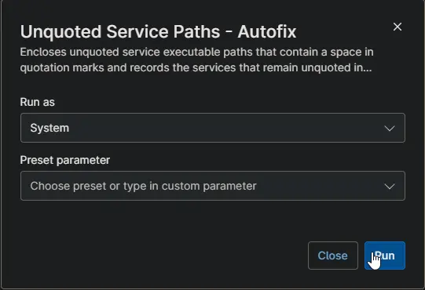

## Description

Encloses the executable part of every unquoted service path in quotation marks and keeps the arguments unchanged. For example, `C:\Program Files\Vendor Agent\agent.exe /service` becomes `"C:\Program Files\Vendor Agent\agent.exe" /service`. It runs as the automation of the [Unquoted Service Paths - Workstations](/docs/ed45bd74-48ec-4463-b012-1dfac05e9a1c) and [Unquoted Service Paths - Servers](/docs/2d18a56f-bbec-46ef-84c7-229643a76c4b) compound conditions when [Unquoted Service Paths - Detection](/docs/73387129-5472-4b0e-945e-f7822c57185d) exits with 1, and can also be run on demand. It finds the services with the same rule as the detection script and does not read [cPVAL Unquoted Service Path Mode](/docs/624406be-6c89-4ed4-a47c-14749752b387).

The new path is applied through the Windows service control manager, which updates the service configuration and the registry together. Running services keep running and use the new path the next time they start. No service or device is restarted.

After the fix, the automation checks the services again:

| Result | cPVAL Unquoted Service Paths | Activity Result |
| ------ | ---------------------------- | --------------- |
| No service has an unquoted path | Cleared | Success |
| Some services still have an unquoted path | Lists them with `AutofixAttempted` set to `1` | Failure, with the names of the services |

The activity log gives the reason for each service that could not be fixed, for example access denied when a security product protects its own service.

The automation verifies its own ProVal signature before it changes anything.

## Requirements

- Windows PowerShell 5.1, run as System.
- Access to `contentrepo.net`, for the signature check.

## Sample Run

## Scenarios

- **Run by a compound condition:** The detection script found unquoted paths on a device type that [cPVAL Unquoted Service Path Mode](/docs/624406be-6c89-4ed4-a47c-14749752b387) fixes. The automation fixes them and updates [cPVAL Unquoted Service Paths](/docs/b3d517ef-c7e4-4dc7-aa10-1e52b6edb196).
- **Run on demand:** Run the automation on a device to fix its unquoted service paths right away, whatever cPVAL Unquoted Service Path Mode is set to.

## Dependencies

- [Custom Field - cPVAL Unquoted Service Paths](/docs/b3d517ef-c7e4-4dc7-aa10-1e52b6edb196)
- [Automation - Unquoted Service Paths - Detection](/docs/73387129-5472-4b0e-945e-f7822c57185d)
- [Solution - Unquoted Service Paths - NinjaOne](/docs/463a9e42-df91-406d-b53c-285f4cbdabac)

## Custom Fields

| Field Label | Scope | Accepted Values | Default Value | Description |
| ----------- | ----- | --------------- | ------------- | ----------- |
| [cPVAL Unquoted Service Paths](/docs/b3d517ef-c7e4-4dc7-aa10-1e52b6edb196) | Device | Written by the automation | - | The services that still have an unquoted path after the fix. Cleared when none is left. |

## Automation Setup/Import

[Automation Configuration](https://github.com/ProVal-Tech/ninjarmm/blob/main/scripts/unquoted-service-paths-autofix.ps1)

## Output

- Activity Logs
- Custom field: [cPVAL Unquoted Service Paths](/docs/b3d517ef-c7e4-4dc7-aa10-1e52b6edb196)

## Changelog

### 2026-10-27

- Initial version of the document
