## Overview

This is a NinjaOne implementation of the agnostic [Invoke-Windows11InstallerWithPrompt](/docs/b2f20f90-99f9-4bb1-ac7a-a3939f73ccec) script.

It upgrades Windows 10 and older Windows 11 devices to Windows 11 24H2 (build 26100) without surprise restarts. The logged-in user can postpone the upgrade a set number of times and then picks a time for it. The script confirms the result after the restart. It needs a single deployment from NinjaOne, then continues through scheduled tasks on the device.

When a device needs upgrading right away instead, the `WithoutPrompt` checkbox skips every prompt. See [Upgrade Without Prompting](#upgrade-without-prompting). An optional notice keeps the user informed while the upgrade runs, and prompts can carry your own wording, icon, and header image.

:::note  
Set the NinjaOne script timeout to at least 30 minutes (45 minutes when `MaxPostpone` is `0`), because the first prompt appears during the NinjaOne run. The upgrade itself always runs from a scheduled task, so it never hits the timeout.

A run shows as failed in NinjaOne when the device fails a compatibility or safety check, when the prompt cannot be displayed, or when the device cannot reach the internet. In the last two cases a retry is already scheduled, and Activity Details shows when it runs.  
:::

## Requirements

- Windows 10, or Windows 11 earlier than 24H2. Workstation editions only
- Hardware that meets the Windows 11 requirements (TPM 2.0, supported processor, Secure Boot capable)
- 24 GB of free space on the system drive (configurable)
- Run As: `System`
- PowerShell 5.1
- Internet access to download the prompt interface, the upgrade tool, and the Windows 11 image

## Sample Run

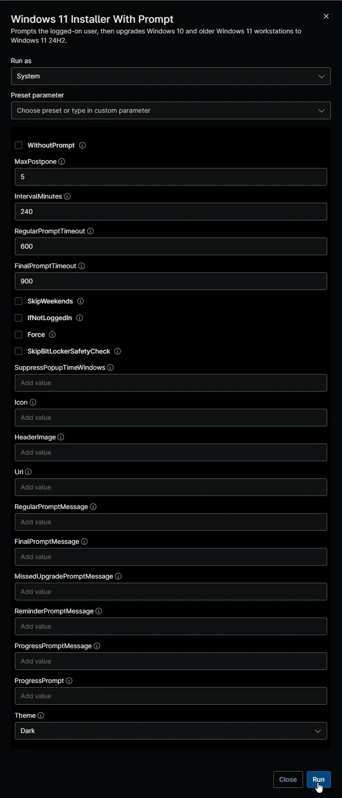

## Dependencies

- [Invoke-Windows11InstallerWithPrompt](/docs/b2f20f90-99f9-4bb1-ac7a-a3939f73ccec)
- [OmniPrompt](/docs/8ead1ffd-dade-4e17-9958-3313da9a7aa8)
- [SilentLauncher](/docs/b0b9f423-eee3-4148-b8a0-e99400c45698)
- [windows-upgrader](/docs/8c083d5d-a464-4937-91ef-980a062b26fd)
- [Microsoft Windows 11 Hardware Readiness script](https://download.microsoft.com/download/e/1/e/e1e682c2-a2ee-46c7-ad1e-d0e38714a795/HardwareReadiness.ps1)

## Examples

### Scenario 1: Business Hours

Run with user parameters `MaxPostpone = 3`, `IntervalMinutes = 120`, `SuppressPopupTimeWindows = 1800-0900`, and `SkipWeekends = True`.

Expected output:

- The user gets three postponable prompts two hours apart, then the final scheduling prompt.
- No prompt appears between 6:00 PM and 9:00 AM or on weekends.
- A time the user picks on the final prompt is still honoured, even when it falls outside those hours.

### Scenario 2: IfNotLoggedIn

Run with user parameter `IfNotLoggedIn = True`. Please ensure that the corresponding checkbox is selected before executing the script.

Expected output:

- If nobody is logged in, the upgrade starts without a prompt, unless another installation is running.
- If a user is logged in, the normal prompt cycle continues.
- `SkipWeekends` and `SuppressPopupTimeWindows` still apply, unless `UpgradeDuringSuppress` is set in the script. See [Manually Customizable Variables](#manually-customizable-variables).

### Scenario 3: Force

Run with user parameter `Force = True`. Please ensure that the corresponding checkbox is selected before executing the script.

Expected output:

- Existing scheduled tasks are removed and the stored cycle is reset.
- The prompt cycle starts again from the first prompt with the variables of this run.
- The reset is refused while the upgrade is running.

### Scenario 4: WithoutPrompt

Run with user parameter `WithoutPrompt = True`. Please ensure that the corresponding checkbox is selected before executing the script.

Expected output:

- No prompt of any kind is shown.
- The compatibility and safety checks still run.
- The upgrade starts from a scheduled task one minute later, and the NinjaOne run ends right away.
- Any cycle already in progress is cancelled, so `Force` is not needed.

### Scenario 5: SkipBitLockerSafetyCheck

Run with user parameter `SkipBitLockerSafetyCheck = True`. Please ensure that the corresponding checkbox is selected before executing the script.

Expected output:

- A device whose BitLocker volume lacks a TPM or recovery password protector, or cannot be suspended, continues to the upgrade instead of failing the check.
- The device may ask for the BitLocker recovery key after the restart, so make sure the key is backed up before using this option.

### Scenario 6: ProgressPrompt (Interval Mode)

Run with user parameter `ProgressPrompt = Interval=15/600`.

Expected output:

- While the upgrade runs, a notice appears on the user's desktop for 600 seconds (10 minutes) every 15 minutes.
- Plain `Interval` uses the built-in defaults: every 10 minutes for 300 seconds.
- The notice only appears while a user is logged in and the screen is unlocked.

### Scenario 7: ProgressPrompt (Stay Mode)

Run with user parameter `ProgressPrompt = Stay`.

Expected output:

- The notice appears as soon as the upgrade starts and stays on the desktop for the whole upgrade.
- Clicking its OK button only hides it until the next check brings it back.
- The restart at the end of the upgrade closes it.

### Scenario 8: Icon and HeaderImage

Run with user parameters `Icon = https://example.com/icon.png` and `HeaderImage = \\fileserver\share\header.png`.

Expected output:

- Both values are passed through unchanged. The script stages verified local copies and runs every prompt with those local paths.
- The logged-in user never needs access to the original sources, and a failed refresh keeps the last good copy.

### Scenario 9: Custom Prompt Text

Run with user parameters `RegularPromptMessage = IT will upgrade ComputerName to Windows 11 24H2. You have PromptsLeft reminder(s) left.\n\nSave your work and click Upgrade Now.` and `Theme = Light`.

Expected output:

- The postponable prompts show your wording, with `ComputerName` and `PromptsLeft` replaced by live values.
- The other prompts keep the built-in wording in the user's language.
- Every prompt uses the light theme.

### Scenario 10: Uri

Run with user parameter `Uri = https://files.example.com/win11/Win11_24H2_English_x64.iso`.

Expected output:

- The upgrade installs your Windows 11 image instead of the image hosted by ProVal.
- An `http://` link, or a value with spaces or quotes, stops the run with an error instead of installing the default image.

:::warning  
ProVal is not responsible for any issue that occurs when Windows is installed or upgraded from a custom ISO or ZIP file.  
:::

## Before You Deploy

- **Single deployment:** Run the script once per device. Scheduled tasks on the device handle every later prompt, the upgrade, and the check after the restart.
- **Variables stay with the cycle:** A cycle keeps the variables of the run that started it. Running the script again while a cycle is in progress changes nothing and reports success. Check `Force` to start over with new variables.
- **Script timeout:** The 30-minute timeout covers the default prompt timeouts. If you raise them, allow about twice `RegularPromptTimeout` (twice `FinalPromptTimeout` when `MaxPostpone` is `0`), plus a few minutes for downloads and checks.
- **Who gets prompted:** Devices that fail the hardware, disk space, or BitLocker checks are never prompted. Devices already on 24H2 or later are left unchanged. See [Compatibility and Safety Checks](/docs/b2f20f90-99f9-4bb1-ac7a-a3939f73ccec#compatibility-and-safety-checks).
- **No surprise upgrades:** If the device is off at the time the user picked, the upgrade does not start later by surprise. The user is asked to pick a new time instead. See [If the Device Was Off at the Chosen Time](/docs/b2f20f90-99f9-4bb1-ac7a-a3939f73ccec#if-the-device-was-off-at-the-chosen-time).
- **BitLocker and laptops:** BitLocker is suspended for the upgrade and turned back on afterwards. A laptop on battery does not start the upgrade; it waits `IntervalMinutes` and tries again.
- **Logs:** Device logs, upgrade tool output, and the scheduled tasks are listed in [Logs and Artifacts](/docs/b2f20f90-99f9-4bb1-ac7a-a3939f73ccec#logs-and-artifacts).

## Upgrade Without Prompting

Check the `WithoutPrompt` variable when a device needs its upgrade now, with no user interaction. For example, a device being worked on by a technician or prepared before handover.

- The prompt cycle is skipped. The upgrade starts from a scheduled task one minute later, and the NinjaOne run ends right away, so no long script timeout is needed.
- It takes precedence over every prompt variable. `MaxPostpone`, the prompt timeouts, `SuppressPopupTimeWindows`, `SkipWeekends`, `IfNotLoggedIn`, the message variables, `ProgressPrompt`, `Theme`, `Icon`, and `HeaderImage` are ignored while it is checked, so they can stay filled in.
- `Uri` and `SkipBitLockerSafetyCheck` still apply, as do `MinimumFreeSpaceGB`, `MinimumReservedPartitionFreeMB`, and `MaxACPowerRetries` from the script. `IntervalMinutes` still sets the wait before a retry.
- The compatibility and safety checks still run.
- Any cycle already in progress is cancelled, so `Force` is not needed. This is refused while the upgrade is running.
- No prompt of any kind is shown, including the in-progress notice and the completion prompt.
- On battery, the upgrade waits and retries silently. If the device is off at the start time, the upgrade starts when the device comes back.

Setting `MaxPostpone` to `0` is not the same thing. It still runs the prompt cycle and shows the final scheduling prompt.

## While the Upgrade Runs

The upgrade can run for an hour or more with nothing visible on screen. An optional notice keeps the user informed. NinjaOne caps a script at 20 variables, which left a single slot for the whole feature, so one variable, `ProgressPrompt`, enables it and selects the mode:

- **Blank (default):** the notice stays off.
- **`Interval`:** every 10 minutes a notice appears for 300 seconds, closes itself, and repeats until the upgrade finishes. `Interval=<minutes>` sets a custom interval, and `Interval=<minutes>/<seconds>` sets a custom interval and timeout, for example `Interval=15/600`.
- **`Stay`:** the notice appears as soon as the upgrade starts and stays on screen until the upgrade finishes. Clicking its OK button only hides it until the next check brings it back, so nobody power-cycles a machine they think is stuck.

Values are case-insensitive, and a bare `<minutes>` or `<minutes>/<seconds>` is shorthand for the Interval forms. An unrecognized value is logged as a warning and leaves the notice off. The notice only appears while a user is logged in and the screen is unlocked, and the restart at the end of the upgrade closes it. It is never shown when `WithoutPrompt` is checked.

The notice wording is set through the `ProgressPromptMessage` variable, and its title is set in the `prompt titles` section of the script.

## Prompt Display Retry

A prompt that fails to display is retried automatically. A failed attempt never uses up one of the user's postponements, and a prompt the user simply ignored is still handled as an answer rather than retried. When every attempt fails, the script reschedules itself for the next interval and keeps its prompt state, so the cycle resumes where it left off.

The retry uses the agnostic script defaults, currently one extra attempt 30 seconds later. The count and the pause are set in the `prompt display retry settings` section of the script, and editing them requires re-signing. See [Manually Customizable Variables](#manually-customizable-variables).

## Customize the Prompt Text

Leave the message variables empty and users see the built-in wording in their own language (English or Dutch). Enter your own text and it is used instead, exactly as written.

| Variable | Replaces |
| --- | --- |
| `RegularPromptMessage` | Body of the postponable prompts |
| `FinalPromptMessage` | Body of the final scheduling prompt |
| `MissedUpgradePromptMessage` | Body of the prompt that asks for a new time after a missed upgrade |
| `ReminderPromptMessage` | Body of the 10-minute warning |
| `ProgressPromptMessage` | Body of the notice shown while the upgrade runs |
| `ProgressPrompt` | Enables and configures the in-progress notice (see [While the Upgrade Runs](#while-the-upgrade-runs)) |
| `Theme` | Prompt window appearance (`Dark` or `Light`) |

### Default messages

These are the messages users see when the message variables are left empty. Dutch wording is used automatically when the logged-in user runs Windows in Dutch (`nl-NL` or `nl-BE`). The Dutch messages are listed in the [agnostic script document](/docs/b2f20f90-99f9-4bb1-ac7a-a3939f73ccec#default-messages).

Names such as `PromptsLeft` and `ScheduledUpgradeTime` are replaced with live values before the prompt appears. `\n` produces a line break.

#### Titles

| Parameter | English | Dutch |
| --- | --- | --- |
| `Title` | Windows 11 Upgrade | Windows 11-upgrade |
| `ReminderPromptTitle` | Windows 11 Upgrade - Starting Soon | Windows 11-upgrade - Start binnenkort |
| `CompletionPromptTitle` | Windows 11 Upgrade - Complete | Windows 11-upgrade - Voltooid |
| `ProgressPromptTitle` | Windows 11 Upgrade - In Progress | Windows 11-upgrade - Bezig |

#### Messages

**Regular prompt** — `RegularPromptMessage`

```text
An upgrade to Windows 11 24H2 is available for your computer. The upgrade can take an hour or more and restarts your computer, so please save your work first. You will receive PromptsLeft more prompt(s) with an interval of PromptIntervalMinutes minutes. After the last prompt the upgrade will proceed automatically.\n\nPlease save your work and click Upgrade Now to proceed.
```

**Final prompt** — `FinalPromptMessage`

```text
An upgrade to Windows 11 24H2 is required on your computer. This is the final prompt. Please select a time within the next 48 hours for the upgrade to begin. If no action is taken within FinalTimeoutMinutes minutes the upgrade will proceed automatically in DelayAfterFinalMinutes minutes.\n\nChoose a time and click Schedule Upgrade.
```

**Missed upgrade prompt** — `MissedUpgradePromptMessage`

```text
Your Windows 11 upgrade was planned for MissedUpgradeTime, but it could not start because your computer was turned off or not connected at that time. Please select a new time within the next 48 hours for the upgrade to begin. If no time is selected, you will be asked again in PromptIntervalMinutes minutes.\n\nChoose a time and click Schedule Upgrade.
```

**Reminder prompt** — `ReminderPromptMessage`

```text
Your Windows 11 upgrade is scheduled to begin at ScheduledUpgradeTime.\n\nPlease save all your work now. The upgrade will start in MinutesUntilUpgrade minute(s).\n\nClick OK to acknowledge.
```

**Completion prompt** — `CompletionPromptMessage`

```text
Your computer has been upgraded to Windows 11 24H2 successfully.\n\nYour computer is ready to use.\n\nClick OK to acknowledge.
```

**In-progress notice** — `ProgressPromptMessage`

```text
Windows 11 24H2 is being downloaded and installed on your computer. The upgrade is running in the background.\n\nYour computer will restart automatically, possibly more than once, so please save your work and leave the computer switched on.\n\nNo action is needed from you.
```

#### Extra line on laptops

On laptops, notebooks, and tablets the following line is added before the closing sentence of these five prompts. Desktops do not see it.

| Prompt | Added line |
| --- | --- |
| Regular prompt | Please connect your laptop to power before the upgrade begins. The upgrade does not start while the laptop runs on battery. |
| Final prompt | Please make sure your laptop is connected to power at the time you select. |
| Missed upgrade prompt | Please make sure your laptop is connected to power at the time you select. |
| Reminder prompt | Please make sure your laptop is connected to power now. |
| In-progress notice | Please keep your laptop connected to power until the upgrade has finished. |

### Insert live values

Type any of these names into your message as a plain word. The real value is filled in before the prompt appears.

| Name | Shows |
| --- | --- |
| `PromptsToSend` | Total prompts the user will receive |
| `PromptsSent` | Prompts shown so far, including this one |
| `PromptsLeft` | Prompts still to come after this one |
| `PromptIntervalMinutes` / `PromptIntervalHours` | Time between prompts |
| `RegularTimeoutSeconds` / `RegularTimeoutMinutes` | Regular prompt timeout |
| `FinalTimeoutSeconds` / `FinalTimeoutMinutes` | Final prompt timeout |
| `DelayAfterFinalSeconds` / `DelayAfterFinalMinutes` | Grace period after the final prompt |
| `ScheduledUpgradeTime` | Time the upgrade starts (reminder prompt only) |
| `MinutesUntilUpgrade` | Minutes until the upgrade starts (reminder prompt only) |
| `MissedUpgradeTime` | Time the missed upgrade was planned for (missed upgrade prompt only) |
| `ProgressIntervalMinutes` | Minutes between in-progress notices |
| `ProgressTimeoutSeconds` / `ProgressTimeoutMinutes` | How long each in-progress notice stays on screen |
| `UpgradeElapsedMinutes` | Minutes the upgrade has been running (in-progress notice only) |
| `ComputerName` | Machine name |
| `UserName` | Logged-in username |

Use `\n` for a line break.

**Example:**

```text
IT will upgrade ComputerName to Windows 11 24H2. You have PromptsLeft reminder(s) left, one every PromptIntervalHours hour(s).\n\nSave your work and click Upgrade Now.
```

**Example with the in-progress notice:**

```text
IT is upgrading ComputerName to Windows 11. This has been running for UpgradeElapsedMinutes minute(s).\n\nPlease leave the machine switched on.
```

### Prompt titles

Titles are not Ninja variables, because a script is capped at 20 variables and titles change far less often than message bodies. To change a title, edit the `prompt titles` section near the top of the script and re-sign it. Leave them blank and the built-in titles are used. The same section holds the completion message. See [Manually Customizable Variables](#manually-customizable-variables) for the full list and the re-signing requirement.

### Things to know

- These names are reserved words. If a message needs the literal word `ComputerName`, reword it.
- Button labels always follow the user's language and cannot be changed.
- The in-progress notice always carries an OK button. In stay mode, clicking it only hides the notice until the next check brings it back.
- Custom text is not translated and does not receive the automatic connect-to-power line shown on laptops. Include that wording yourself if your fleet has laptops.

## Sample Prompts

### Sample Prompts - English

**Desktops:**

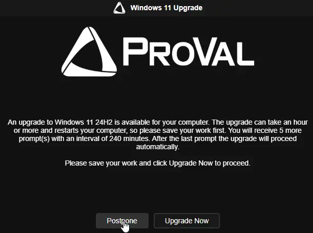  
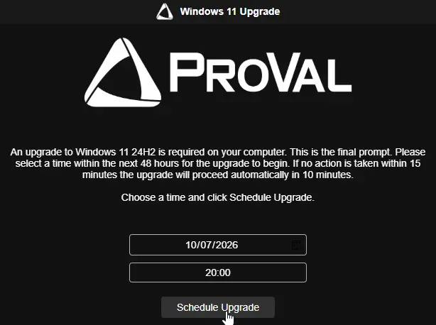  
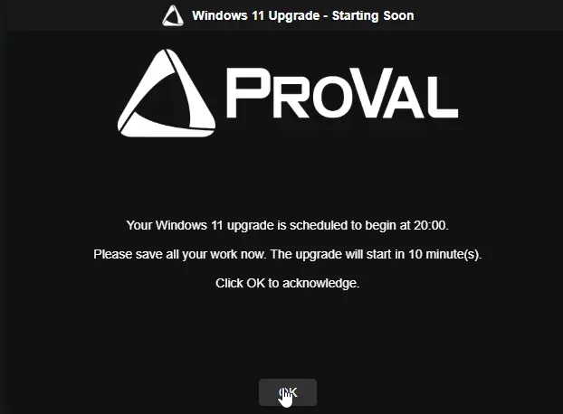  

**Laptops:**

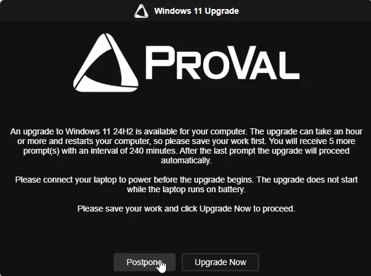  
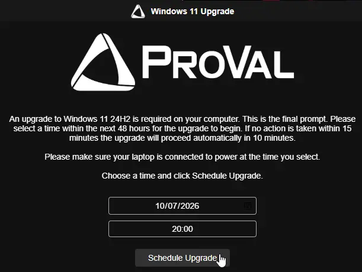  
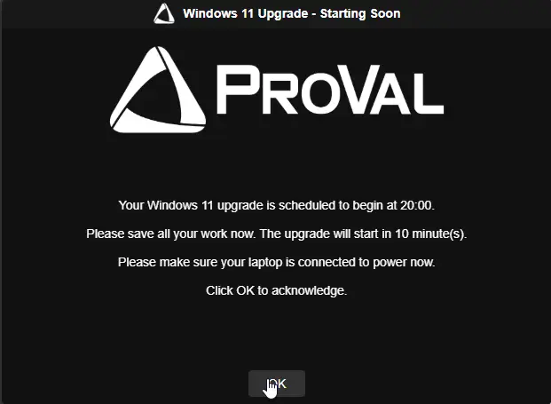

### Missed Upgrade Prompt - English

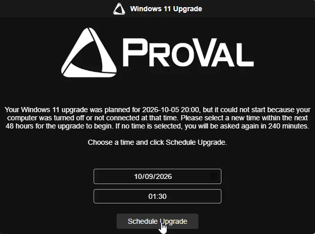  

### Upgrade In Progress Notification - English

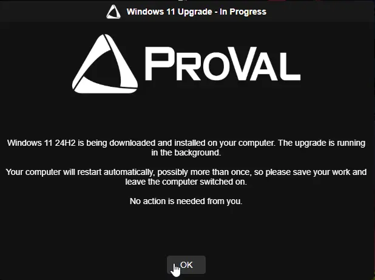  

### Completion Prompt - English

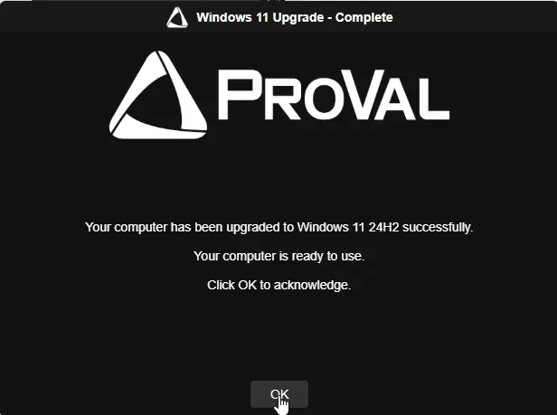  

### Sample Prompts - Dutch

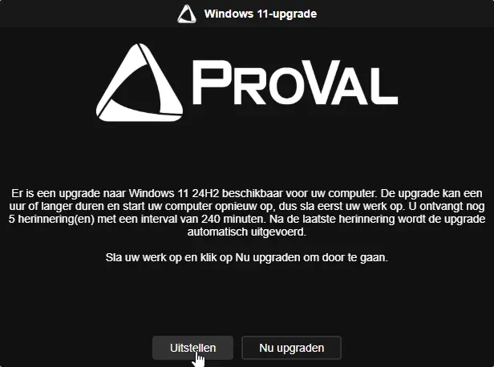  
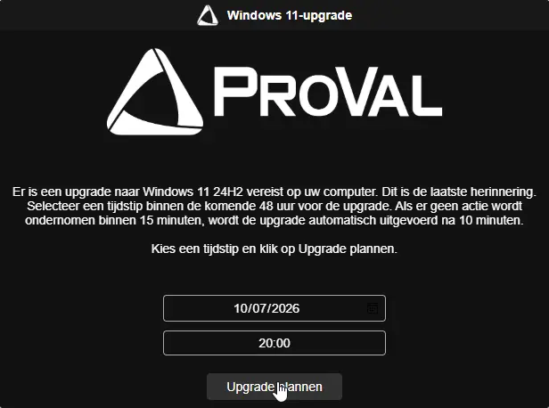  
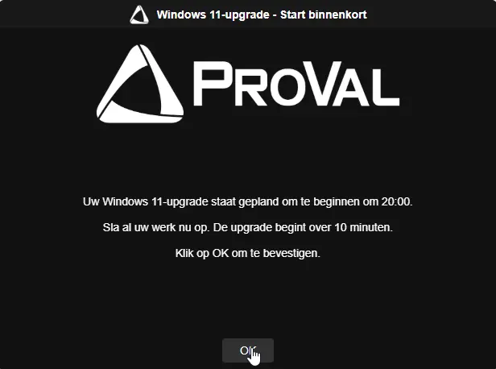  

#### Missed Upgrade Prompt - Dutch

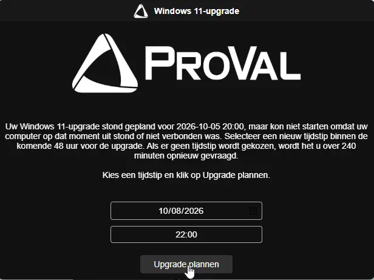  

#### Upgrade In Progress Notification - Dutch

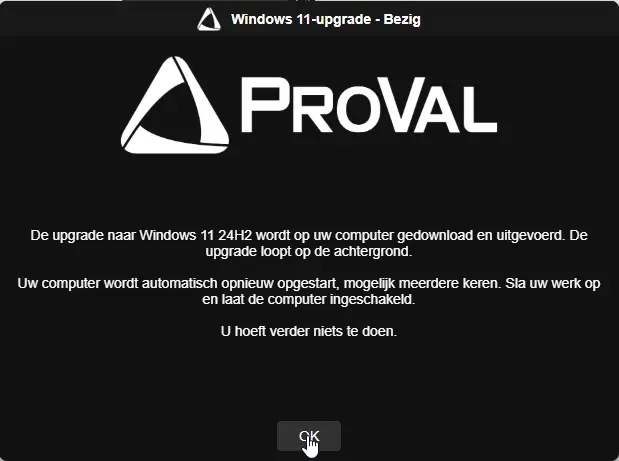  

#### Completion Prompt - Dutch

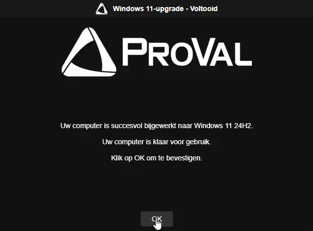  

## Parameters

The script uses all 20 of NinjaOne's variable slots.

| Name | Calculated Name | Example | Accepted Values | Required | Default | Type | Description |
| ---- | --------------- | ------- | --------------- | -------- | ------- | ---- | ----------- |
| WithoutPrompt | withoutprompt | -- | `True/False` | False | False | Checkbox | Skips every prompt and starts the upgrade from a scheduled task one minute later. Takes precedence over all prompt, suppression, and scheduling variables. Cancels any cycle in progress. See [Upgrade Without Prompting](#upgrade-without-prompting). |
| MaxPostpone | maxpostpone | `3` | 0-50 | False | 5 | Integer | Number of postponable prompts before the final scheduling prompt. Total prompts = MaxPostpone + 1 (final). `0` shows the final prompt first. |
| IntervalMinutes | intervalminutes | `120` | 10-1440 | False | 240 | Integer | Minutes between prompts. Also the wait before any retry, for example after a missing internet connection or on battery. |
| RegularPromptTimeout | regularprompttimeout | `300` | 60-86400 | False | 600 | Integer | Seconds before an ignored regular prompt closes and counts as a postponement. Also used for the completion prompt. |
| FinalPromptTimeout | finalprompttimeout | `1800` | 60-86400 | False | 900 | Integer | Seconds before the final scheduling prompt and the missed upgrade prompt close. An ignored final prompt starts the upgrade after the grace period (600 seconds by default); an ignored missed upgrade prompt never starts it. |
| SkipWeekends | skipweekends | -- | `True/False` | False | False | Checkbox | Hides prompts on Saturdays and Sundays. |
| IfNotLoggedIn | ifnotloggedin | -- | `True/False` | False | False | Checkbox | Starts the upgrade without a prompt when nobody is logged in, unless another installation is running. |
| Force | force | -- | `True/False` | False | False | Checkbox | Clears the cycle in progress and starts again from the first prompt with the variables of this run. Refused while the upgrade is running. |
| SkipBitLockerSafetyCheck | skipbitlockersafetycheck | -- | `True/False` | False | False | Checkbox | Continues when BitLocker lacks the TPM and recovery password protectors, its status cannot be read, or it cannot be suspended. The device may then ask for the recovery key after the restart. |
| SuppressPopupTimeWindows | suppresspopuptimewindows | `1800-0900` | `HHmm-HHmm` | False | -- | string/text | 24-hour time window during which prompts are hidden. A window that passes midnight is supported. An invalid value is ignored. |
| Icon | icon | `https://example.com/icon.png` | -- | False | -- | string/text | Web URL, local path, or UNC path for the icon displayed in the prompt window. Passed through unchanged; the script stages a verified local copy and runs every prompt with that path. |
| HeaderImage | headerimage | `\\fileserver\share\header.png` | -- | False | -- | string/text | Web URL, local path, or UNC path for the header image displayed at the top of the prompt window. Staged locally in the same way as `Icon`. |
| Uri | uri | `https://files.example.com/win11/Win11_24H2_English_x64.iso` | `https://` link | False | -- | string/text | Direct link to your own Windows 11 ISO or ZIP file. Leave blank to install the image hosted by ProVal. An `http://` link or a value with spaces or quotes stops the run with an error. **ProVal is not responsible for any issue caused by a custom ISO or ZIP file.** |
| RegularPromptMessage | regularpromptmessage | `IT will upgrade ComputerName to Windows 11 24H2. You have PromptsLeft reminder(s) left.` | -- | False | -- | string/text | Body of the postponable prompts. Leave blank to use the built-in wording. |
| FinalPromptMessage | finalpromptmessage | `This is the last reminder. Pick a time in the next 48 hours.` | -- | False | -- | string/text | Body of the final scheduling prompt. Leave blank to use the built-in wording. |
| MissedUpgradePromptMessage | missedupgradepromptmessage | `Your upgrade planned for MissedUpgradeTime did not start. Please pick a new time.` | -- | False | -- | string/text | Body of the prompt that asks for a new time after the device was off at the planned upgrade time. Leave blank to use the built-in wording. |
| ReminderPromptMessage | reminderpromptmessage | `Your upgrade begins at ScheduledUpgradeTime. Save your work now.` | -- | False | -- | string/text | Body of the 10-minute warning. Leave blank to use the built-in wording. |
| ProgressPromptMessage | progresspromptmessage | `IT is upgrading ComputerName to Windows 11. This has been running for UpgradeElapsedMinutes minute(s).` | -- | False | -- | string/text | Body of the notice shown while the upgrade runs. Leave blank to use the built-in wording. The notice itself is enabled through `ProgressPrompt`. |
| ProgressPrompt | progressprompt | `Interval=15/600` | `Stay` / `Interval` / `Interval=<m>` / `Interval=<m>/<s>` / `<m>` / `<m>/<s>` | False | -- | string/text | Enables and configures the in-progress notice. Leave blank to keep it off. See [While the Upgrade Runs](#while-the-upgrade-runs). |
| Theme | theme | -- | `Dark/Light` | False | Dark | Dropdown | Prompt window theme. |

:::note  
A number outside its accepted range stops the run before anything changes on the device. Activity Details names each value that is out of range and the range it must fall in. This also covers the values set in the script. See [Manually Customizable Variables](#manually-customizable-variables).  
:::

### ProgressPrompt

| Format | Example | Effect | Valid |
| --- | --- | --- | --- |
| *(blank)* | *(leave the variable empty)* | Notice stays off (the default) | ✅ |
| `null` (literal string) | `null` | Treated the same as blank. NinjaOne sends this for an unset variable | ✅ |
| `Stay` | `Stay` | Notice kept on the desktop for the whole upgrade and shown again whenever it is dismissed | ✅ |
| `Keep` / `KeepVisible` | `Keep` | Same effect as `Stay` | ✅ |
| `Interval` | `Interval` | Notice repeats at the built-in defaults: every 10 minutes, each staying on screen for 300 seconds | ✅ |
| `Interval=<minutes>` | `Interval=15` | Notice repeats every 15 minutes, each staying on screen for the default 300 seconds | ✅ |
| `Interval=<minutes>/<seconds>` | `Interval=15/600` | Notice repeats every 15 minutes, each staying on screen for 600 seconds | ✅ |
| `:` instead of `=` after `Interval` | `Interval:15/600` | Equivalent to the `=` form | ✅ |
| `<minutes>` (bare number) | `15` | Shorthand for `Interval=15` | ✅ |
| `<minutes>/<seconds>` (bare numbers) | `15/600` | Shorthand for `Interval=15/600` | ✅ |
| Any letter casing | `STAY` or `interval=15` | Values are case-insensitive | ✅ |
| Spaces anywhere in the value | `Interval = 15 / 600` | Whitespace is removed before parsing, so spaced values work | ✅ |
| `Interval=0` | `Interval=0` | Parses successfully, but a zero interval turns the repeating notices off. Leave the variable blank instead | ✅ |
| Interval or timeout out of range | `Interval=2000` or `Interval=15/10` | The interval must be 0-1440 minutes and the timeout 30-86400 seconds. The run stops before anything changes on the device, and Activity Details names `ProgressPromptInterval` or `ProgressPromptTimeout` | ❌ |
| `True` / `On` / `Show` / `Enabled` | `True` | Not recognized; a warning is logged and the notice stays off | ❌ |
| `Stay` with settings attached | `Stay=10` | Stay mode takes no interval or timeout, so extra text makes the value invalid | ❌ |
| Separator with no number after it | `Interval=` | Nothing follows the separator | ❌ |
| Non-numeric settings | `Interval=abc` | The minutes and seconds must be whole numbers | ❌ |
| Units written inside the value | `15 min` or `Interval=15m/600s` | Units are not part of the format; supply bare numbers | ❌ |
| Wrong separator before the timeout | `Interval=15:600` | The timeout must follow a `/`, not a `:` or a second `=` | ❌ |
| Too many segments | `Interval=15/600/300` | Only one interval and one timeout are accepted | ❌ |
| Negative or decimal values | `Interval=-5` or `Interval=7.5` | Only whole, non-negative numbers are accepted | ❌ |

:::note  
Every unrecognized value logs a warning to Activity Details and leaves the notice off. The script never guesses a mode from an unrecognized value, so a typo can never switch a deployment into stay mode.  
:::

### Manually Customizable Variables

NinjaOne caps a script at 20 variables, and this script uses all of them. The remaining parameters of the upgrade script are plain placeholder variables inside the PowerShell file. They live in five clearly marked regions near the top of the script, and together with the 20 Ninja variables they cover every parameter of the upgrade script.

Leave a value at its shipped default and the parameter is not passed, so the upgrade script applies its own built-in default. Set a value and it is passed on every deployment of this script.

**`prompt titles` region**

| Variable | Agnostic parameter | Ships as | Effect |
| --- | --- | --- | --- |
| `$promptTitle` | `Title` | `''` (blank) | Custom title for the regular, final, and missed upgrade prompts. Built-in: `Windows 11 Upgrade` / `Windows 11-upgrade`. |
| `$reminderPromptTitle` | `ReminderPromptTitle` | `''` (blank) | Custom title for the 10-minute warning. Built-in: `Windows 11 Upgrade - Starting Soon` / `Windows 11-upgrade - Start binnenkort`. |
| `$completionPromptTitle` | `CompletionPromptTitle` | `''` (blank) | Custom title for the completion confirmation. Built-in: `Windows 11 Upgrade - Complete` / `Windows 11-upgrade - Voltooid`. |
| `$completionPromptMessage` | `CompletionPromptMessage` | `''` (blank) | Custom body for the completion confirmation. Blank uses the built-in wording in the user's language. |
| `$progressPromptTitle` | `ProgressPromptTitle` | `''` (blank) | Custom title for the in-progress notice. Built-in: `Windows 11 Upgrade - In Progress` / `Windows 11-upgrade - Bezig`. |

Titles and messages set here accept the same live values and `\n` line breaks as the Ninja message variables.

**`final prompt settings` region**

| Variable | Agnostic parameter | Ships as | Effect |
| --- | --- | --- | --- |
| `$delayAfterFinalPrompt` | `DelayAfterFinalPrompt` | `$null` | Seconds to wait before the upgrade starts after the final prompt closes without an answer. `$null` uses the upgrade script default (currently 600). Does not apply when the user picks a time. Valid range 0-86400. |

**`prompt display retry settings` region**

| Variable | Agnostic parameter | Ships as | Effect |
| --- | --- | --- | --- |
| `$promptDisplayRetryCount` | `PromptDisplayRetryCount` | `$null` | Extra attempts to display a prompt when it fails to appear or returns unreadable output. `$null` uses the upgrade script default (currently 1). Valid range 0-5. |
| `$promptDisplayRetryDelay` | `PromptDisplayRetryDelay` | `$null` | Seconds to wait between display attempts. `$null` uses the upgrade script default (currently 30). Valid range 0-600. |

**`unattended and forced upgrade settings` region**

| Variable | Agnostic parameter | Ships as | Effect |
| --- | --- | --- | --- |
| `$maxMissedPromptsBeforeForce` | `MaxMissedPromptsBeforeForce` | `$null` | Consecutive missed prompts (screen locked, or nobody logged in without `IfNotLoggedIn`) before the upgrade is forced without any prompt. `$null` uses the upgrade script default (currently 0, which disables forcing). The counter resets as soon as a user is active at an unlocked machine. Valid range 0-100. |
| `$upgradeDuringSuppress` | `UpgradeDuringSuppress` | `$false` | Set to `$true` to let an unattended upgrade (`IfNotLoggedIn` with nobody logged in) or a forced upgrade (the threshold above reached) run inside the suppress time window or on a weekend. Prompts are never shown during suppression either way. |

**`upgrade safety and retry settings` region**

| Variable | Agnostic parameter | Ships as | Effect |
| --- | --- | --- | --- |
| `$minimumFreeSpaceGB` | `MinimumFreeSpaceGB` | `$null` | Free space required on the system drive, in GB. `$null` uses the upgrade script default (currently 24). Valid range 1-1024. |
| `$minimumReservedPartitionFreeMB` | `MinimumReservedPartitionFreeMB` | `$null` | Free space required on the system reserved partition, in MB. `$null` uses the upgrade script default (currently 15). Valid range 1-1024. |
| `$maxACPowerRetries` | `MaxACPowerRetries` | `$null` | Times the upgrade waits for a laptop to be connected to power before the cycle ends as a failure. `$null` uses the upgrade script default (currently 3). Valid range 0-10. |
| `$maxMissedScheduledUpgrades` | `MaxMissedScheduledUpgrades` | `$null` | Missed or unanswered upgrade times allowed before the cycle ends as a failure. `$null` uses the upgrade script default (currently 3). `0` ends the cycle at the first missed time. Valid range 0-10. |

**Setting a value:**

Each region sits near the top of the script with a comment block explaining it. Setting a value is a one-line edit:

```powershell
# prompt titles region
$promptTitle = 'Windows upgrade for ComputerName'

# final prompt settings region
$delayAfterFinalPrompt = 900

# prompt display retry settings region
$promptDisplayRetryCount = 2
$promptDisplayRetryDelay = 60

# unattended and forced upgrade settings region
$maxMissedPromptsBeforeForce = 3
$upgradeDuringSuppress = $true

# upgrade safety and retry settings region
$minimumFreeSpaceGB = 40
$maxMissedScheduledUpgrades = 1
```

:::warning  
**The script must be re-signed after any edit.** This script is Authenticode-signed and validates its own signature at the start of every run. Editing any variable in the five regions above changes the script file, which invalidates the signature. Until the script is re-signed, every execution stops immediately with:

```text
Invalid Signature: Current script '<script path>' failed code-signature validation. Execution has been stopped.
```

The script will not run again in that state. The self-signature check runs before the upgrade script is downloaded and before any parameter is passed, so nothing is processed: no prompts appear and no upgrade runs.  
:::

:::note  
**Need one of these values changed?** Reach out to ProVal. ProVal can update these variables for you, re-sign the script through the ProVal code-signing portal, and publish the updated version, so the change reaches every deployment that pulls the script from the [Automation Configuration](https://github.com/ProVal-Tech/ninjarmm/blob/main/scripts/windows-11-installer-with-prompt.ps1). If you re-sign the script yourself instead, make sure the edited copy replaces the published automation script. Otherwise NinjaOne keeps deploying the previous signed version and your change never reaches the devices.  
:::

## Automation Setup/Import

[Automation Configuration](https://github.com/ProVal-Tech/ninjarmm/blob/main/scripts/windows-11-installer-with-prompt.ps1)

## Output

- Activity Details

## Changelog

### 2026-11-24

- Initial version of the document
