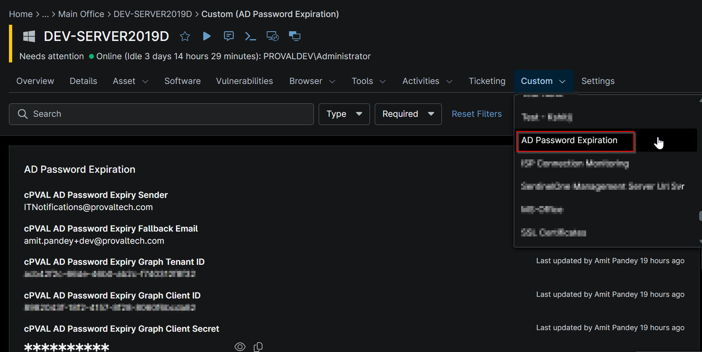
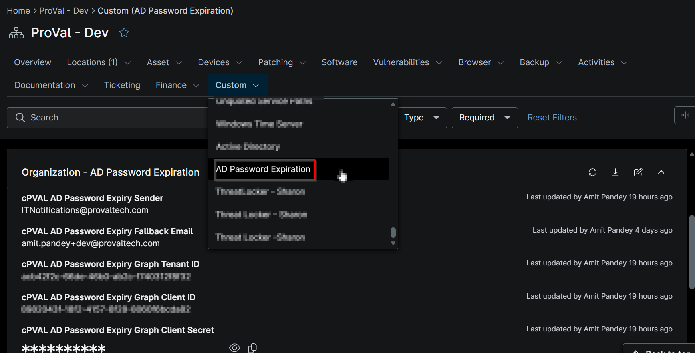
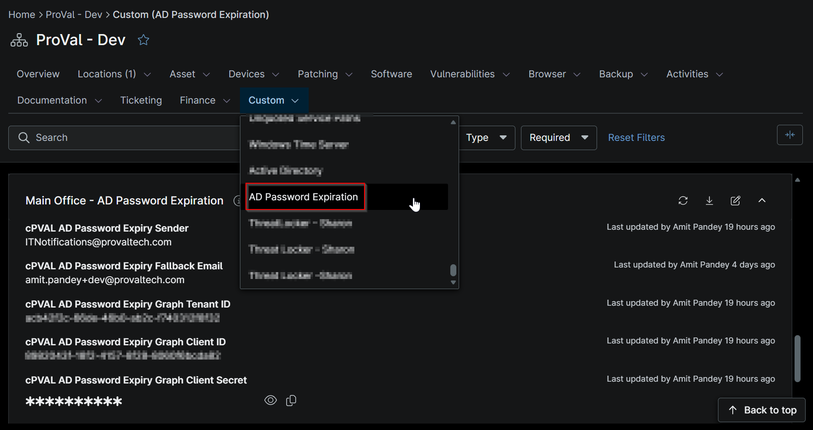

## Summary

Optional. Helpdesk/PSA mailbox(es) for users without an email address, separated by semicolons (;).

## Details

| Label | Field Name | Example | Definition Scope | Type | Required | Default Value | Dropdown Options | Editable | Custom Field Tab |
| ----- | ---------- | ------- | ---------------- | ---- | -------- | ------------- | ---------------- | -------- | ---------------- |
| cPVAL AD Password Expiry Fallback Email | cpvalAdPasswordExpiryFallbackEmail | helpdesk@domain.com | `Organization`, `Location`, `Device` | Text | false |  |  | Yes | AD Password Expiration |

## Dependencies

- [Solution - AD Password Expiration Notification](/docs/d4cea30e-2724-4a28-870e-91eb349ad028)

## Custom Field Creation

- [Custom Field Configuration](https://github.com/ProVal-Tech/ninjarmm/blob/main/custom-fields/cpval-ad-password-expiry-fallback-email.toml)

## Sample Screenshot

### Device Level

### Organization and Location Level

## Changelog

### 2026-11-09

- Initial version of the document