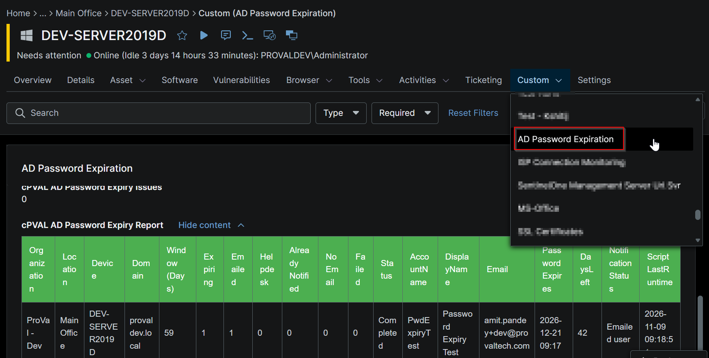

## Summary

This custom field stores the last-run summary, expiring user list, including their status in the html data (tabular format).

## Details

| Label | Field Name | Example | Definition Scope | Type | Required | Default Value | Dropdown Options | Editable | Custom Field Tab |
| ----- | ---------- | ------- | ---------------- | ---- | -------- | ------------- | ---------------- | -------- | ---------------- |
| cPVAL AD Password Expiry Report | cpvalAdPasswordExpiryReport | html data | `Device` | WYSIWYG | false |  |  | Yes | AD Password Expiration |

## Dependencies

- [Solution - AD Password Expiration Notification](/docs/d4cea30e-2724-4a28-870e-91eb349ad028)

## Custom Field Creation

- [Custom Field Configuration](https://github.com/ProVal-Tech/ninjarmm/blob/main/custom-fields/cpval-ad-password-expiry-report.toml)

## Sample Screenshot

### Device Level

## Changelog

### 2026-11-09

- Initial version of the document