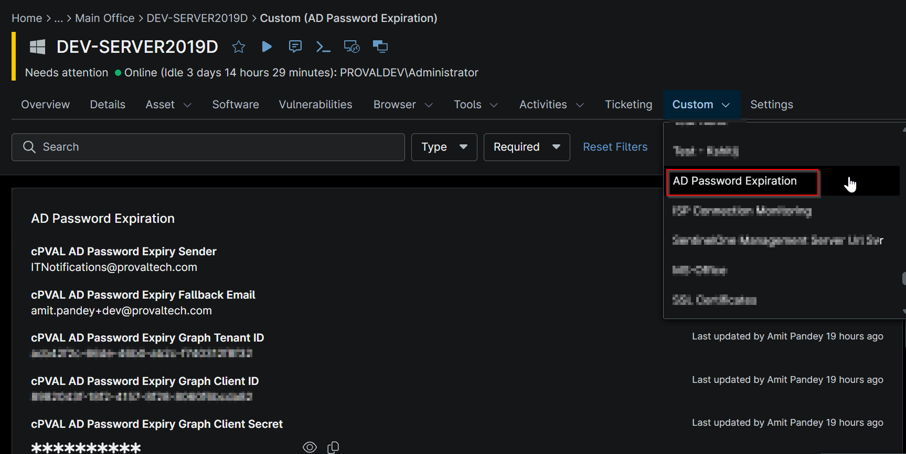
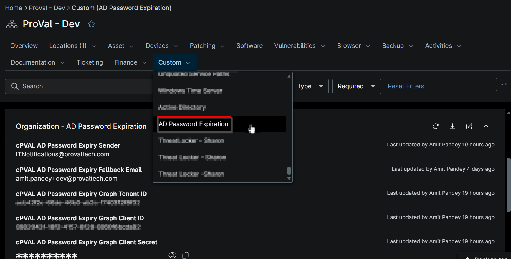
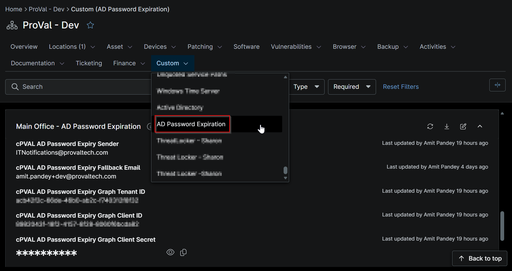

## Summary

Required. Specify the mailbox used to send password expiration notifications. For SMTP delivery, the IT Support email address can also be used.

## Details

| Label | Field Name | Example | Definition Scope | Type | Required | Default Value | Dropdown Options | Editable | Custom Field Tab |
| ----- | ---------- | ------- | ---------------- | ---- | -------- | ------------- | ---------------- | -------- | ---------------- |
| cPVAL AD Password Expiry Sender | cpvalAdPasswordExpirySender | it@domain.com | `Organization`, `Location`, `Device` | Text | false |  |  | Yes | AD Password Expiration |

## Dependencies

- [Solution - AD Password Expiration Notification](/docs/d4cea30e-2724-4a28-870e-91eb349ad028)

## Custom Field Creation

- [Custom Field Configuration](https://github.com/ProVal-Tech/ninjarmm/blob/main/custom-fields/cpval-ad-password-expiry-sender.toml)

## Sample Screenshot

### Device Level

### Organization and Location Level

## Changelog

### 2026-11-09

- Initial version of the document