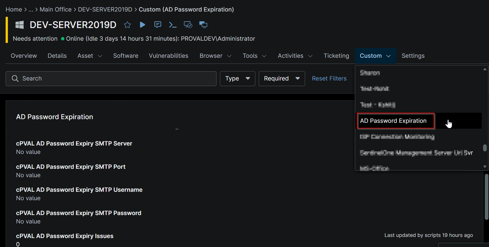
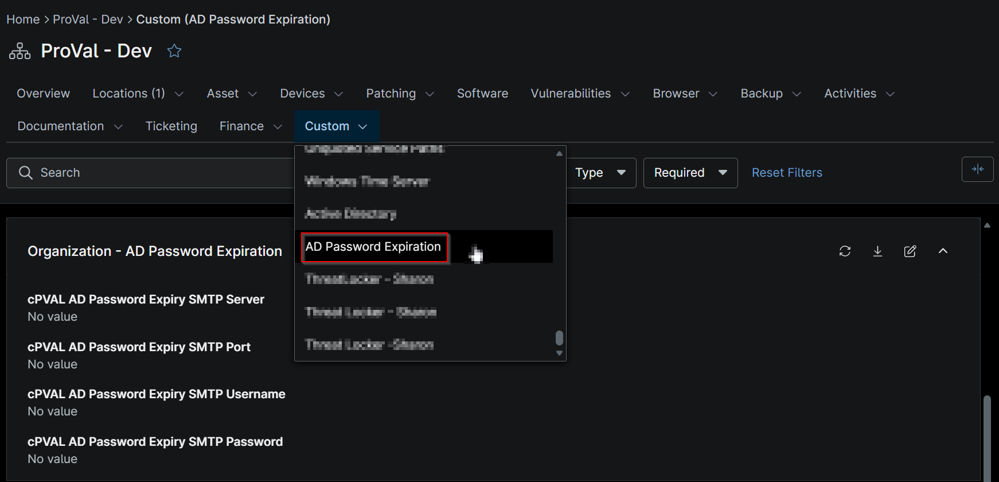
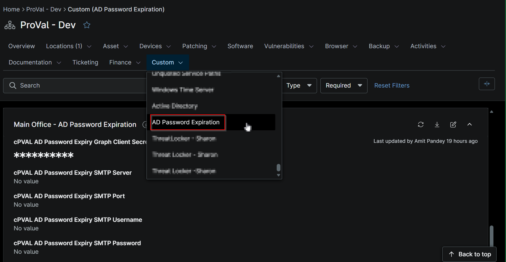

## Summary

Provide the SMTP port detail. 

Required only when the [cPVAL AD Password Expiry Email Method](/docs/546c3075-2c22-4886-b9a6-224055c744e7) is set to `SMTP`.

## Details

| Label | Field Name | Example | Definition Scope | Type | Required | Default Value | Dropdown Options | Editable | Custom Field Tab |
| ----- | ---------- | ------- | ---------------- | ---- | -------- | ------------- | ---------------- | -------- | ---------------- |
| cPVAL AD Password Expiry SMTP Port | cpvalAdPasswordExpirySmtpPort | ******* | `Organization`, `Location`, `Device` | Text | false |  |  | Yes | AD Password Expiration |

## Dependencies

- [Solution - AD Password Expiration Notification](/docs/d4cea30e-2724-4a28-870e-91eb349ad028)

## Custom Field Creation

- [Custom Field Configuration](https://github.com/ProVal-Tech/ninjarmm/blob/main/custom-fields/cpval-ad-password-expiry-smtp-port.toml)

## Sample Screenshot

### Device Level

### Organization and Location Level

## Changelog

### 2026-11-09

- Initial version of the document