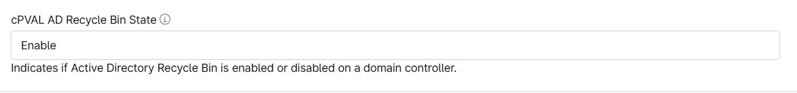

## Summary

Indicates if Active Directory Recycle Bin is enabled or disabled on a domain controller. This custom field is updated by [Automation : Active Directory - Enable AD Recycle Bin](/docs/afd7cc1e-9518-4eef-9685-7f2653248b8f) script.

## Details

| Label | Field Name | Example | Definition Scope | Type | Required | Default Value | Dropdown Options | Editable | Custom Field Tab |
| ----- | ---------- | ------- | ---------------- | ---- | -------- | ------------- | ---------------- | -------- | ---------------- |
| cPVAL AD Recycle Bin State | cpvalAdRecycleBinState |  | `Device` | Text | False | | True | Active Directory |

## Dependencies

* [Automation : Active Directory - Enable AD Recycle Bin](/docs/afd7cc1e-9518-4eef-9685-7f2653248b8f)
* [Solution - AD Recycle Bin](/docs/56ed4b40-11ce-4f8d-b1ca-c897d2c496e6)

## Custom Field Creation

- [Custom Field Configuration](https://github.com/ProVal-Tech/ninjarmm/blob/main/custom-fields/cpval-ad-recycle-bin-state.toml)

## Sample Screenshot

## Changelog

### 2026-10-29

- Initial version of the document
