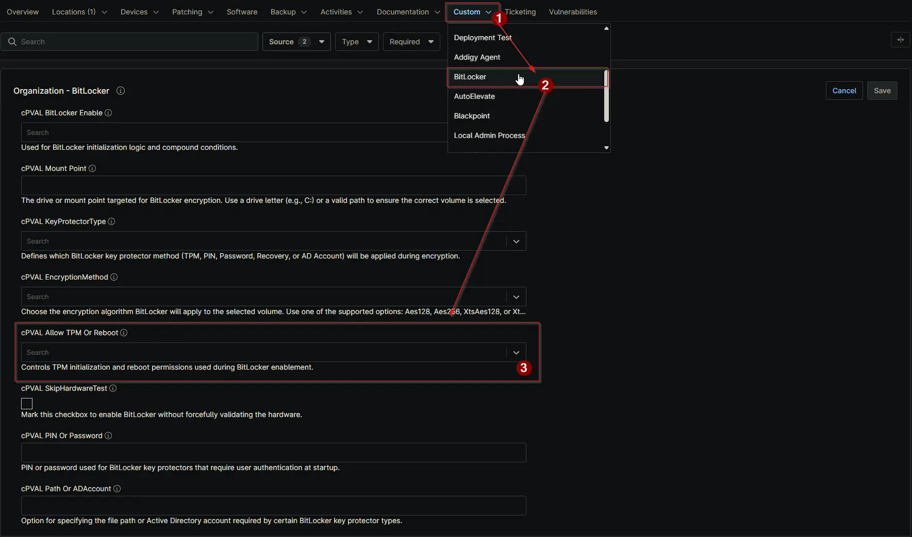

## Summary

Defines whether the [BitLocker Initialize - NinjaOne](/docs/2ebfabd5-05cf-4175-a513-2aa290eb26e8) solution may initialize the TPM and restart the device. When the field is blank, it uses `0`.

| Value | Allows |
| ----- | ------ |
| `0` | Neither |
| `1` | Initializing the TPM when it is not ready |
| `2` | Restarting the device when the BitLocker hardware test needs a restart |
| `3` | Initializing the TPM and the restarts it or the hardware test needs |

Without permission to restart, encryption starts after the next restart the user makes, and a TPM initialization that needs a restart completes on the first run after that restart.

:::note  
TPM initialization can clear the TPM, which removes keys other software keeps in it, such as Windows Hello PINs.  
:::

## Details

| Label | Field Name | Example | Definition Scope | Type | Required | Default Value | Dropdown Options | Editable | Custom Field Tab |
| ----- | ---------- | ------- | ---------------- | ---- | -------- | ------------- | ---------------- | -------- | ---------------- |
| cPVAL Allow TPM Or Reboot | cpvalAllowTpmOrReboot | `3` | `Organization`, `Location`, `Device` | `Drop-down` | `False` | `0` | `0`, `1`, `2`, `3` | `Yes` | BitLocker |

## Dependencies

- [Automation: BitLocker Initialization - Detection](/docs/87d7a413-4bd4-4629-9475-35db91cb1320)
- [Automation: Initialize and Audit BitLocker](/docs/e3a24552-f347-4117-82f5-7afaaa3fc198)
- [Solution: BitLocker Initialize - NinjaOne](/docs/2ebfabd5-05cf-4175-a513-2aa290eb26e8)

## Custom Field Creation

- [Custom Field Configuration](https://github.com/ProVal-Tech/ninjarmm/blob/main/custom-fields/cpval-allow-tpm-or-reboot.toml)

## Sample Screenshot

## Changelog

### 2026-10-26

- Documented which restarts each value allows and that TPM initialization can clear the TPM.
- Updated the document to the standard format.

### 2025-12-16

- Initial version of the document
