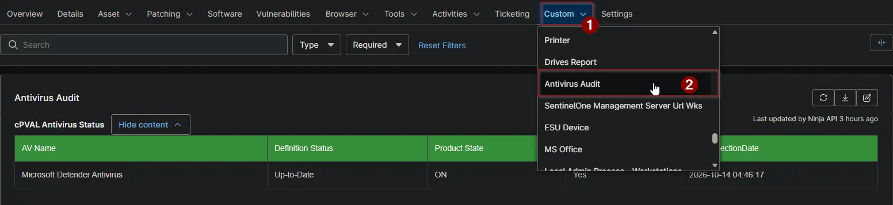

## Summary

Shows the antivirus products NinjaOne reports for the device, with their definition status and whether they are switched on. Devices without antivirus are marked too. Use it to find devices that are unprotected, switched off or out of date. The [Antivirus Status Audit](/docs/3724a85b-929e-4f55-9b3a-bd13a21e1d05) automation fills this field for every Windows and Mac device. The [Antivirus Status](/docs/460013c8-7bb9-4773-ac6b-a03689575e79) and [Antivirus Missing](/docs/08cc8eb4-7a6f-4a17-a34e-218e5ff5e547) reports collect it from every client.

:::note  
The data comes from the antivirus information NinjaOne already shows under **Details > Antivirus**. Nothing is collected on the device itself.
:::

## Details

| Label | Field Name | Example | Definition Scope | Type | Required | Default Value | Dropdown Options | Editable | Custom Field Tab |
| ----- | ---------- | ------- | ---------------- | ---- | -------- | ------------- | ---------------- | -------- | ---------------- |
| cPVAL Antivirus Status | cpvalAntivirusStatus | HTML table | `Device` | `WYSIWYG` | `False` | - | - | `Yes` | Antivirus Audit |

## Table Columns

The field holds a table with one row per antivirus product. A device without antivirus has a single row with `Is Installed` set to `No`.

| Column | Description |
| ------ | ----------- |
| AV Name | The antivirus product, for example `Microsoft Defender Antivirus`. |
| Definition Status | Whether the virus definitions are current, for example `Up-to-Date`. |
| Product State | Whether the antivirus is switched on: `ON` or `OFF`. |
| Is Installed | `Yes` for an antivirus product. `No` when NinjaOne reports no antivirus for the device. |
| DataCollectionDate | When NinjaOne collected the antivirus information. Blank when NinjaOne has no antivirus information for the device. |

## Dependencies

* [Automation: Antivirus Status Audit](/docs/3724a85b-929e-4f55-9b3a-bd13a21e1d05)
* [Audit Report: Antivirus Status](/docs/460013c8-7bb9-4773-ac6b-a03689575e79)
* [Audit Report: Antivirus Missing](/docs/08cc8eb4-7a6f-4a17-a34e-218e5ff5e547)
* [Solution: Antivirus Status Audit](/docs/d613b809-a8cf-4dde-b3fa-e36b13223eeb)

## Custom Field Creation

- [Custom Field Configuration](https://github.com/ProVal-Tech/ninjarmm/blob/main/custom-fields/cpval-antivirus-status.toml)

## Sample Screenshot

## Changelog

### 2026-10-14

- Initial version of the document
