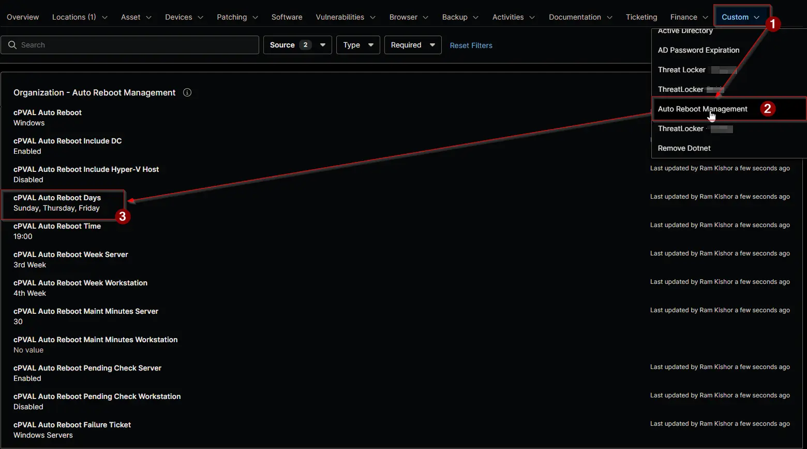

## Summary

Selects the days of the week on which the [Auto Reboot Management - NinjaOne](/docs/52091463-99b7-4a21-8ad0-7ade5b8212e7) solution restarts devices. Select one or more days. Together with [cPVAL Auto Reboot Time](/docs/bf65ebff-8d3b-463b-a97f-90dd19ff45fc) and the week fields, it sets the restart schedule.

:::note

- The days selected at the most specific level replace the days selected above it. They're never combined. For example, if the organization selects `Saturday` and a location selects `Sunday`, devices at that location restart on Sunday only.
- A blank value inherits the days from the level above. No day selected at any level means no restart.
- A change takes effect at the next run of the [Auto Reboot Management](/docs/15697579-8f51-4c51-9812-d909edebfc8b) automation, within an hour.

:::

## Details

| Label | Field Name | Example | Definition Scope | Type | Required | Default Value | Dropdown Options | Editable | Custom Field Tab |
| ----- | ---------- | ------- | ---------------- | ---- | -------- | ------------- | ---------------- | -------- | ---------------- |
| cPVAL Auto Reboot Days | cpvalAutoRebootDays | `Sunday` | `Organization`, `Location`, `Device` | Multi-select | No | | `Sunday`, `Monday`, `Tuesday`, `Wednesday`, `Thursday`, `Friday`, `Saturday` | Yes | <ul><li>`Auto Reboot Management` (Organization and Location)</li><li>`Auto Reboot Management - Servers`</li><li>`Auto Reboot Management - Workstations`</li></ul> |

## Dependencies

- [Automation: Auto Reboot Management](/docs/15697579-8f51-4c51-9812-d909edebfc8b)
- [Custom Field: cPVAL Auto Reboot Time](/docs/bf65ebff-8d3b-463b-a97f-90dd19ff45fc)
- [Custom Field: cPVAL Auto Reboot Week Server](/docs/de971df1-518d-4504-8efe-deae1895296d)
- [Custom Field: cPVAL Auto Reboot Week Workstation](/docs/5a05feef-d177-49a7-a5fd-876d7589c567)
- [Solution: Auto Reboot Management - NinjaOne](/docs/52091463-99b7-4a21-8ad0-7ade5b8212e7)

## Custom Field Creation

- [Custom Field Configuration](https://github.com/ProVal-Tech/ninjarmm/blob/main/custom-fields/cpval-auto-reboot-days.toml)

## Sample Screenshot

## Changelog

### 2026-11-11

- Initial version of the document
