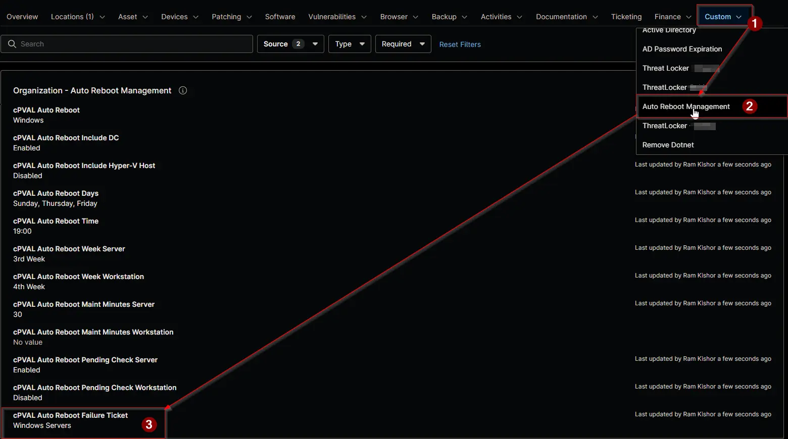

## Summary

Selects the device types for which a failed scheduled restart creates a ConnectWise Manage ticket. The reboot failure compound conditions read this field.

| Option | Workstations | Servers |
| ------ | ------------ | ------- |
| `Windows` | Ticket | Ticket |
| `Windows Workstations` | Ticket | No ticket |
| `Windows Servers` | No ticket | Ticket |
| `Disabled` | No ticket | No ticket |

The failure itself is always recorded in [cPVAL Auto Reboot Failure](/docs/3b31f3bd-c1b1-4f43-bce9-ea6f669f783a), whatever this field holds. This field only decides whether a ticket is created.

:::note

- Servers include domain controllers and Hyper-V hosts.
- A blank value inherits from the level above. Blank at every level creates no ticket.

:::

## Details

| Label | Field Name | Example | Definition Scope | Type | Required | Default Value | Dropdown Options | Editable | Custom Field Tab |
| ----- | ---------- | ------- | ---------------- | ---- | -------- | ------------- | ---------------- | -------- | ---------------- |
| cPVAL Auto Reboot Failure Ticket | cpvalAutoRebootFailureTicket | `Windows Servers` | `Organization`, `Location`, `Device` | Drop-down | No | | `Windows`, `Windows Workstations`, `Windows Servers`, `Disabled` | Yes | <ul><li>`Auto Reboot Management` (Organization and Location)</li><li>`Auto Reboot Management - Servers`</li><li>`Auto Reboot Management - Workstations`</li></ul> |

## Dependencies

- [Automation: Auto Reboot Management - Failure Detection](/docs/6bf3e590-1fb6-4dc8-9b38-423176e0025c)
- [Compound Condition: Auto Reboot Management - Reboot Failure [Windows Servers]](/docs/f458ca84-e7c2-44d1-ad9c-15421c77d5d4)
- [Compound Condition: Auto Reboot Management - Reboot Failure [Windows Workstations]](/docs/76d88457-ec23-4b6b-81e2-af0a13583aa0)
- [Ticket Template: Auto Reboot Failure](/docs/375c80c2-07dd-43b9-b24b-3cc4c948c105)
- [Solution: Auto Reboot Management - NinjaOne](/docs/52091463-99b7-4a21-8ad0-7ade5b8212e7)

## Custom Field Creation

- [Custom Field Configuration](https://github.com/ProVal-Tech/ninjarmm/blob/main/custom-fields/cpval-auto-reboot-failure-ticket.toml)

## Sample Screenshot

## Changelog

### 2026-11-11

- Initial version of the document
