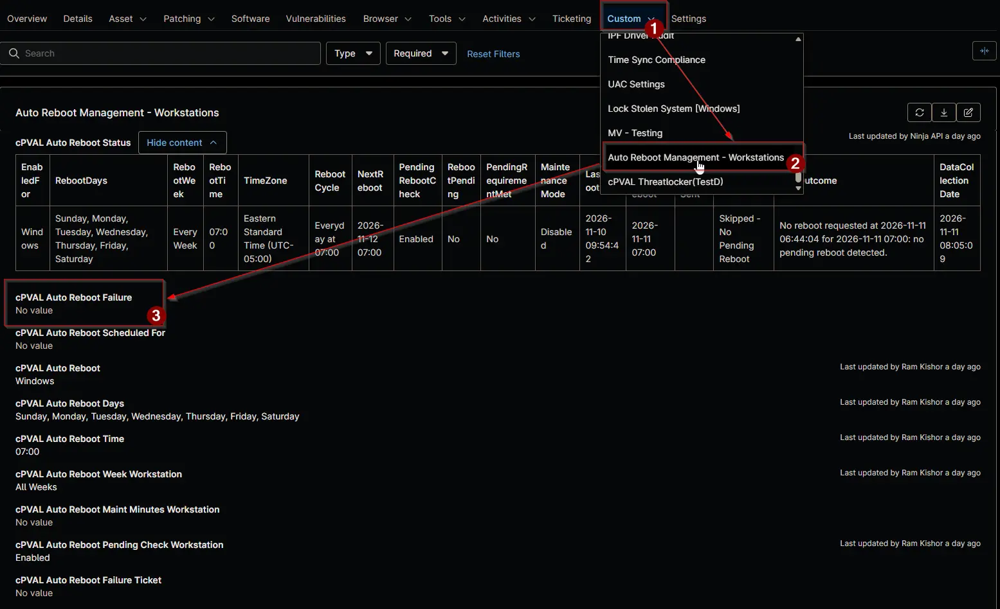

## Summary

Shows the latest failed scheduled restart of the device. The [Auto Reboot Management](/docs/15697579-8f51-4c51-9812-d909edebfc8b) automation writes it when the result of a restart becomes `Not Rebooted`, `Not Confirmed - Offline`, `Not Picked Up` or `Failed - On Device`, followed by the details. The reboot failure compound conditions read it to create a ticket.

The failure is always recorded, whether ticketing is enabled or not. [cPVAL Auto Reboot Failure Ticket](/docs/4c0f96e5-8387-4cb6-8426-d267ec01b0f9) decides whether a ticket is created.

The field is cleared:

- when a later restart of the device is confirmed;
- when the same restart turns out not to be a failure, for example a device that comes back online after the restart time and records it as missed;
- when the device is no longer enabled for auto reboot.

:::note

Clear the field to acknowledge a failure. It's written again only when a new failure occurs, and clearing it resets the reboot failure compound condition, which closes its ticket.

:::

## Details

| Label | Field Name | Example | Definition Scope | Type | Required | Default Value | Dropdown Options | Editable | Custom Field Tab |
| ----- | ---------- | ------- | ---------------- | ---- | -------- | ------------- | ---------------- | -------- | ---------------- |
| cPVAL Auto Reboot Failure | cpvalAutoRebootFailure | `Not Rebooted: The reboot scheduled for 2026-11-10 02:00 did not happen; last boot 2026-11-05 11:26:57.` | `Device` | Text | No | |  | Yes | <ul><li>`Auto Reboot Management - Servers`</li><li>`Auto Reboot Management - Workstations`</li></ul> |

## Dependencies

- [Automation: Auto Reboot Management](/docs/15697579-8f51-4c51-9812-d909edebfc8b)
- [Automation: Auto Reboot Management - Failure Detection](/docs/6bf3e590-1fb6-4dc8-9b38-423176e0025c)
- [Compound Condition: Auto Reboot Management - Reboot Failure [Windows Servers]](/docs/f458ca84-e7c2-44d1-ad9c-15421c77d5d4)
- [Compound Condition: Auto Reboot Management - Reboot Failure [Windows Workstations]](/docs/76d88457-ec23-4b6b-81e2-af0a13583aa0)
- [Solution: Auto Reboot Management - NinjaOne](/docs/52091463-99b7-4a21-8ad0-7ade5b8212e7)

## Custom Field Creation

- [Custom Field Configuration](https://github.com/ProVal-Tech/ninjarmm/blob/main/custom-fields/cpval-auto-reboot-failure.toml)

## Sample Screenshot

## Changelog

### 2026-11-11

- Initial version of the document
