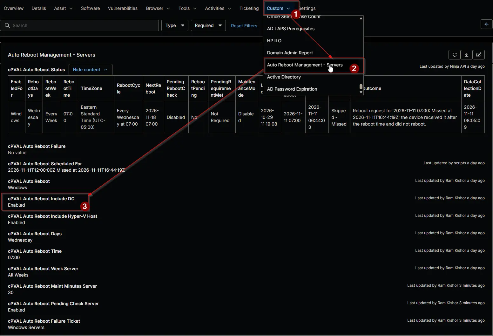

## Summary

Includes domain controllers in the [Auto Reboot Management - NinjaOne](/docs/52091463-99b7-4a21-8ad0-7ade5b8212e7) schedule. Domain controllers are excluded by default, so a client's servers can be restarted without taking down its domain controllers at the same time.

- `Enabled` restarts domain controllers on the server schedule.
- `Disabled`, or a blank value at every level, keeps them excluded. Set `Disabled` at a lower level to exclude them again.

Domain controllers are detected by the NTDS service or by the domain role the NinjaOne agent reports. The field applies to servers only.

:::note

- Set the field at the organization level for a whole client, and override it at a location or on a device where needed. The most specific value wins.
- A blank value inherits from the level above.
- A change takes effect at the next run of the [Auto Reboot Management](/docs/15697579-8f51-4c51-9812-d909edebfc8b) automation, within an hour.

:::

## Details

| Label | Field Name | Example | Definition Scope | Type | Required | Default Value | Dropdown Options | Editable | Custom Field Tab |
| ----- | ---------- | ------- | ---------------- | ---- | -------- | ------------- | ---------------- | -------- | ---------------- |
| cPVAL Auto Reboot Include DC | cpvalAutoRebootIncludeDc | `Enabled` | `Organization`, `Location`, `Device` | Drop-down | No | | `Enabled`, `Disabled` | Yes | <ul><li>`Auto Reboot Management` (Organization and Location)</li><li>`Auto Reboot Management - Servers`</li></ul> |

## Dependencies

- [Automation: Auto Reboot Management](/docs/15697579-8f51-4c51-9812-d909edebfc8b)
- [Custom Field: cPVAL Auto Reboot](/docs/cab41cb1-87d8-4d37-bbe2-3faa67516831)
- [Solution: Auto Reboot Management - NinjaOne](/docs/52091463-99b7-4a21-8ad0-7ade5b8212e7)

## Custom Field Creation

- [Custom Field Configuration](https://github.com/ProVal-Tech/ninjarmm/blob/main/custom-fields/cpval-auto-reboot-include-dc.toml)

## Sample Screenshot

## Changelog

### 2026-11-11

- Initial version of the document
