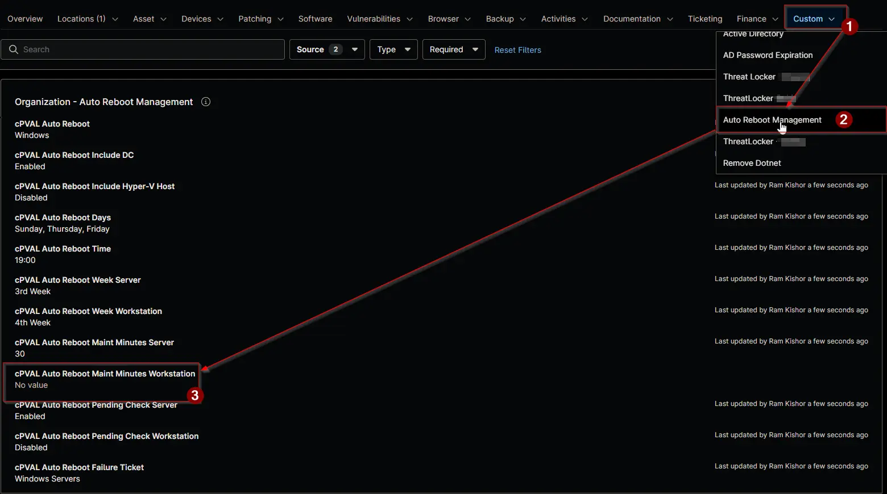

## Summary

Sets how many minutes of NinjaOne maintenance mode cover the scheduled restart of workstations, so the restart doesn't raise offline alerts or start tasks. Maintenance mode starts 5 minutes before the restart time and ends this many minutes after it.

| Value | Result |
| ----- | ------ |
| Blank | Inherits from the level above. Blank at every level means no maintenance mode. |
| `0` | No maintenance mode at this level, even if a level above sets one. |
| `1` to `14` | 15 minutes, the shortest window applied. |
| `15` or more | The number of minutes set. |

:::note

- Maintenance mode is scheduled only when a restart is requested, and suppresses alerts and tasks.
- The field applies to workstations only and is ignored on servers.
- A change takes effect at the next run of the [Auto Reboot Management](/docs/15697579-8f51-4c51-9812-d909edebfc8b) automation, within an hour.

:::

## Details

| Label | Field Name | Example | Definition Scope | Type | Required | Default Value | Dropdown Options | Editable | Custom Field Tab |
| ----- | ---------- | ------- | ---------------- | ---- | -------- | ------------- | ---------------- | -------- | ---------------- |
| cPVAL Auto Reboot Maint Minutes Workstation | cpvalAutoRebootMaintMinutesWorkstation | `30` | `Organization`, `Location`, `Device` | Integer | No | |  | Yes | <ul><li>`Auto Reboot Management` (Organization and Location)</li><li>`Auto Reboot Management - Workstations`</li></ul> |

## Dependencies

- [Automation: Auto Reboot Management](/docs/15697579-8f51-4c51-9812-d909edebfc8b)
- [Solution: Auto Reboot Management - NinjaOne](/docs/52091463-99b7-4a21-8ad0-7ade5b8212e7)

## Custom Field Creation

- [Custom Field Configuration](https://github.com/ProVal-Tech/ninjarmm/blob/main/custom-fields/cpval-auto-reboot-maint-minutes-workstation.toml)

## Sample Screenshot

## Changelog

### 2026-11-11

- Initial version of the document
