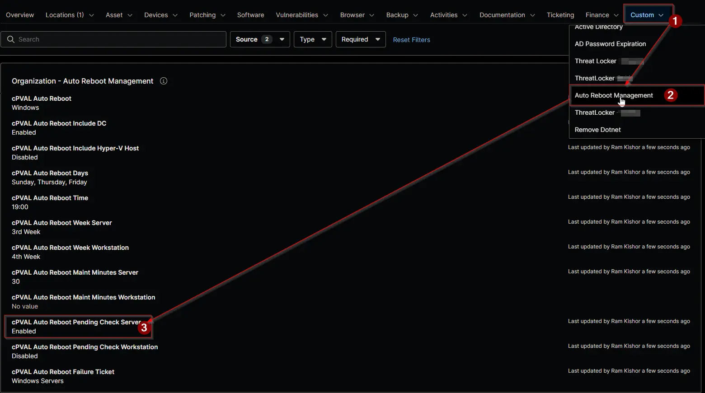

## Summary

Restarts servers only when NinjaOne reports a pending reboot, for example after updates are installed.

- `Enabled` skips the scheduled restart of a server that has no pending reboot. The skip is recorded in [cPVAL Auto Reboot Status](/docs/1c29d754-ec90-4f42-88f1-4ac335657fbc) as `Skipped - No Pending Reboot`.
- `Disabled` restarts servers on schedule whether a reboot is pending or not.

The pending reboot state is the one the NinjaOne agent last reported for the device, so a reboot that became pending in the last few minutes may not be seen yet.

:::note

- The field applies to servers only and is ignored on workstations.
- A blank value inherits from the level above. Blank at every level means `Disabled`.
- A change takes effect at the next run of the [Auto Reboot Management](/docs/15697579-8f51-4c51-9812-d909edebfc8b) automation, within an hour.

:::

## Details

| Label | Field Name | Example | Definition Scope | Type | Required | Default Value | Dropdown Options | Editable | Custom Field Tab |
| ----- | ---------- | ------- | ---------------- | ---- | -------- | ------------- | ---------------- | -------- | ---------------- |
| cPVAL Auto Reboot Pending Check Server | cpvalAutoRebootPendingCheckServer | `Enabled` | `Organization`, `Location`, `Device` | Drop-down | No | | `Enabled`, `Disabled` | Yes | <ul><li>`Auto Reboot Management` (Organization and Location)</li><li>`Auto Reboot Management - Servers`</li></ul> |

## Dependencies

- [Automation: Auto Reboot Management](/docs/15697579-8f51-4c51-9812-d909edebfc8b)
- [Custom Field: cPVAL Auto Reboot Status](/docs/1c29d754-ec90-4f42-88f1-4ac335657fbc)
- [Solution: Auto Reboot Management - NinjaOne](/docs/52091463-99b7-4a21-8ad0-7ade5b8212e7)

## Custom Field Creation

- [Custom Field Configuration](https://github.com/ProVal-Tech/ninjarmm/blob/main/custom-fields/cpval-auto-reboot-pending-check-server.toml)

## Sample Screenshot

## Changelog

### 2026-11-11

- Initial version of the document
