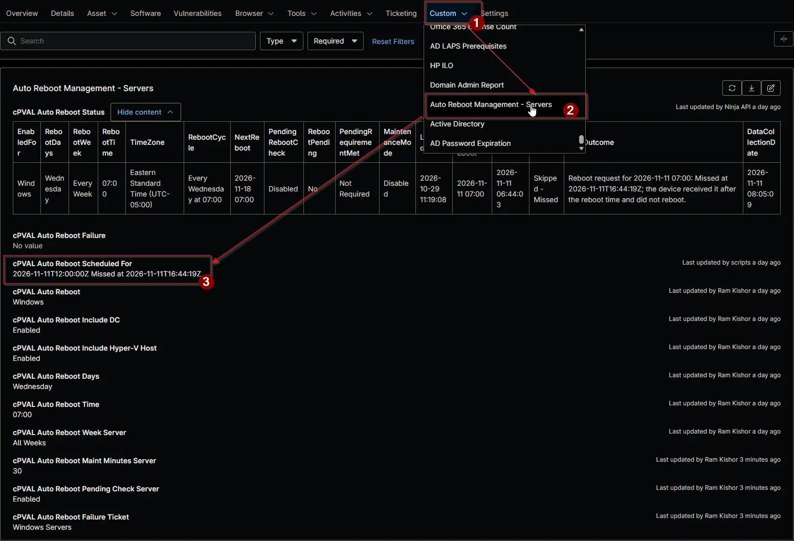

## Summary

Holds the restart request that the [Auto Reboot Management](/docs/15697579-8f51-4c51-9812-d909edebfc8b) automation writes 25 to 55 minutes before a device is due to restart, and the outcome the device writes once it acts on it. The reboot trigger compound conditions read it to run the [Auto Reboot Management - Reboot Machine](/docs/585400cb-52f4-4432-84b7-a57569a3dc39) automation on the device.

The restart time is stored in UTC, so the device restarts at the right moment whatever its own time zone.

| Value | Meaning |
| ----- | ------- |
| `2026-11-10T07:00:00Z` | The request is pending; the device hasn't acted on it yet. |
| `2026-11-10T07:00:00Z Scheduled at 2026-11-10T06:41:12Z` | The device scheduled the restart. |
| `2026-11-10T07:00:00Z Missed at 2026-11-10T07:12:40Z` | The device received the request after the restart time, so it didn't restart. |
| `2026-11-10T07:00:00Z Failed at 2026-11-10T06:41:12Z: ...` | The device couldn't schedule the restart. |

:::note

- To cancel a pending restart, clear the field before the device acts on it. Once the field shows `Scheduled`, the restart is already counting down on the device; cancel it there with `shutdown /a`.
- The field is script-managed. Don't enter a value by hand.

:::

## Details

| Label | Field Name | Example | Definition Scope | Type | Required | Default Value | Dropdown Options | Editable | Custom Field Tab |
| ----- | ---------- | ------- | ---------------- | ---- | -------- | ------------- | ---------------- | -------- | ---------------- |
| cPVAL Auto Reboot Scheduled For | cpvalAutoRebootScheduledFor | `2026-11-10T07:00:00Z Scheduled at 2026-11-10T06:41:12Z` | `Device` | Text | No | |  | Yes | <ul><li>`Auto Reboot Management - Servers`</li><li>`Auto Reboot Management - Workstations`</li></ul> |

## Dependencies

- [Automation: Auto Reboot Management](/docs/15697579-8f51-4c51-9812-d909edebfc8b)
- [Automation: Auto Reboot Management - Reboot Detection](/docs/43641711-d392-4d1e-af16-991a71b6536a)
- [Automation: Auto Reboot Management - Reboot Machine](/docs/585400cb-52f4-4432-84b7-a57569a3dc39)
- [Compound Condition: Auto Reboot Management - Reboot Trigger [Windows Servers]](/docs/41ccbc86-b7f0-4674-9c7c-f765a0e0df01)
- [Compound Condition: Auto Reboot Management - Reboot Trigger [Windows Workstations]](/docs/5313102f-bd2a-4350-a775-07c150632573)
- [Solution: Auto Reboot Management - NinjaOne](/docs/52091463-99b7-4a21-8ad0-7ade5b8212e7)

## Custom Field Creation

- [Custom Field Configuration](https://github.com/ProVal-Tech/ninjarmm/blob/main/custom-fields/cpval-auto-reboot-scheduled-for.toml)

## Sample Screenshot

## Changelog

### 2026-11-11

- Initial version of the document
