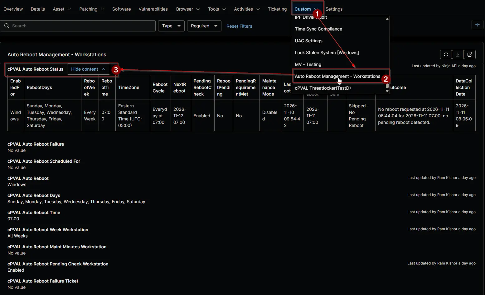

## Summary

Shows the effective [Auto Reboot Management - NinjaOne](/docs/52091463-99b7-4a21-8ad0-7ade5b8212e7) schedule of the device, its next restart and the result of its last scheduled restart, as a one row table. The [Auto Reboot Management](/docs/15697579-8f51-4c51-9812-d909edebfc8b) automation writes it on every device enabled for auto reboot, and the [Auto Reboot Management Status](/docs/413d9e77-6f09-457a-9ff1-f9142b0e38e9) report combines it across devices.

| Column | Shows |
| ------ | ----- |
| EnabledFor | The value of [cPVAL Auto Reboot](/docs/cab41cb1-87d8-4d37-bbe2-3faa67516831) that applies to the device. |
| RebootDays | The days the device restarts on. |
| RebootWeek | `Every Week`, or the week of the month, such as `Week 2`. |
| RebootTime | The restart time. |
| RebootCycle | The full schedule, for example `2nd Tuesday at 02:00`. |
| NextReboot | The date and time of the next restart. |
| PendingRebootCheck | Whether the pending reboot check applies: `Enabled` or `Disabled`. |
| RebootPending | Whether NinjaOne reports a pending reboot: `Yes` or `No`. |
| PendingRequirementMet | `Yes`, `No`, or `Not Required` when the check doesn't apply. |
| MaintenanceMode | The maintenance mode applied around the restart, such as `30 minutes`, or `Disabled`. |
| LastReboot | When the device last started. |
| LastScheduledReboot | The restart the solution last handled. |
| LastRebootSent | When the restart request was written. |
| RebootResult | The result of the last scheduled restart. See below. |
| LastOutcome | Details of the last action, such as when the device scheduled the restart. |
| DataCollectionDate | When the row last changed. |

| RebootResult | Meaning |
| ------------ | ------- |
| `Awaiting Reboot` | The restart was requested and its time hasn't passed by 30 minutes yet. |
| `Rebooted` | The device started after the restart was requested. |
| `Not Rebooted` | The device scheduled the restart but, 30 minutes after the restart time, is online and hasn't restarted. |
| `Not Confirmed - Offline` | The device scheduled the restart and is offline 30 minutes after the restart time, so the restart can't be confirmed. |
| `Not Picked Up` | The device is online 30 minutes after the restart time but never acted on the request. |
| `Failed - On Device` | The device couldn't schedule the restart. |
| `Skipped - Offline` | The device was offline and never received the request. No restart. |
| `Skipped - Missed` | The device received the request after the restart time and didn't restart. |
| `Skipped - Cancelled` | The request was cleared before the restart was confirmed. |
| `Skipped - No Pending Reboot` | The pending reboot check applied and no reboot was pending. |

:::note

- The table is rewritten only when a value other than DataCollectionDate changes.
- It's cleared when the device is no longer enabled for auto reboot.
- The field is script-managed and read only for technicians.

:::

## Details

| Label | Field Name | Example | Definition Scope | Type | Required | Default Value | Dropdown Options | Editable | Custom Field Tab |
| ----- | ---------- | ------- | ---------------- | ---- | -------- | ------------- | ---------------- | -------- | ---------------- |
| cPVAL Auto Reboot Status | cpvalAutoRebootStatus | *HTML table* | `Device` | WYSIWYG | No | |  | No | <ul><li>`Auto Reboot Management - Servers`</li><li>`Auto Reboot Management - Workstations`</li></ul> |

## Dependencies

- [Automation: Auto Reboot Management](/docs/15697579-8f51-4c51-9812-d909edebfc8b)
- [Audit Report: Auto Reboot Management Status](/docs/413d9e77-6f09-457a-9ff1-f9142b0e38e9)
- [Automation: WYSIWYG Custom Field Report - Organization and Global KB](/docs/67df14cd-3c20-4a40-bb7a-80caae242687)
- [Scheduled Task: Auto Reboot Management](/docs/33d689db-0f80-4f9d-928a-eb76fe283ff5)
- [Solution: Auto Reboot Management - NinjaOne](/docs/52091463-99b7-4a21-8ad0-7ade5b8212e7)

## Custom Field Creation

- [Custom Field Configuration](https://github.com/ProVal-Tech/ninjarmm/blob/main/custom-fields/cpval-auto-reboot-status.toml)

## Sample Screenshot

## Changelog

### 2026-11-11

- Initial version of the document
