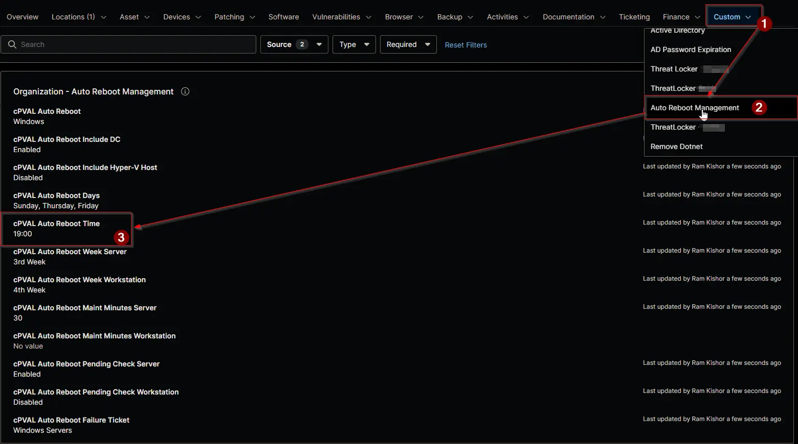

## Summary

Selects the time of day at which the [Auto Reboot Management - NinjaOne](/docs/52091463-99b7-4a21-8ad0-7ade5b8212e7) solution restarts devices, on the hour or the half hour, from `00:00` to `23:30`.

Times follow the time zone of the device that runs the [Auto Reboot Management](/docs/15697579-8f51-4c51-9812-d909edebfc8b) automation. A device in another time zone restarts at the same moment, so its local restart time differs. Users see a restart notice about 50 minutes before a restart on the hour, and about 20 minutes before a restart on the half hour.

:::note

- Times are offered on the hour and the half hour only, so the hourly [Auto Reboot Management](/docs/33d689db-0f80-4f9d-928a-eb76fe283ff5) scheduled task can request every restart at least 25 minutes ahead.
- A blank value inherits from the level above. No time at any level means no restart.
- A change takes effect at the next run of the [Auto Reboot Management](/docs/15697579-8f51-4c51-9812-d909edebfc8b) automation, within an hour.

:::

## Details

| Label | Field Name | Example | Definition Scope | Type | Required | Default Value | Dropdown Options | Editable | Custom Field Tab |
| ----- | ---------- | ------- | ---------------- | ---- | -------- | ------------- | ---------------- | -------- | ---------------- |
| cPVAL Auto Reboot Time | cpvalAutoRebootTime | `02:00` | `Organization`, `Location`, `Device` | Drop-down | No | | `00:00`, `00:30`, `01:00`, `01:30`, `02:00`, `02:30`, `03:00`, `03:30`, `04:00`, `04:30`, `05:00`, `05:30`, `06:00`, `06:30`, `07:00`, `07:30`, `08:00`, `08:30`, `09:00`, `09:30`, `10:00`, `10:30`, `11:00`, `11:30`, `12:00`, `12:30`, `13:00`, `13:30`, `14:00`, `14:30`, `15:00`, `15:30`, `16:00`, `16:30`, `17:00`, `17:30`, `18:00`, `18:30`, `19:00`, `19:30`, `20:00`, `20:30`, `21:00`, `21:30`, `22:00`, `22:30`, `23:00`, `23:30` | Yes | <ul><li>`Auto Reboot Management` (Organization and Location)</li><li>`Auto Reboot Management - Servers`</li><li>`Auto Reboot Management - Workstations`</li></ul> |

## Dependencies

- [Automation: Auto Reboot Management](/docs/15697579-8f51-4c51-9812-d909edebfc8b)
- [Custom Field: cPVAL Auto Reboot Days](/docs/56684cc0-aa4b-4d81-b03b-272db16cb1e7)
- [Scheduled Task: Auto Reboot Management](/docs/33d689db-0f80-4f9d-928a-eb76fe283ff5)
- [Solution: Auto Reboot Management - NinjaOne](/docs/52091463-99b7-4a21-8ad0-7ade5b8212e7)

## Custom Field Creation

- [Custom Field Configuration](https://github.com/ProVal-Tech/ninjarmm/blob/main/custom-fields/cpval-auto-reboot-time.toml)

## Sample Screenshot

## Changelog

### 2026-11-11

- Initial version of the document
