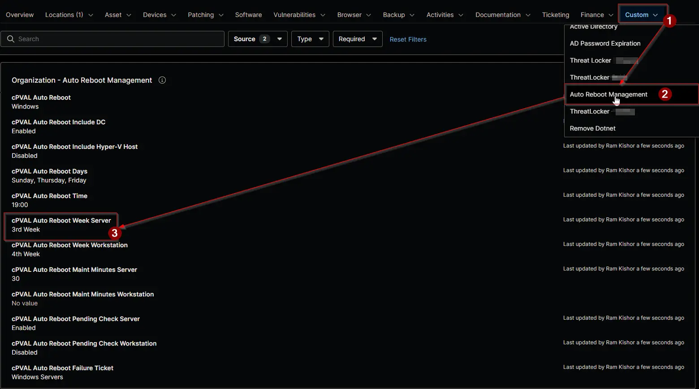

## Summary

Selects the week of the month in which servers restart. `All Weeks` restarts servers every week on the selected days. `1st Week` to `5th Week` restart them in that week of the month only.

Week 1 holds days 1 to 7 of the month, week 2 days 8 to 14, and so on. For example, `2nd Week` with `Tuesday` restarts servers on the second Tuesday of every month. Week 5 holds days 29 to 31, so `5th Week` skips the months in which the selected day doesn't fall on day 29 or later.

:::note

- The field applies to servers only and is ignored on workstations.
- A blank value inherits from the level above. Blank at every level means `All Weeks`.
- A change takes effect at the next run of the [Auto Reboot Management](/docs/15697579-8f51-4c51-9812-d909edebfc8b) automation, within an hour.

:::

## Details

| Label | Field Name | Example | Definition Scope | Type | Required | Default Value | Dropdown Options | Editable | Custom Field Tab |
| ----- | ---------- | ------- | ---------------- | ---- | -------- | ------------- | ---------------- | -------- | ---------------- |
| cPVAL Auto Reboot Week Server | cpvalAutoRebootWeekServer | `2nd Week` | `Organization`, `Location`, `Device` | Drop-down | No | | `All Weeks`, `1st Week`, `2nd Week`, `3rd Week`, `4th Week`, `5th Week` | Yes | <ul><li>`Auto Reboot Management` (Organization and Location)</li><li>`Auto Reboot Management - Servers`</li></ul> |

## Dependencies

- [Automation: Auto Reboot Management](/docs/15697579-8f51-4c51-9812-d909edebfc8b)
- [Custom Field: cPVAL Auto Reboot Days](/docs/56684cc0-aa4b-4d81-b03b-272db16cb1e7)
- [Solution: Auto Reboot Management - NinjaOne](/docs/52091463-99b7-4a21-8ad0-7ade5b8212e7)

## Custom Field Creation

- [Custom Field Configuration](https://github.com/ProVal-Tech/ninjarmm/blob/main/custom-fields/cpval-auto-reboot-week-server.toml)

## Sample Screenshot

## Changelog

### 2026-11-11

- Initial version of the document
