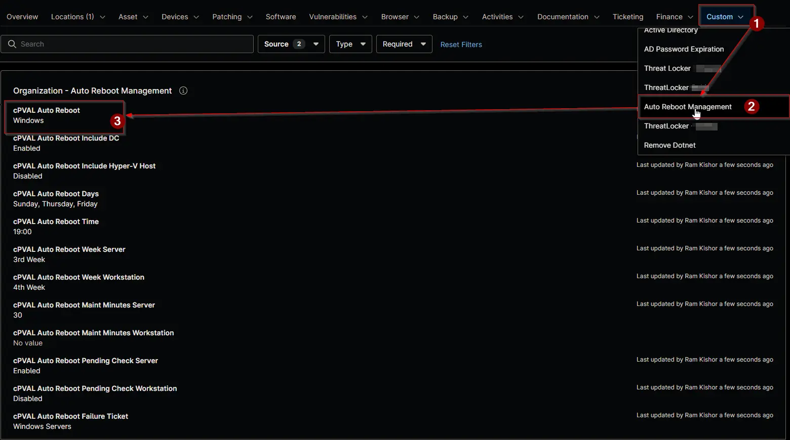

## Summary

Selects which Windows devices the [Auto Reboot Management - NinjaOne](/docs/52091463-99b7-4a21-8ad0-7ade5b8212e7) solution restarts on schedule. It's the switch that turns the solution on for a client, a location or a single device.

| Option | Workstations | Servers |
| ------ | ------------ | ------- |
| `Windows` | Restarted | Restarted |
| `Windows Workstations` | Restarted | Skipped |
| `Windows Servers` | Skipped | Restarted |
| `Disabled` | Skipped | Skipped |

- Set `Disabled` on a device to exclude it, whatever its organization or location holds.
- Set `Windows` on a device to include it, whatever its organization or location holds.
- Domain controllers and Hyper-V hosts also need [cPVAL Auto Reboot Include DC](/docs/4f0f00f5-6c67-4a73-b278-43e6560c9f63) or [cPVAL Auto Reboot Include Hyper-V Host](/docs/e351778e-b498-48ba-a674-7e8f4d783b15) set to `Enabled`.

:::note

- Set the field at the organization level for a whole client, and override it at a location or on a device where needed. The most specific value wins.
- A blank value inherits from the level above. Blank at every level means no device is restarted.
- A change takes effect at the next run of the [Auto Reboot Management](/docs/15697579-8f51-4c51-9812-d909edebfc8b) automation, within an hour.

:::

## Details

| Label | Field Name | Example | Definition Scope | Type | Required | Default Value | Dropdown Options | Editable | Custom Field Tab |
| ----- | ---------- | ------- | ---------------- | ---- | -------- | ------------- | ---------------- | -------- | ---------------- |
| cPVAL Auto Reboot | cpvalAutoReboot | `Windows Workstations` | `Organization`, `Location`, `Device` | Drop-down | No | | `Windows`, `Windows Workstations`, `Windows Servers`, `Disabled` | Yes | <ul><li>`Auto Reboot Management` (Organization and Location)</li><li>`Auto Reboot Management - Servers`</li><li>`Auto Reboot Management - Workstations`</li></ul> |

## Dependencies

- [Automation: Auto Reboot Management](/docs/15697579-8f51-4c51-9812-d909edebfc8b)
- [Custom Field: cPVAL Auto Reboot Include DC](/docs/4f0f00f5-6c67-4a73-b278-43e6560c9f63)
- [Custom Field: cPVAL Auto Reboot Include Hyper-V Host](/docs/e351778e-b498-48ba-a674-7e8f4d783b15)
- [Custom Field: cPVAL Auto Reboot Days](/docs/56684cc0-aa4b-4d81-b03b-272db16cb1e7)
- [Custom Field: cPVAL Auto Reboot Time](/docs/bf65ebff-8d3b-463b-a97f-90dd19ff45fc)
- [Solution: Auto Reboot Management - NinjaOne](/docs/52091463-99b7-4a21-8ad0-7ade5b8212e7)

## Custom Field Creation

- [Custom Field Configuration](https://github.com/ProVal-Tech/ninjarmm/blob/main/custom-fields/cpval-auto-reboot.toml)

## Sample Screenshot

## Changelog

### 2026-11-11

- Initial version of the document
