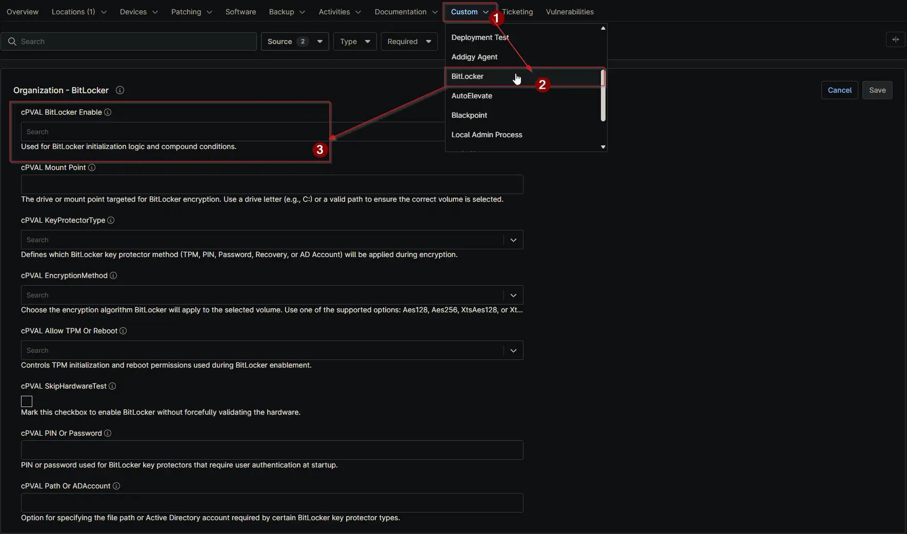

## Summary

Selects the Windows devices on which the [BitLocker Initialize - NinjaOne](/docs/2ebfabd5-05cf-4175-a513-2aa290eb26e8) solution enforces BitLocker. The solution's compound conditions read this field before they run the [BitLocker Initialization - Detection](/docs/87d7a413-4bd4-4629-9475-35db91cb1320) script.

| Option | Devices covered |
| ------ | --------------- |
| `Windows` | Every Windows device |
| `Windows Workstations` | Laptops and desktops |
| `Windows Servers` | Servers |
| `Windows Laptops` | Laptops only |
| `Windows Desktops` | Desktops only |
| `Disable` | None. The checks stop, and drives that are already encrypted stay encrypted. |

:::note  
A workstation counts as a laptop when Windows has detected a battery on it. All-in-ones, mini PCs and virtual machines count as desktops.  
:::

## Details

| Label | Field Name | Example | Definition Scope | Type | Required | Default Value | Dropdown Options | Editable | Custom Field Tab |
| ----- | ---------- | ------- | ---------------- | ---- | -------- | ------------- | ---------------- | -------- | ---------------- |
| cPVAL BitLocker Enable | cpvalBitlockerEnable | `Windows Laptops` | `Organization`, `Location`, `Device` | `Drop-down` | `False` | - | `Windows`, `Windows Workstations`, `Windows Servers`, `Windows Laptops`, `Windows Desktops`, `Disable` | `Yes` | BitLocker |

## Dependencies

- [Compound Condition: Enable BitLocker - Laptop](/docs/32f08cdb-3ce6-4628-989b-704cd2e6394e)
- [Compound Condition: Enable BitLocker - Desktop](/docs/47f52182-7c4c-4b4d-a0d7-7cb25c5256fa)
- [Compound Condition: Enable BitLocker - Server](/docs/a4d9dc9c-3e10-4cf4-a296-709ad9f507dd)
- [Solution: BitLocker Initialize - NinjaOne](/docs/2ebfabd5-05cf-4175-a513-2aa290eb26e8)

## Custom Field Creation

- [Custom Field Configuration](https://github.com/ProVal-Tech/ninjarmm/blob/main/custom-fields/cpval-bitlocker-enable.toml)

## Sample Screenshot

## Changelog

### 2026-10-26

- Added the `Windows Laptops` and `Windows Desktops` options.
- Corrected the Custom Field Configuration link.
- Updated the document to the standard format.

### 2025-12-16

- Initial version of the document
