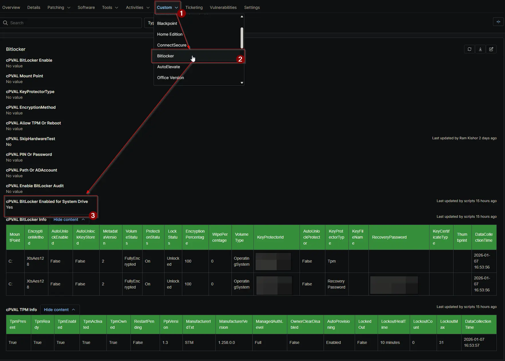

## Summary

Checked when the operating system drive has a BitLocker key protector, and unchecked otherwise. Use it in conditions, groups and compliance reports. The [BitLocker and TPM Audit](/docs/2d104874-ec69-4d95-b912-7fcd240bf592) and [Initialize and Audit BitLocker](/docs/e3a24552-f347-4117-82f5-7afaaa3fc198) automations update it on every run.

:::note
A checked field does not guarantee that protection is on. Protection can be suspended while the drive still has key protectors. Check the `ProtectionStatus` column of [cPVAL BitLocker Info](/docs/fd545101-1cd5-4d9f-8df7-57c4df1616b9) to confirm.
:::

## Details

| Label | Field Name | Example | Definition Scope | Type | Required | Default Value | Dropdown Options | Editable | Custom Field Tab |
| ----- | ---------- | ------- | ---------------- | ---- | -------- | ------------- | ---------------- | -------- | ---------------- |
| cPVAL BitLocker Enabled for System Drive | cpvalBitlockerEnabledForSystemDrive | `Checked` | `Device` | `Checkbox` | `False` | - | - | `Yes` | BitLocker Audit |

## Dependencies

- [Automation: BitLocker and TPM Audit](/docs/2d104874-ec69-4d95-b912-7fcd240bf592)
- [Automation: Initialize and Audit BitLocker](/docs/e3a24552-f347-4117-82f5-7afaaa3fc198)
- [Solution: BitLocker and TPM Audit](/docs/57c787ad-8d22-4ae4-b5e5-dac34fc600fc)
- [Solution: BitLocker Initialize - NinjaOne](/docs/2ebfabd5-05cf-4175-a513-2aa290eb26e8)

## Custom Field Creation

- [Custom Field Configuration](https://github.com/ProVal-Tech/ninjarmm/blob/main/custom-fields/cpval-bitlocker-enabled-for-system-drive.toml)

## Sample Screenshot

## Changelog

### 2026-10-26

- Clarified that the field is checked when the operating system drive has a key protector, whether or not protection is on.
- Renamed the Initialize BitLocker dependency to Initialize and Audit BitLocker and added the BitLocker Initialize - NinjaOne solution.
- Updated the document to the standard format.

### 2026-01-08

- Initial version of the document
