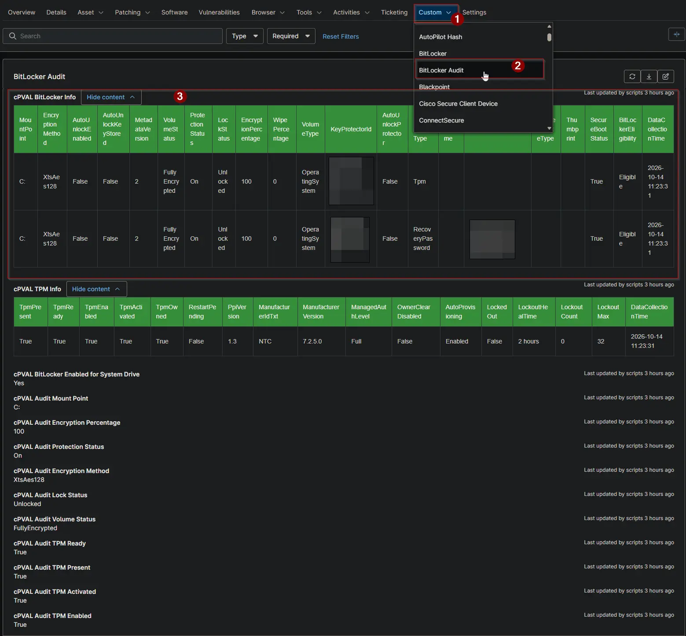

## Summary

Lists every BitLocker volume and key protector on the device, with its Secure Boot status and BitLocker eligibility. Use it to confirm which drives are encrypted and which devices are ready for BitLocker. The [BitLocker and TPM Audit](/docs/2d104874-ec69-4d95-b912-7fcd240bf592) automation fills this field, [Initialize and Audit BitLocker](/docs/e3a24552-f347-4117-82f5-7afaaa3fc198) fills it at the end of every run, and the [BitLocker Status](/docs/249c4ee7-7b81-4adf-97c6-d44c967ad2d1) report collects it from every client.

:::note  
This field contains BitLocker recovery passwords. The [BitLocker Status](/docs/249c4ee7-7b81-4adf-97c6-d44c967ad2d1) report leaves the `RecoveryPassword` column out by default.  
:::

## Details

| Label | Field Name | Example | Definition Scope | Type | Required | Default Value | Dropdown Options | Editable | Custom Field Tab |
| ----- | ---------- | ------- | ---------------- | ---- | -------- | ------------- | ---------------- | -------- | ---------------- |
| cPVAL BitLocker Info | cpvalBitlockerInfo | HTML table | `Device` | `WYSIWYG` | `False` | - | - | `Yes` | BitLocker Audit |

## Table Columns

The field holds a table with one row per key protector of each volume. `SecureBootStatus` and `BitLockerEligibility` describe the device, so they repeat on every row.

| Column | Description |
| ------ | ----------- |
| MountPoint | The drive letter of the volume, for example `C:`. |
| EncryptionMethod | The encryption algorithm, for example `XtsAes128`. |
| AutoUnlockEnabled | `True` when the volume unlocks automatically. |
| AutoUnlockKeyStored | `True` when an auto-unlock key is stored on the device. |
| MetadataVersion | The BitLocker metadata version of the volume. |
| VolumeStatus | The encryption state, for example `FullyEncrypted` or `FullyDecrypted`. |
| ProtectionStatus | `On` when the volume is encrypted and protected. |
| LockStatus | `Locked` or `Unlocked`. |
| EncryptionPercentage | How much of the volume is encrypted. |
| WipePercentage | How much free space has been wiped. |
| VolumeType | The volume type, for example `OperatingSystem` or `Data`. |
| KeyProtectorId | The ID of the key protector in this row. |
| AutoUnlockProtector | `True` when this protector is used for auto-unlock. |
| KeyProtectorType | The protector type, for example `Tpm` or `RecoveryPassword`. |
| KeyFileName | The key file name, for external key protectors. |
| RecoveryPassword | The 48-digit recovery password, for recovery password protectors. |
| KeyCertificateType | The certificate type, when a certificate is used. |
| Thumbprint | The certificate thumbprint, when a certificate is used. |
| SecureBootStatus | `True` when Secure Boot is on. `False` when it is off or the device does not support it. |
| BitLockerEligibility | `Eligible` when the TPM is activated, enabled and ready. `Not Eligible` otherwise. `Not Defined` when no TPM information was available. |
| DataCollectionTime | When the data was collected. |

## Dependencies

* [Automation: BitLocker and TPM Audit](/docs/2d104874-ec69-4d95-b912-7fcd240bf592)
* [Automation: Initialize and Audit BitLocker](/docs/e3a24552-f347-4117-82f5-7afaaa3fc198)
* [Audit Report: BitLocker Status](/docs/249c4ee7-7b81-4adf-97c6-d44c967ad2d1)
* [Solution: BitLocker and TPM Audit](/docs/57c787ad-8d22-4ae4-b5e5-dac34fc600fc)
* [Solution: BitLocker Initialize - NinjaOne](/docs/2ebfabd5-05cf-4175-a513-2aa290eb26e8)

## Custom Field Creation

- [Custom Field Configuration](https://github.com/ProVal-Tech/ninjarmm/blob/main/custom-fields/cpval-bitlocker-info.toml)

## Sample Screenshot

## Changelog

### 2026-10-26

- Noted that Initialize and Audit BitLocker also fills the field, renamed its dependency from Initialize BitLocker, and added the BitLocker Initialize - NinjaOne solution.

### 2026-10-14

- Added the `SecureBootStatus` and `BitLockerEligibility` columns.
- Added the [BitLocker Status](/docs/249c4ee7-7b81-4adf-97c6-d44c967ad2d1) report to the dependencies.
- Updated the Details table to the standard format.

### 2026-01-08

- Initial version of the document
